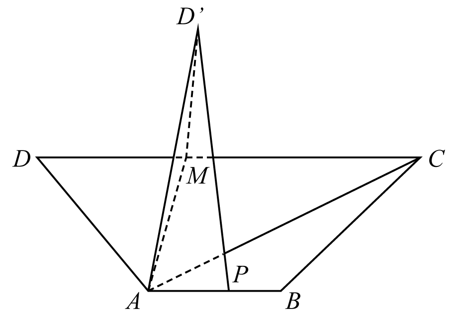

# Mathematics - 题目 3103

**ID**: 57b1ce8142654dc491ef02d40000f0f2
**年级**: Grade 12
**难度**: Medium
**题型**: Fill-in-the-blank

## 题目
如图，在直角梯形ABCD中，AB∥CD，∠ABC＝90°，AB＝1，AC＝CD＝DA＝2，动点M在边DC上（不同于D点），P为边AB上任意一点，沿AM将△ADM翻折成△AD'M，当平面AD'M垂直于平面ABC时，线段PD'长度的最小值为．​​​​​​​‌

## 解答

1. 作 $DH\bot $ 直线 $AM$ 于点 $H$ ，连接 $PH$ ，则翻折后 $D\prime H\bot AM$ ，
2. 
3. $\because $ 平面 $AD\prime M\bot $ 平面 $ABC$ ， $AM$ 为两平面的交线，
4. $\therefore D\prime H\bot $ 平面 $ABC$ ， $\therefore $  $\left |{PD\prime }\right |=\sqrt {\left |{D\prime H}\right |{^{2}}+\left |{PH}\right |{^{2}}}$ ．
5. 设 $\angle DAH=θ$ ，由 $\left |{DA}\right |=2$ ，得 $\left |{DH}\right |=2{\sin}θ$ ， $\left |{AH}\right |=2{\cos}θ$ ，
6. 设 $\left |{AP}\right |=x$ ，则 $x\in [0$ ， $1]$ ．
7. 由 $\left |{AC}\right |=\left |{CD}\right |=\left |{DA}\right |=2$ 知 $\vartriangle ACD$ 为正三角形，则 $\angle BAD=\frac {2π}{3}$ ，
8. $\therefore $  $\angle BAM=\frac {2π}{3}-θ$ ，在 $\vartriangle PAH$ 中， $\left |{PH}\right |{^{2}}=\left |{AP}\right |{^{2}}+\left |{AH}\right |{^{2}}-2\left |{AP}\right |\cdot \left |{AH}\right |\cdot {\cos}\angle PAH$ ，
9. 即 $\left |{PH}\right |{^{2}}=x{^{2}}-4{\cos}θ{\cos}(\frac {2π}{3}-θ)x+4{\cos}{^{2}}θ$ ，
10. $\therefore $  $\left |{PD{^{\prime }}}\right |{^{2}}=x{^{2}}-4{\cos}θ{\cos}(\frac {2π}{3}-θ)x+4{\cos}{^{2}}θ+4{\sin}{^{2}}θ$ ，
11. 记 $t=2{\cos}θ{\cos}(\frac {2π}{3}-θ)$ ，则 $\left |{PD{^{\prime }}}\right |{^{2}}=(x-t){^{2}}+4-t{^{2}}$ ，
12. 由 $t=2{\cos}θ{\cos}(\frac {2π}{3}-θ)={\sin}(2θ-\frac {π}{6})-\frac {1}{2},0<θ\mathrm{\leqslant }\frac {π}{3}$ ，得 $-1<t\mathrm{\leqslant }\frac {1}{2}$ ，又 $x\in [0$ ， $1]$ ，
13. $\therefore $ 若 $-1<t<0$ ，则当 $x=0$ 时， $(\left |{PD{^{^{′}}}}\right |{^{2}}){{}_{{\rm{m}}{\rm{i}}{\rm{n}}}}=4$ ；
14. 若 $0\mathrm{\leqslant }t\mathrm{\leqslant }\frac {1}{2}$ ，则当 $x=t$ 时， $(\left |{PD{^{\prime }}}\right |{^{2}}){{}_{{\rm{m}}{\rm{i}}{\rm{n}}}}=4-t{^{2}}\mathrm{\geqslant }4-\frac {1}{4}=\frac {15}{4}$ ，
15. $\therefore $  $(\left |{PD\prime }\right |){{}_{{\rm{m}}{\rm{i}}{\rm{n}}}}=\frac {\sqrt {15}}{2}$ ．
16. 故答案为： $\frac {\sqrt {15}}{2}$ ．

## 知识点

**中文**:
  - 余弦定理及其公式的变形
  - 翻折问题

**English**:
  - Law of Cosines and Formula Transformations
  - Folding Problems

---
