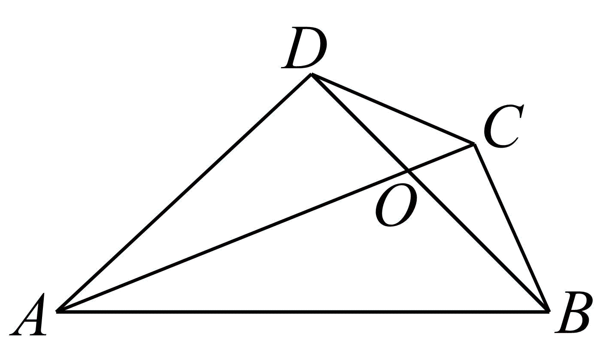

# Mathematics - 题目 408

**ID**: 832e9c515d304863b632c976a1c73f00
**年级**: Grade 12
**难度**: Medium
**题型**: Fill-in-the-blank

## 题目
如图，四边形 $ABCD$ 中， $AC$ 与 $BD$ 相交于点O， $AC$ 平分 $∠DAB$ ， $\angle ABC=\frac {{\rm{π}}}{3}$ ， $AB=3BC=3$ ，则 ${\sin}\angle DAB$ 的值.​​​​​​​‌

## 解答

1. 在 $\vartriangle ABC$ 中， $∠ABC=\frac {{\rm{π}}}{3},AB=3,BC=1$ ，
2. 由余弦定理得
3. $AC{{}^{2}}=AB{{}^{2}}+BC{{}^{2}}-2AB\times BC\times {\rm{c}}{\rm{o}}{\rm{s}}∠ABC$
4. $=3{{}^{2}}+1{{}^{2}}-2\times 3\times 1\times \frac {1}{2}=7$ ，
5. 所以 $AC=\sqrt {7}$ .
6. 由正弦定理得 $\frac {BC}{{\rm{s}}{\rm{i}}{\rm{n}}\angle BAC}=\frac {AC}{{\rm{s}}{\rm{i}}{\rm{n}}\angle ABC}$ ，
7. ${\rm{s}}{\rm{i}}{\rm{n}}∠BAC=\frac {BC\cdot {\rm{s}}{\rm{i}}{\rm{n}}∠ABC}{AC}=\frac {\frac {\sqrt {3}}{2}}{\sqrt {7}}=\frac {\sqrt {21}}{14}$ .即 ${\rm{c}}{\rm{o}}{\rm{s}}∠BAC=\frac {5\sqrt {7}}{14}$ .
8. 又因为 $AC$ 平分 $∠DAB$ ，所以 ${\rm{s}}{\rm{i}}{\rm{n}}∠DAB=2{\rm{s}}{\rm{i}}{\rm{n}}∠BAC{\rm{c}}{\rm{o}}{\rm{s}}∠BAC=\frac {5\sqrt {3}}{14}$ .
9. 故答案为： $\frac {5\sqrt {3}}{14}$

## 知识点

**中文**:
  - 余弦定理及其公式的变形
  - 正弦定理及其公式的变形

**English**:
  - Law of Cosines and Formula Transformations
  - Law of Sines and Formula Transformations

---
