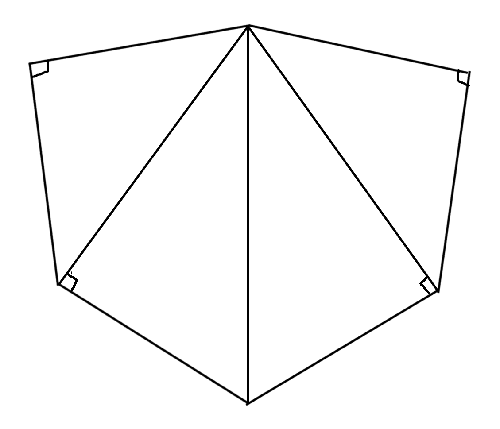

# Mathematics - 题目 3910

**ID**: a7c86f047e3640e383fd8d3c7f24717e
**年级**: Grade 12
**难度**: Medium
**题型**: Fill-in-the-blank

## 题目
如图所示的由4个直角三角形组成的各边长均为1的六边形是某棱锥的侧面展开图，则该棱锥的内切球半径为．​​​​​​​‌

## 解答

1. 将图形还原得四棱锥 $P-ABCD$ ，如图，设内切球的球心为O，半径为r，则有
2. $V{{}_{P-ABCD}}=V{{}_{O-ABCD}}+$  $V{{}_{O-PAB}}+V{{}_{O-PBC}}+V{{}_{O-PAD}}+V{{}_{O-PDC}}$ ，即 $\frac {1}{3}\times 1\times S{{}_{ABCD}}=\frac {1}{3}(S{{}_{ABCD}}+S{{}_{△PAB}}+S{{}_{△PBC}}+$  $S{{}_{△PAD}}+S{{}_{△PDC}})\cdot r$ ，
3. $\frac {1}{3}\times 1\times 1\times 1=\frac {1}{3}(1\times 1+\frac {1}{2}\times \sqrt {2}\times 1+\frac {1}{2}\times 1\times 1+\frac {1}{2}\times \sqrt {2}\times 1+\frac {1}{2}\times 1\times 1)r$
4. 解得 $r=1-\frac {\sqrt {2}}{2}$ .
5. 故答案为： $1-\frac {\sqrt {2}}{2}$ .
6. 

## 知识点

**中文**:
  - 球的切接问题
  - 空间几何体的平面展开图

**English**:
  - Tangency and Inscribed/Circumscribed Spheres
  - Planar Nets

---
