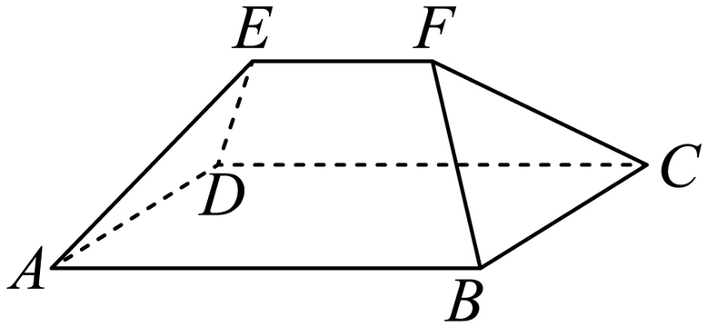

# Mathematics - 题目 1079

**ID**: eda13380b1cd42cdbb3fe1d86c6c7800
**年级**: Grade 12
**难度**: Medium
**题型**: Fill-in-the-blank

## 题目
《九章算术》是我国古代的数学名著，书中描述了一种五面体——刍甍（chú méng），其底面为矩形，顶棱和底面矩形的一组对边平行．现有如图所示一刍甍， $EF//AB$ ，侧面 $\vartriangle ADE$ 和 $\vartriangle BCF$ 为等边三角形，且与底面所成角相等，则该几何体中异面直线共有对；​​​​​​​‌若 $AB=AD=4$ ， $E$ 到底面 $ABCD$ 的距离为 $\sqrt {11}$ ，则该刍甍的体积为．

## 解答

1. 由异面直线的判定定理易知：
2. $AD$ 与 $EF,BF,CF$ 成异面直线，
3. $BC$ 与 $EF,AE,DE$ 成异面直线，
4. $AB$ 与 $CF,DE$ 成异面直线，
5. $CD$ 与 $AE,BF$ 成异面直线，
6. $AE,CF$ 成异面直线， $BF,DE$ 成异面直线，
7. 共12对；
8. 在刍甍 $ABCD-EF$ 中，过 $F$ 作底面 $ABCD$ 的垂线，垂足为 $H$ ，
9. 
10. 则 $FH=\sqrt {11}$ ，取 $BC$ 的中点 $K$ ，则 $FK=2\sqrt {3}$ ，
11. $HK=\sqrt {FK{^{2}}-HK{^{2}}}=1$ ，所以 $EF=2$ ．
12. 分别取 $AB$ ， $DC$ 的中点 $M$ ， $N$ ，
13. 则刍甍 $ABCD-EF$ 被分为四棱锥 $E-AMND$ 和三棱柱 $EMN-FBC$ ．
14. 又因为 $V{{}_{E-AMND}}=\frac {1}{3}\times 4\times 2\times \sqrt {11}=\frac {8\sqrt {11}}{3}$ ，
15. $V{{}_{三棱柱EMN-FBC}}=3V{{}_{三棱锥M-FBC}}=3V{{}_{三棱锥F-MBC}}=\frac {3}{2}V{{}_{四棱锥F-MBCN}}$ ，
16. 又因为 $V{{}_{四棱锥F-MBCN}}=V{{}_{四棱锥E-AMND}}$
17. 所以 $V{{}_{三棱柱EMN-FBC}}=\frac {3}{2}V{{}_{四棱锥F-MBCN}}=4\sqrt {11}$ ，
18. 所以该刍甍的体积为 $\frac {8}{3}\sqrt {11}+4\sqrt {11}=\frac {20}{3}\sqrt {11}$ ．

## 知识点

**中文**:
  - 直线与直线的位置关系的判断
  - 简单组合体的表面积与体积

**English**:
  - Determining Line-Line Relationships
  - Area and Volume of Composite Solids

---
