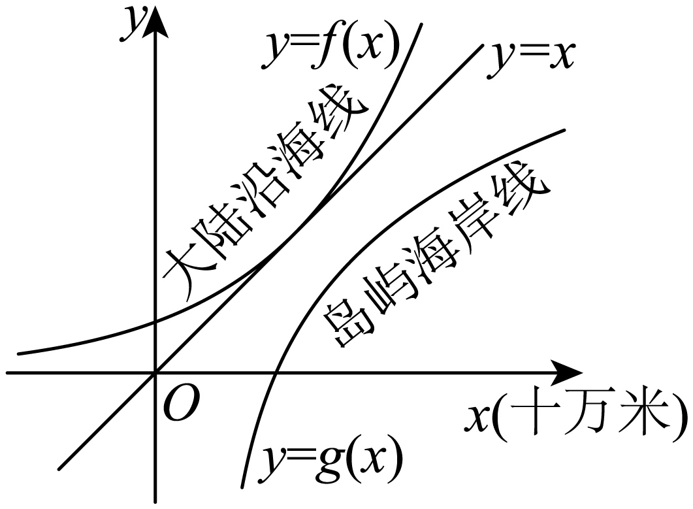

# Mathematics - 题目 2486

**ID**: 044296feb60749c2a223b0fbdb2bf431
**年级**: Grade 12
**难度**: Medium-Hard
**题型**: Calculation

## 题目
随着经济的发展，到某岛进行旅游观光的人数越来越多，交通问题已成为制约经济发展的重要因素，因此政府欲在大陆和岛屿之间 $($ 如图 $)$ 建立一条高速通道以便于大陆和岛屿之间来往，大陆沿海线可近似看作函数 $f\left ({x}\right )=a{^{x}}(a>1)$ 的图象，且正好与直线 $y=x$ 相切，而岛屿海岸线可近似看作函数 $g\left ({x}\right )={\rm{l}}{\rm{o}}{\rm{g}}{{}_{a}}\left ({x-3}\right )(a>1)$ 的图象 ${\rm ．}($ 每单位代表十万米 $)$(1)试求 $a$ 的值及切点坐标．(2)已知建成后的高速通道将开通高铁，并且高铁的最高时速不能超过 $300{\rm{k}}{\rm{m}}/{\rm{h}}$ ，试问高铁能否在半小时内穿过高速通道？请说明理由．​​​​​​​‌

## 解答

1. （1）依题意，设切点为 $(x{{}_{0}},x{{}_{0}})$ ，由函数 $f(x)=a{^{x}}$ 求导得 $f^{′}(x)=a{^{x}}{\ln}a$ ，
2. 则 $f^{′}(x{{}_{0}})=a{^{x{{}_{0}}}}{\rm{l}}{\rm{n}}a=1$ ，即 $a{^{x{{}_{0}}}}=\frac {1}{{\rm{l}}{\rm{n}}a}$ ，解得 $x{{}_{0}}={\rm{l}}{\rm{o}}{\rm{g}}{{}_{a}}\frac {1}{{\rm{l}}{\rm{n}}a}=-{\rm{l}}{\rm{o}}{\rm{g}}{{}_{a}}{\rm{l}}{\rm{n}}a=\frac {-{\rm{l}}{\rm{n}}{\rm{(}}{\rm{l}}{\rm{n}}a)}{{\rm{l}}{\rm{n}}a}$ ，
3. 而 $a{^{x{{}_{0}}}}=x{{}_{0}}$ ，则 $\frac {1}{{\rm{l}}{\rm{n}}a}=\frac {-{\rm{l}}{\rm{n}}({\rm{l}}{\rm{n}}a)}{{\rm{l}}{\rm{n}}a}$ ，解得 $a={\rm{e}}{^{\frac {{{1}}}{{\rm{e}}}}}$ ， $x{{}_{0}}={\rm{e}}$ ，
4. 所以 $a={\rm{e}}{^{\frac {{{1}}}{{\rm{e}}}}}$ ，切点坐标为 $({\rm{e}},{\rm{e}})$ .
5. （2）由（1）及函数 $f(x)=a{^{x}}$ 与函数 $y={\rm{l}}{\rm{o}}{\rm{g}}{{}_{a}}x$ 互为反函数，且 $f(x)$ 的图象与 $y=x$ 相切，
6. 得函数 $f(x)=a{^{x}}$ 的图象与函数 $y={\rm{l}}{\rm{o}}{\rm{g}}{{}_{a}}x$ 的图象有且只有一个公共点，
7. 而 $g(x)={\rm{l}}{\rm{o}}{\rm{g}}{{}_{a}}(x-3)$ 的图象可由 $y={\rm{l}}{\rm{o}}{\rm{g}}{{}_{a}}x$ 的图象向右平移 $3$ 个单位而得到，
8. 因此函数 $f(x)$ 与 $g(x)$ 的图象之间的最短距离 $\mathrm{S}$ 大于直线 $y=x$ 与直线 $y=x-3$ 之间的距离，
9. 即 $S>\frac {3}{\sqrt {2}}=\frac {3\sqrt {2}}{2}$ （十万米） $=\frac {300\sqrt {2}}{2}{\rm{k}}{\rm{m}}$ ．则高铁穿过通道的时间 $t>\frac {\frac {300\sqrt {2}}{2}}{300}=\frac {\sqrt {2}}{2}>\frac {1}{2}$ .
10. 所以高铁不能在半小时内穿过高速通道.

## 知识点

**中文**:
  - 对数函数模型及应用
  - 指数函数模型的应用

**English**:
  - Logarithmic Function Model
  - Exponential Function Model

---
