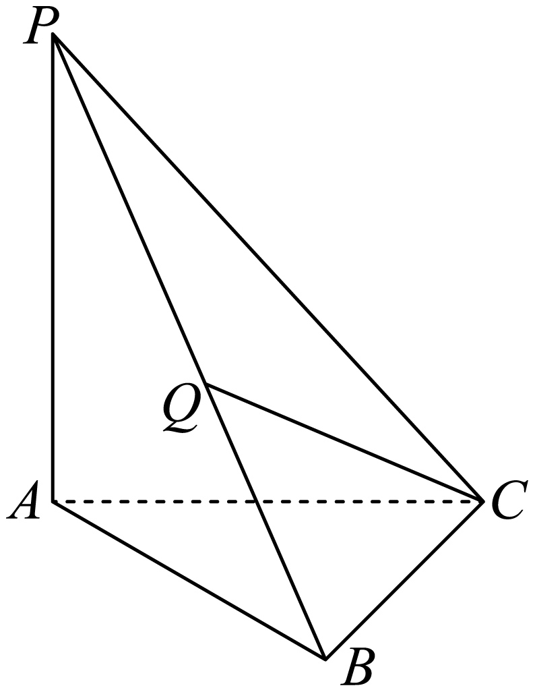

# Mathematics - 题目 2195

**ID**: 0ed6cb8a42264a7eac911ccc70ed1bbe
**年级**: Grade 12
**难度**: Medium-Hard
**题型**: Calculation

## 题目
离散曲率是刻画空间弯曲性的重要指标.​​​​​​​‌设 $P$ 为多面体 $M$ 的一个顶点，定义多面体 $M$ 在点 $P$ 处的离散曲率为，其中 $Q{{}_{i}}\left ({i=1,2,\cdots ,k,k\geqslant 3}\right )$ 为多面体 $M$ 的所有与点 $P$ 相邻的顶点，且平面 $Q{{}_{1}}PQ{{}_{2}}$ ，平面 $Q{{}_{2}}PQ{{}_{3}},\cdots $ ，平面 $Q{{}_{k-1}}PQ{{}_{k}}$ 和平面 $Q{{}_{k}}PQ{{}_{1}}$ 为多面体 $M$ 的所有以 $P$ 为公共点的面.如图，在三棱锥 $P-ABC$ 中.（1）求三棱锥 $P-ABC$ 在各个顶点处的离散曲率的和；（2）若 $PA\bot $ 平面 $ABC,AC\bot BC,AC=BC=2$ ，三棱锥 $P-ABC$ 在顶点 $C$ 处的离散曲率为 $\frac {3}{8}$ ，求点 $\mathrm{A}$ 到平面 $PBC$ 的距离；（3）在（2）的前提下，又知点 $Q$ 在棱 $PB$ 上，直线 $CQ$ 与平面 $ABC$ 所成角的余弦值为 $\frac {\sqrt {30}}{6}$ ，求 $BQ$ 的长度.

## 解答

1. （1）由离散曲率的定义得：
2. ${\rm{Φ}}{{}_{P}}=1-\frac {1}{2{\rm{π}}}\left ({∠APB+∠BPC+∠APC}\right ),{\rm{Φ}}{{}_{A}}=1-\frac {1}{2{\rm{π}}}\left ({∠PAB+∠BAC+∠PAC}\right )$ ，
3. ${\rm{Φ}}{{}_{B}}=1-\frac {1}{2{\rm{π}}}\left ({∠PBA+∠ABC+∠PBC}\right ),{\rm{Φ}}{{}_{C}}=1-\frac {1}{2{\rm{π}}}\left ({∠PCA+∠BCA+∠PCB}\right )$ ，
4. 因为 $∠APC+∠PAC+∠ACP={\rm{π}}$ ，同理可得其他三个三角形内角和为 ${\rm{π}}$ ，
5. 所以 ${\rm{Φ}}{{}_{P}}+{\rm{Φ}}{{}_{A}}+{\rm{Φ}}{{}_{B}}+{\rm{Φ}}{{}_{C}}=4-\frac {1}{2{\rm{π}}}\times 4{\rm{π}}=2$ ；
6. （2）由 $PA\bot $ 平面 $ABC,BC\subset $ 平面 $ABC$ ，得 $PA\bot BC$ ，
7. 又 $AC\bot BC,AC\cap PA=A,AC,PA\subset $ 平面 $PAC$ ，则 $BC\bot $ 平面 $PAC$ ，
8. 由 $PC\subset $ 平面 $PAC$ ，得 $BC\bot PC$ ，即 $\angle BCP=\frac {{\rm{π}}}{2}$ ，
9. 又 ${\rm{Φ}}{{}_{C}}=1-\frac {1}{2{\rm{π}}}\left ({\angle PCA+\angle BCA+\angle PCB}\right )$ ，即 $\frac {3}{8}=1-\frac {1}{2{\rm{π}}}\left ({\angle PCA+\frac {{\rm{π}}}{2}+\frac {{\rm{π}}}{2}}\right )$ ，
10. 解得 $\angle PCA=\frac {{\rm{π}}}{4}$ ，
11. 过点 $\mathrm{A}$ 作 $AM\bot PC$ 于点 $M$ ，由 $BC\bot $ 平面 $PAC,AM\subset $ 平面 $PAC$ ，得 $BC\bot AM$ ，
12. 又 $BC\cap PC=C,BC,PC\subset $ 平面 $PCB$ ，则 $AM\bot $ 平面 $PCB$ ，因此点 $\mathrm{A}$ 到平面 $PCB$ 的距离为线段 $AM$ 的长.
13. 在 ${\rm{R}}{\rm{t}}\vartriangle ACM$ 中， $AM=AC{\rm{s}}{\rm{i}}{\rm{n}}\angle PCA=2\times \frac {\sqrt {2}}{2}=\sqrt {2}$ ，
14. 所以点 $\mathrm{A}$ 到平面 $PBC$ 的距离为 $\sqrt {2}$ .
15. 
16. （3）方法一：过点 $Q$ 作 $QG{\rm{/}}{\rm{/}}PA$ 交 $AB$ 于点 $G$ ，连接 $CG$ ，
17. 由 $PA\bot $ 平面 $ABC$ ，得 $QG\bot $ 平面 $ABC$ ，则 $\angle GCQ$ 为直线 $CQ$ 与平面 $ABC$ 所成的角，
18. 依题意， $PA=2,AB=\sqrt {2{^{2}}+2{^{2}}}=2\sqrt {2},PB=\sqrt {2{^{2}}+(2\sqrt {2}){^{2}}}=2\sqrt {3}$ ，
19. 设 $BQ=x\left ({0\leqslant x\leqslant 2\sqrt {3}}\right )$ ，
20. 则 ${\rm{s}}{\rm{i}}{\rm{n}}∠PBA=\frac {PA}{PB}=\frac {\sqrt {3}}{3},QG=BQ{\rm{s}}{\rm{i}}{\rm{n}}∠PBA=\frac {\sqrt {3}}{3}x$ ，
21. ${\rm{c}}{\rm{o}}{\rm{s}}∠PBA=\frac {AB}{PB}=\frac {\sqrt {6}}{3},BG=BQ{\rm{c}}{\rm{o}}{\rm{s}}∠PBA=\frac {\sqrt {6}}{3}x$ ，
22. 在 $\vartriangle BCG$ 中，根据余弦定理， $CG=\sqrt {BC{^{2}}+BG{^{2}}-2BC\cdot BG{\rm{c}}{\rm{o}}{\rm{s}}∠CBG}=\sqrt {4+\frac {2}{3}x{^{2}}-\frac {4\sqrt {3}}{3}}x$ ，
23. 由 ${\rm{c}}{\rm{o}}{\rm{s}}\angle GCQ=\frac {\sqrt {30}}{6}$ ，得 ${\rm{s}}{\rm{i}}{\rm{n}}∠GCQ=\sqrt {1-{\rm{c}}{\rm{o}}{\rm{s}}{^{2}}∠GCQ}=\frac {\sqrt {6}}{6},{\rm{t}}{\rm{a}}{\rm{n}}∠GCQ=\frac {{\rm{s}}{\rm{i}}{\rm{n}}∠GCQ}{{\rm{c}}{\rm{o}}{\rm{s}}∠GCQ}=\frac {\sqrt {5}}{5}$ ，
24. 因此 ${\rm{t}}{\rm{a}}{\rm{n}}\angle GCQ=\frac {QG}{CG}=\frac {\frac {\sqrt {3}}{3}x}{\sqrt {4+\frac {2}{3}x{^{2}}-\frac {4\sqrt {3}}{3}x}}=\frac {\sqrt {5}}{5}$ ，整理得 $3x{^{2}}+4\sqrt {3}x-12=0$ ，即 $\left ({3x-2\sqrt {3}}\right )\left ({x+2\sqrt {3}}\right )=0$ ，
25. 解得 $x=\frac {2\sqrt {3}}{3}$ 或 $x=-2\sqrt {3}$ ，因为 $x>0$ ，所以 $BQ=\frac {2\sqrt {3}}{3}$ .
26. 方法二：由（2）知， $PA\bot $ 平面 $ABC,BC\bot $ 平面 $PAC$ ，过 $\mathrm{A}$ 作 $BC$ 的平行线，建立如图所示的空间直角坐标系 $A-xyz$ ，
27. 
28. 由题意得： $A\left ({0,0,0}\right ),B\left ({2,2,0}\right ),C\left ({0,2,0}\right ),P\left ({0,0,2}\right )$ ，
29. 所以， $\overrightarrow {{CB}}=\left ({2,0,0}\right ),\overrightarrow {{BP}}=\left ({-2,-2,2}\right )$ ，
30. 设 $\overrightarrow {{BQ}}=λ\overrightarrow {{BP}}\left ({0\leqslant λ\leqslant 1}\right )$ ，则 $\overrightarrow {{CQ}}=\overrightarrow {{CB}}+\overrightarrow {{BQ}}=\left ({2,0,0}\right )+λ\left ({-2,-2,2}\right )=\left ({2-2λ,-2λ,2λ}\right )$ ，
31. 设 $CQ$ 与平面 $ABC$ 所成的角为 $θ$ ，因为 ${\rm{c}}{\rm{o}}{\rm{s}}θ=\frac {\sqrt {30}}{6}$ ，所以 ${\rm{s}}{\rm{i}}{\rm{n}}θ=\frac {\sqrt {6}}{6}$ ，
32. 取平面 $ABC$ 的法向量 $\overrightarrow n=\left ({0,0,1}\right )$ ，
33. 则 ${\rm{s}}{\rm{i}}{\rm{n}}θ=\left |{{\rm{c}}{\rm{o}}{\rm{s}}\left \langle {\overrightarrow {{CQ}},\overrightarrow n}\right \rangle \left |{=\left |{\frac {\overrightarrow {{CQ}}\cdot \overrightarrow n}{\left |{\overrightarrow {{CQ}}}\right |\left |{\overrightarrow n}\right |}}\right |=\frac {\left |{2λ}\right |}{\sqrt {(2-2λ){^{2}}+(-2λ){^{2}}+(2λ){^{2}}}}=\frac {\sqrt {6}}{6}}\right .}\right .$ ，
34. 整理得 $3λ{^{2}}+2λ-1=0$ ，即 $\left ({3λ-1}\right )\left ({λ+1}\right )=0$ ，解得： $λ=\frac {1}{3}$ 或 $λ=-1$ （舍），
35. 所以 $\overrightarrow {{BQ}}=\frac {1}{3}\overrightarrow {{BP}}=\left ({-\frac {2}{3},-\frac {2}{3},\frac {2}{3}}\right )$ ，所以 $BQ=\frac {2\sqrt {3}}{3}$ .

## 知识点

**中文**:
  - 点与面之间的距离
  - 直线与平面所成的角
  - 空间向量新定义问题

**English**:
  - Point-Plane Distance
  - Line-Plane Angle
  - New Definition Problems

---
