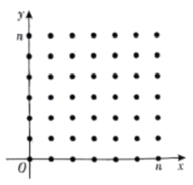

# Mathematics - 题目 1488

**ID**: 17b5d4cd979e4bdebc14452592b5bb6d
**年级**: Grade 12
**难度**: Medium-Hard
**题型**: Calculation

## 题目
如图，在平面直角坐标系 $xOy$ 中有一个点阵，点阵中所有点的集合为 $M=$  $\left \{\hspace{-0.​​​​​​​‌5em}\begin{array}{l}\left ({x,y}\right )\left |{\begin{Bmatrix}x\leqslant n,\\y\leqslant n,\\x\in {\mathbf{N}},\\y\in {\mathbf{N}},\end{Bmatrix}}\right .\end{array}\hspace{-0.5em}\right.$ ，从集合 $M$ 中任取两个不同的点，用随机变量 $X$ 表示它们之间的距离.(1)当 $n=2$ 时，求 $X$ 的分布列.(2)对给定的正整数 $n\left ({n\geqslant 4}\right )$ .（i）求随机变量 $X$ 的所有可能取值的个数；（用含有 $n$ 的式子表示）（ii）求概率 $P(X<\sqrt {2}\left ({n-1}\right ))$ .（用含有 $n$ 的式子表示）

## 解答

1. （1）当 $n=2$ 时，集合 $M$ 中共有 $9$ 个点，
2. 则 $X$ 的所有可能取值为 $1$ ， $\sqrt {2}$ ， $2$ ， $\sqrt {5}$ ， $2\sqrt {2}$ ．
3. 所以 $P\left ({X=1}\right )=\frac {12}{{\rm{C}}{{}_{9}^{2}}}=\frac {12}{36}=\frac {1}{3}$ ，
4. $P\left ({X=\sqrt {2}}\right )=\frac {8}{{\rm{C}}{{}_{9}^{2}}}=\frac {8}{36}=\frac {2}{9}$ ，
5. $P\left ({X=2}\right )=\frac {6}{{\rm{C}}{{}_{9}^{2}}}=\frac {6}{36}=\frac {1}{6}$ ，
6. $P\left ({X=\sqrt {5}}\right )=\frac {8}{{\rm{C}}{{}_{9}^{2}}}=\frac {8}{36}=\frac {2}{9}$ ，
7. $P\left ({X=2\sqrt {2}}\right )=\frac {2}{{\rm{C}}{{}_{9}^{2}}}=\frac {2}{36}=\frac {1}{18}$ ．
8. 所以 $X$ 的分布列为
9. $X$
10. $1$
11. $\sqrt {2}$
12. $2$
13. $\sqrt {5}$
14. $2\sqrt {2}$
15. $P$
16. $\frac {1}{3}$
17. $\frac {2}{9}$
18. $\frac {1}{6}$
19. $\frac {2}{9}$
20. $\frac {1}{18}$
21. （2）（i）由题意得，集合 $M$ 中任取两个不同的点之间的不同距离的总数可以转化成边长为 $i\left ({i=1，2，3，\cdots ，n}\right )$ 的正方形边界上任取两个不同的点之间的不同距离的个数的总和，
22. 在边长为 $1$ 的正方形中，有 $2$ 个不同的距离，
23. 在边长为 $2$ 的正方形中，有 $3$ 个不同的距离，
24. 在边长为 $n$ 的正方形中，有 $n+1$ 个不同的距离，
25. 由各正方形大小不同，距离大小各不相同，
26. 得 $X$ 的所有可能取值的个数为 $2+3+4+\cdots +\left ({n+1}\right )=\frac {n\left ({2+n+1}\right )}{2}=\frac {n\left ({n+3}\right )}{2}$ ．
27. （ii）由对立事件，不妨考虑 $X\geqslant \sqrt {2}\left ({n-1}\right )$ 的情况，
28. $\①$ 当 $X=\sqrt {2}\left ({n-1}\right )$ 时，取出的两点为边长为 ${\rm{n}}-1$ 的正方形的顶点，
29. 此时，这种正方形共有 $4$ 个，每个正方形中距离等于 $\sqrt {2}\left ({n-1}\right )$ 的情形有 $2$ 种，
30. 所以，事件 $\left \{X=\sqrt {2}\left ({n-1}\right )\right \}$ 包含的样本点个数为 $4\times 2=8;$
31. $\②$ 当 $X>\sqrt {2}\left ({n-1}\right )$ 时，不妨设 $X=\sqrt {n{^{2}}+d{^{2}}}$ ， $d\leqslant n$ 且 $d\in {\mathbf{N}^{*}}$ ，
32. 由 $\sqrt {n{^{2}}+d{^{2}}}>\sqrt {2}\left ({n-1}\right )$ ，得 $d{^{2}}>n{^{2}}-4n+2=(n-2){^{2}}-2$ ，
33. 因为 $n\geqslant 4$ ，所以 $(n-2){^{2}}-2>(n-3){^{2}}$ ，
34. 所以 $d>n-3$ ，即 $d=n-2$ ， ${\rm{n}}-1$ ， $n$ ，
35. $a)$ 当 $d=n-2$ ，即 $X=\sqrt {n{^{2}}+(n-2){^{2}}}$ 时，取出的两点为边长分别为 $n$ ， $n-2$ 的矩形的顶点，
36. 此时，这种矩形共有 $6$ 个，每个矩形中距离等于 $\sqrt {n{^{2}}+(n-2){^{2}}}$ 的情形有 $2$ 种，
37. 所以，事件 $\left \{X=\sqrt {n{^{2}}+(n-2){^{2}}}\right \}$ 包含的样本点个数为 $6\times 2=12;$
38. $b)$ 当 $d=n-1$ ，即 $X=\sqrt {n{^{2}}+(n-1){^{2}}}$ 时，取出的两点为边长分别为 $n$ ， ${\rm{n}}-1$ 的矩形的顶点，
39. 此时，这种矩形共有 $4$ 个，每个矩形中距离等于 $\sqrt {n{^{2}}+(n-1){^{2}}}$ 的情形有 $2$ 种，
40. 所以，事件 $\left \{X=\sqrt {n{^{2}}+(n-1){^{2}}}\right \}$ 包含的样本点个数为 $4\times 2=8;$
41. $c)$ 当 $d=n$ ，即 $X=\sqrt {2}n$ 时，取出的两点为边长为 $n$ 的正方形的顶点，
42. 此时，这种正方形共有 $1$ 个，每个正方形中距离等于 $\sqrt {2}n$ 的情形有 $2$ 种，
43. 所以，事件 $\left \{X=\sqrt {2}n\right \}$ 包含的样本点个数为 $1\times 2=2$ ；
44. 由题知样本空间包含的所有样本点的个数为 $C{{}_{(n+1){^{2}}}^{2}}$ ，
45. 所以由古典概型得 $P\left ({X\geqslant \sqrt {2}\left ({n-1}\right )}\right )=\frac {8+12+8+2}{{\rm{C}}{{}_{{\left({n+1}\right)^{2}}}^{2}}}=\frac {30}{{\rm{C}}{{}_{{\left({n+1}\right)^{2}}}^{2}}}$ ，
46. 所以由对立事件公式得 $P(X<\sqrt {2}\left ({n-1}\right ))=1-P\left ({X\geqslant \sqrt {2}\left ({n-1}\right )}\right )=1-\frac {30}{C{{}_{(n+1){^{2}}}^{2}}}=1-\frac {60}{n\left ({n+2}\right )(n+1){^{2}}}$ ．

## 知识点

**中文**:
  - 对立事件
  - 概率与计数原理相结合的应用题
  - 离散型随机变量的分布列

**English**:
  - Complementary Events
  - Combined Problems
  - Probability Distribution Table

---
