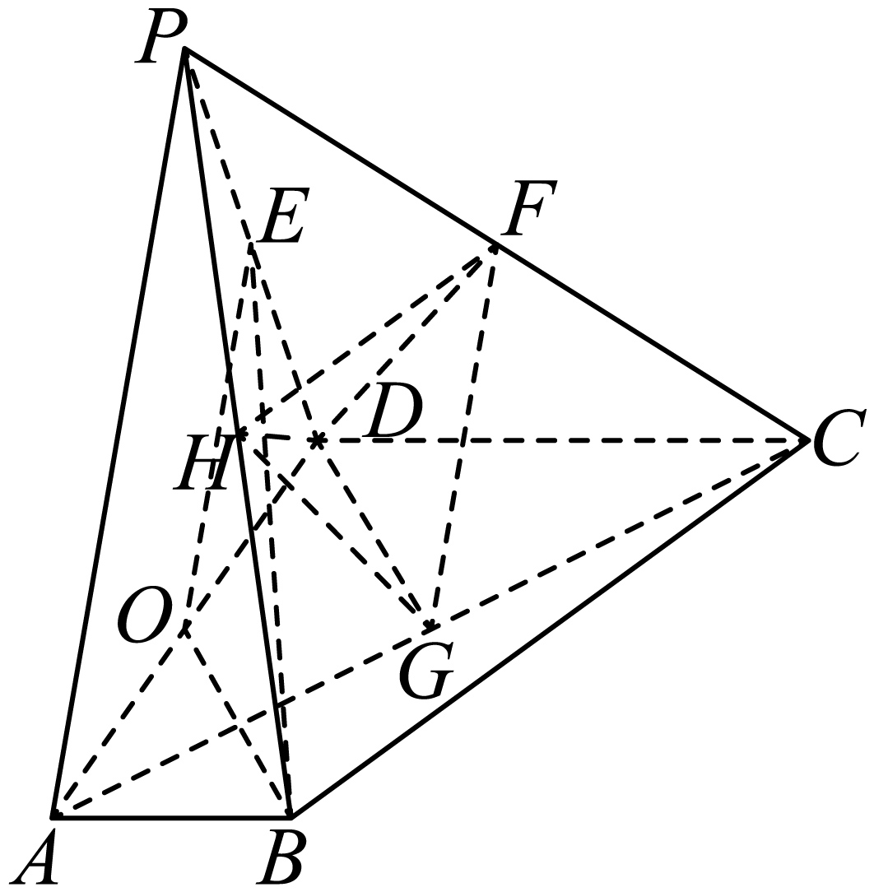

# Mathematics - 题目 3051

**ID**: 230f3f932721431583767c08104be59f
**年级**: Grade 12
**难度**: Medium-Hard
**题型**: Calculation

## 题目
两个向量 $\overrightarrow {{a}}$ 和 $\overrightarrow {{b}}$ 的叉乘写作 $\overrightarrow {{a}}\times \overrightarrow {{b}}$ ，叉乘运算结果是一个向量，其模为 $\left |{\overrightarrow a\times \overrightarrow b}\right |=\left |{\overrightarrow a}\right |\left |{\overrightarrow b}\right |\sin \left \langle {\overrightarrow a,\overrightarrow b}\right \rangle $ ，方向与这两个向量所在平面垂直.​​​​​​​‌若 $\overrightarrow a=\left ({x{{}_{1}},y{{}_{1}},z{{}_{1}}}\right )$ ， $\overrightarrow b=\left ({x{{}_{2}},y{{}_{2}},z{{}_{2}}}\right )$ ，则 $\overrightarrow a\times \overrightarrow b=\left ({y{{}_{1}}z{{}_{2}}-y{{}_{2}}z{{}_{1}},-\left ({x{{}_{1}}z{{}_{2}}-x{{}_{2}}z{{}_{1}}}\right ),x{{}_{1}}y{{}_{2}}-x{{}_{2}}y{{}_{1}}}\right )$ .如图，已知在四棱锥 $P-ABCD$ 中，底面 $ABCD$ 是直角梯形， $\angle BAD=90{}\degree $ ， $AB平行且等于\frac {1}{2}CD$ ， $AD=CD=2$ ， $O$ ， $E$ ， $F$ ， $G$ 分别是 $AD$ ， $PD$ ， $PC$ ， $AC$ 的中点.(1)证明：平面 $BOE//$ 平面 $DFG$ ；(2)已知 $PA=PD=\sqrt {5}$ ， $PB=\sqrt {6}$ ， $H$ 为 $PB$ 中点，以 $O$ 为原点， $\overrightarrow {{OA}}$ 的方向为 $x$ 轴的正方向建立空间右手直角坐标系.①求 $\overrightarrow {{DF}}\times \overrightarrow {{DG}}$ ；②求三棱锥 $H-DFG$ 的体积.

## 解答

1. （1）证明：在 $\mathrm{△}APD$ 中， $O$ ， $E$ 分别为 $AD$ ， $PD$ 中点,
2. $\therefore OE/\mskip-4mu/AP$ ,
3. 在 $\mathrm{△}APC$ 中， $F$ ， $G$ 分别为 $PC$ ， $AC$ 中点,
4. $\therefore FG/\mskip-4mu/AP$ ,
5. $\therefore OE\mathrm{/\mskip-4mu/}FG$ ,
6. $\because FG\subset $ 平面 $DFG$ ， $OE\not\subset $ 平面 $DFG$ ,
7. $\therefore OE//$ 平面 $DFG$ ,
8. 连 $BG$ ， $OG$ ，  $\because OG平行且等于\frac {1}{2}CD,AB平行且等于\frac {1}{2}CD$ , $\therefore OG平行且等于AB$ .
9. $\therefore $ 四边形 $AOGB$ 为平行四边形,
10. $\therefore BG平行且等于AO$ , $\therefore BG平行且等于OD$ ,
11. $\therefore $ 四边形 $ODGB$ 为平行四边形,
12. $\therefore OB/\mskip-4mu/DG$ ,
13. $\because DG\subset $ 平面 $DFG$ ， $OB\not\subset $ 平面 $DFG$ ,
14. 故 $OB//$ 平面 $DFG$ ,
15. $\because OE\subset $ 平面 $BOE$ ， $OB\mathrm{⊂}$ 平面 $BOE$ ，且 $OE\cap OB=O$ ,
16. $\therefore $ 平面 $BOE//$ 平面 $DFG$ .
17. ${\rm （2）}\because PA=\sqrt {5}$ ， $PB=\sqrt {6}$ ， $AB=1$ ,
18. $\therefore PB{^{2}}=PA{^{2}}+AB{^{2}}$ ， $\therefore PA\bot AB$ ，
19. 又 $\angle BAD=90{}\degree $ ， $∴AB\mathrm{⊥}AD$ ，
20. $\because AD$ ， $AP\mathrm{⊂}$ 平面 $PAD$ ， $AD\cap AP=A$ ，
21. $∴AB\mathrm{⊥}$ 平面 $PAD$
22. 又 $AB\mathrm{⊂}$ 平面 $ABCD$ ， $\therefore $ 平面 $PAD\bot $ 平面 $ABCD$ ,
23. $\because PA=PD$ ， $O$ 为 $AD$ 中点,
24. $\therefore PO\bot AD$ ,
25. 又平面 $ABCD\mathrm{∩}$ 平面 $PAD=AD$ ,
26. $\therefore PO\bot $ 平面 $ABCD$ ,
27. $\therefore $ 以 $\overrightarrow {{OA}}$ 的方向为 $x$ 轴正方向， $\overrightarrow {{OG}}$ 方向为 $y$ 轴正方向， $\overrightarrow {{OP}}$ 方向为 $z$ 轴正方向，建立如图所示的空间右手直角坐标系，
28. 则 $D\left ({-1,0,0}\right )$ ， $F\left ({-\frac {1}{2},1,1}\right )$ ， $G\left ({0,1,0}\right )$ ， $H\left ({\frac {1}{2},\frac {1}{2},1}\right )$ ,
29. $\therefore \overrightarrow {{DF}}=\left ({\frac {1}{2},1,1}\right )$ ， $\overrightarrow {{DG}}=\left ({1,1,0}\right )$ ,
30. $\therefore \overrightarrow {{DF}}\times \overrightarrow {{DG}}=\left ({-1,1,-\frac {1}{2}}\right )$ ,
31. $\therefore S{{}_{\vartriangle DFG}}=\frac {1}{2}\left |{DF}\right |\left |{DG}\right |{\rm{s}}{\rm{i}}{\rm{n}}\angle FDG=\frac {1}{2}\left |{\overrightarrow {{DF}}\times \overrightarrow {{DG}}}\right |=\frac {1}{2}\sqrt {1+1+\frac {1}{4}}=\frac {3}{4}$ ，
32. 设 $\overrightarrow n=\left ({x,y,z}\right )$ 是平面 $DFG$ 的法向量，则 $\begin{cases}\overrightarrow n\cdot \overrightarrow {{DF}}=0\\\overrightarrow n\cdot \overrightarrow {{DG}}=0\end{cases}$ ，即 $\begin{cases}\frac {1}{2}x+y+z=0\\x+y=0\end{cases}$ ,
33. 取 $x=2$ ，则 $y{\rm{=}}-{{2}}$ ， $z=1$ , $\therefore \overrightarrow n=\left ({2,-2,1}\right )$ ,
34. $\because \overrightarrow {{DH}}=\left ({\frac {3}{2},\frac {1}{2},1}\right )$ ,
35. $\therefore H$ 到平面 $DFG$ 的距离 $d=\frac {\left |{\overrightarrow {{DH}}\cdot \overrightarrow n}\right |}{\left |{\overrightarrow n}\right |}=1$ ,
36. $\therefore $ 三棱锥 $H-DFG$ 的体积 $V{{}_{H-DFG}}=\frac {1}{3}S{{}_{\vartriangle DFG}}d=\frac {1}{4}$ .
37. 

## 知识点

**中文**:
  - 平面与平面平行的判定
  - 棱柱、棱锥、棱台的体积
  - 空间向量新定义问题

**English**:
  - Plane-Plane Parallelism Determination
  - Volume of Polyhedra
  - New Definition Problems

---
