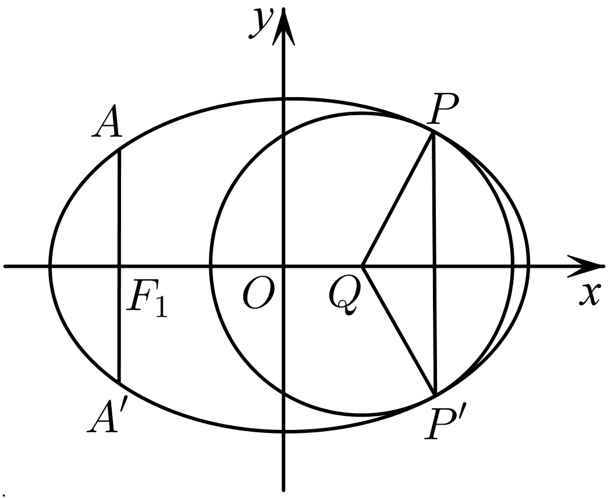

# Mathematics - 题目 2634

**ID**: 2a09d4f9cacf4c04ba3698c8698d7472
**年级**: Grade 12
**难度**: Medium-Hard
**题型**: Calculation

## 题目
如图，椭圆的中心为原点 $O$ ，长轴在 $x$ 轴上，离心率 $e=\frac {\sqrt {2}}{2}$ ，过左焦点 $F{{}_{1}}$ 作 $x$ 轴的垂线交椭圆于 $A$ 、 $A^{′}$ 两点， $\left |{AA^{′}}\right |=4$ ．(1)求该椭圆的标准方程；​​​​​​​‌(2)取平行于 $y$ 轴的直线与椭圆相交于不同的两点 $P$ 、 $P^{′}$ ，过 $P$ 、 $P^{′}$ 作圆心为 $Q$ 的圆，使椭圆上的其余点均在圆 $Q$ 外．求 $△PP^{′}Q$ 的面积 $S$ 的最大值，并写出对应的圆 $Q$ 的标准方程．

## 解答

1. (1)
2. 解：设椭圆方程为 $\frac {x{^{2}}}{a{^{2}}}+\frac {y{^{2}}}{b{^{2}}}=1\left ({a>b>0}\right )$ ，
3. 左焦点 $F{{}_{1}}\left ({-c,0}\right )$ ，将 $x=-c$ 代入椭圆方程，得 $y=\pm \frac {b{^{2}}}{a}$ ，
4. 由题意可得 $\begin{cases}\frac {b{^{2}}}{a}=2\\\frac {c}{a}=\frac {\sqrt {2}}{2}\\a{^{2}}=b{^{2}}+c{^{2}}\end{cases}$ ，解得 $\begin{cases}a=4\\b=c=2\sqrt {2}\end{cases}$ ，
5. 所以椭圆方程为 $\frac {x{^{2}}}{16}+\frac {y{^{2}}}{8}=1$ .
6. (2)
7. 解：当点 $Q$ 在 $y$ 轴的右侧时，
8. 设 $Q\left ({t,0}\right )\left ({t>0}\right )$ ，圆的半径为 $r$ ，直线 $PP^{′}$ 方程为 $x=m\left ({m>t}\right )$ ，
9. 则圆 $Q$ 的方程为 ${\left({x-t}\right)^{2}}+y{^{2}}=r{^{2}}$ ，
10. 由 $\begin{cases}{\left({x-t}\right)^{2}}+y{^{2}}=r{^{2}}\\x{^{2}}+2y{^{2}}=16\end{cases}$ 得 $x{^{2}}-4tx+2t{^{2}}+16-2r{^{2}}=0$ ，
11. 由 $\Delta =16t{^{2}}-4\left ({2t{^{2}}+16-2r{^{2}}}\right )=0$ ，即，得 $t{^{2}}+r{^{2}}=8$ ，①
12. 把 $x=m$ 代入 $\frac {x{^{2}}}{16}+\frac {y{^{2}}}{8}=1$ ，得 $y{^{2}}=8\left ({1-\frac {m{^{2}}}{16}}\right )=8-\frac {m{^{2}}}{2}$ ，
13. 所以点 $P$ 坐标为 $\left ({m,\sqrt {8-\frac {m{^{2}}}{2}}}\right )$ ，代入 ${\left({x-t}\right)^{2}}+y{^{2}}=r{^{2}}$ ，得 ${\left({m-t}\right)^{2}}+8-\frac {m{^{2}}}{2}=r{^{2}}$ ，②
14. 由①②消掉 $r{^{2}}$ 得 $4t{^{2}}-4mt+m{^{2}}=0$ ，即 $m=2t$ ，
15. $S{{}_{△PP^{′}Q}}=\frac {1}{2}\left |{PP^{′}}\right |\left ({m-t}\right )=\sqrt {8-\frac {m{^{2}}}{2}}\times \left ({m-t}\right )=\sqrt {8-2t{^{2}}}\cdot t=\sqrt {2}\cdot \sqrt {\left ({4-t{^{2}}}\right )t{^{2}}}$
16. $\leqslant \sqrt {2}\times \frac {\left ({4-t{^{2}}}\right )+t{^{2}}}{2}=2\sqrt {2}$ ，
17. 当且仅当 $4-t{^{2}}=t{^{2}}$ 时，即当 $t=\sqrt {2}$ 时取等号，圆 $Q$ 的标准方程为 ${\left({x-\sqrt {2}}\right)^{2}}+y{^{2}}=6$ ．
18. 在椭圆上任取一点 $E\left ({x,y}\right )$ ，其中 $-4\leqslant x\leqslant 4$ ，则 $y{^{2}}=8-\frac {x{^{2}}}{2}$ ，
19. 所以， $\left |{EQ}\right |=\sqrt {{\left({x-\sqrt {2}}\right)^{2}}+y{^{2}}}=\sqrt {x{^{2}}-2\sqrt {2}x+2+8-\frac {x{^{2}}}{2}}=\sqrt {\frac {x{^{2}}}{2}-2\sqrt {2}x+10}$
20. $=\sqrt {\frac {1}{2}{\left({x-2\sqrt {2}}\right)^{2}}+6}\geqslant \sqrt {6}$ ，当且仅当 $x=2\sqrt {2}$ 时，等号成立，
21. 故椭圆上除 $P$ 、 $P^{′}$ 外的点在圆 $Q$ 外，所以 $△PP^{′}Q$ 的面积的最大值为 $2\sqrt {2}$ ，
22. 当圆心 $Q$ 、直线 $PP^{′}$ 在 $y$ 轴左侧时，由对称性可得圆 $Q$ 的方程为 ${\left({x+\sqrt {2}}\right)^{2}}+y{^{2}}=6$ ， $△PP^{′}Q$ 的面积的最大值仍为 $2\sqrt {2}$ ．

## 知识点

**中文**:
  - 圆与椭圆的位置关系
  - 由椭圆的几何性质求方程
  - 弦长面积问题
  - 范围最值问题

**English**:
  - Circle-Ellipse Relationship
  - Finding Equation from Properties
  - Chord Length and Area Problems
  - Range and Extrema Problems

---
