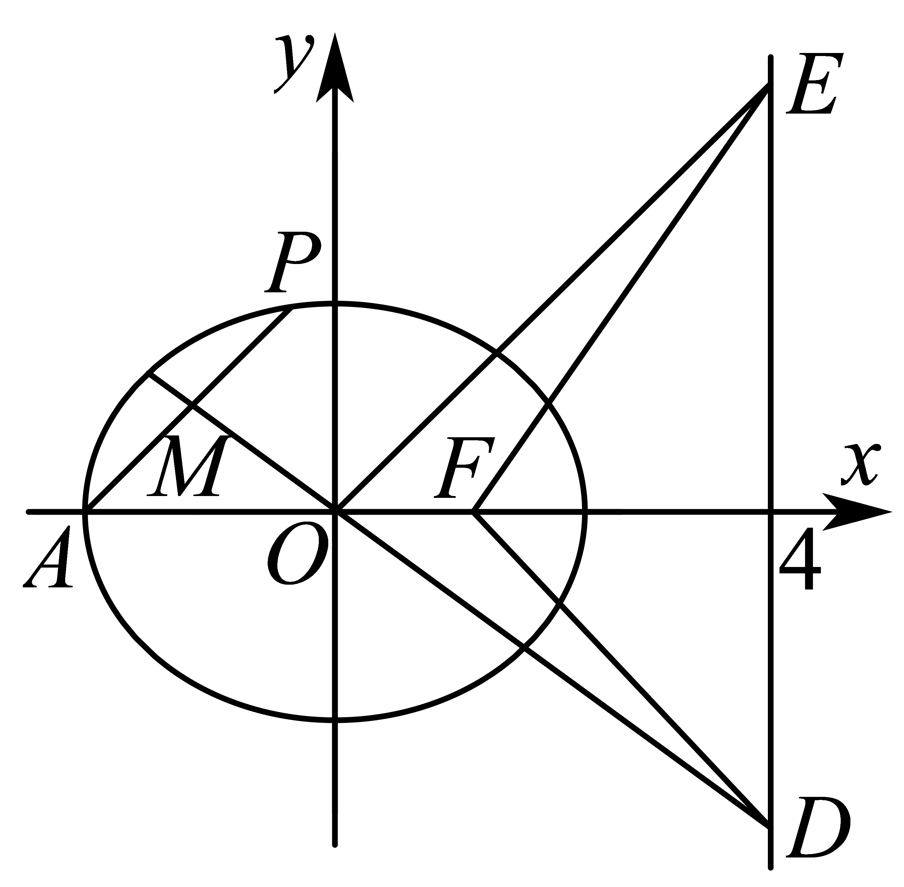

# Mathematics - 题目 367

**ID**: 35bbf05ca6e148679eb8f1ea75284c10
**年级**: Grade 12
**难度**: Medium-Hard
**题型**: Calculation

## 题目
如图，已知椭圆 $C：\frac {x{^{2}}}{a{^{2}}}+\frac {y{^{2}}}{b{^{2}}}=1\left ({a>b>0}\right )$ 的离心率为 $\frac {1}{2}{\rm ，\mathit{F}}$ 为椭圆C的右焦点， $A\left ({-a,0}\right )$ ， $\left |{AF}\right |=3$ .​​​​​​​‌（1）求椭圆C的方程；（2）设O为原点，P为椭圆上一点，AP的中点为M，直线OM与直线 $x=4$ 交于点D，过O且平行于AP的直线与直线 $x=4$ 交于点E.求证： $\angle ODF=\angle OEF$ .

## 解答

1. （1）设椭圆C的半焦距为c，
2. 依题意，得： $\left \{\hspace{-0.5em}\begin{array}{l}e=\frac {c}{a}=\frac {1}{2}\\\left |{AF}\right |=a+c=3\end{array}\hspace{-0.5em}\right.$ ，解得 $a=2$ ， $c=1$ ，
3. $\therefore b{^{2}}=a{^{2}}-c{^{2}}=3$ ，
4. $\therefore $ 椭圆C的方程是： $\frac {x{^{2}}}{4}+\frac {y{^{2}}}{3}=1$ .
5. （2）证明：由第一问得 $A\left ({-2,0}\right )$ ，设AP的中点 $M\left ({x{{}_{0}},y{{}_{0}}}\right )$ ， $P\left ({x{{}_{1}},y{{}_{1}}}\right )$ ，
6. 设直线AP的方程为： $y=k\left ({x+2}\right )\left ({k\ne 0}\right )$ ，将其代入椭圆方程，
7. 整理得： $\left ({4k{^{2}}+3}\right )x{^{2}}+16k{^{2}}x+16k{^{2}}-12=0$ ，
8. $\because $ 椭圆C与直线AP的交点为 $A\left ({-2,0}\right )$ 与 $P\left ({x{{}_{1}},y{{}_{1}}}\right )$ ，
9. $\therefore -2+x{{}_{1}}=\frac {-16k{^{2}}}{4k{^{2}}+3}$ ，
10. $\because AP$ 的中点是 $M\left ({x{{}_{0}},y{{}_{0}}}\right )$ ，
11. $\therefore x{{}_{0}}=\frac {-2+x{{}_{1}}}{2}=\frac {-8k{^{2}}}{4k{^{2}}+3}$ ，代入 $y=k\left ({x+2}\right )\left ({k\ne 0}\right )$ 得： $y{{}_{0}}=k\left ({x{{}_{0}}+2}\right )=\frac {6k}{4k{^{2}}+3}$ ，
12. 即 $M\left ({\frac {-8k{^{2}}}{4k{^{2}}+3},\frac {6k}{4k{^{2}}+3}}\right )$ ，
13. $\therefore $ 直线OM的斜率是 $\frac {\frac {6k}{4k{^{2}}+3}}{\frac {-8k{^{2}}}{4k{^{2}}+3}}=-\frac {3}{4k}$ ，
14. $\therefore $ 直线OM的方程是 $y=-\frac {3}{4k}x$ ，令 $x=4$ ，得 $D\left ({4,-\frac {3}{k}}\right )$ ，
15. $\because AP\parallel OE$ ，且直线 $OE$ 过原点，
16. $\therefore $ 直线OE的方程是 $y=kx$ ，令 $x=4$ ，得 $E\left ({4,4k}\right )$ ，
17. 由 $F\left ({1,0}\right )$ ，得直线EF的斜率是 $\frac {4k}{4-1}=\frac {4k}{3}$ ，
18. $\because $ 直线OM的斜率与直线EF的斜率互为负倒数，
19. $\therefore EF\bot OM$ ，记垂足为H，
20. $\because $ 直线DF的斜率是 $\frac {-\frac {3}{k}}{4-1}=-\frac {1}{k}$ ，
21. $\because $ 直线DF的斜率与直线OE的斜率互为负倒数，
22. $\therefore DF\bot OE$ ，记垂足为G，
23. 
24. 在 $Rt\vartriangle EHO$ 和 $Rt\vartriangle DGO$ 中， $\angle ODF$ 和 $\angle OEF$ 都与 $\angle EOD$ 互余，
25. $\therefore \angle ODF=\angle OEF$ .

## 知识点

**中文**:
  - 由椭圆的几何性质求方程
  - 直线与椭圆的位置关系
  - 角度问题

**English**:
  - Finding Equation from Properties
  - Line-Ellipse Relationship
  - Angle Problems

---
