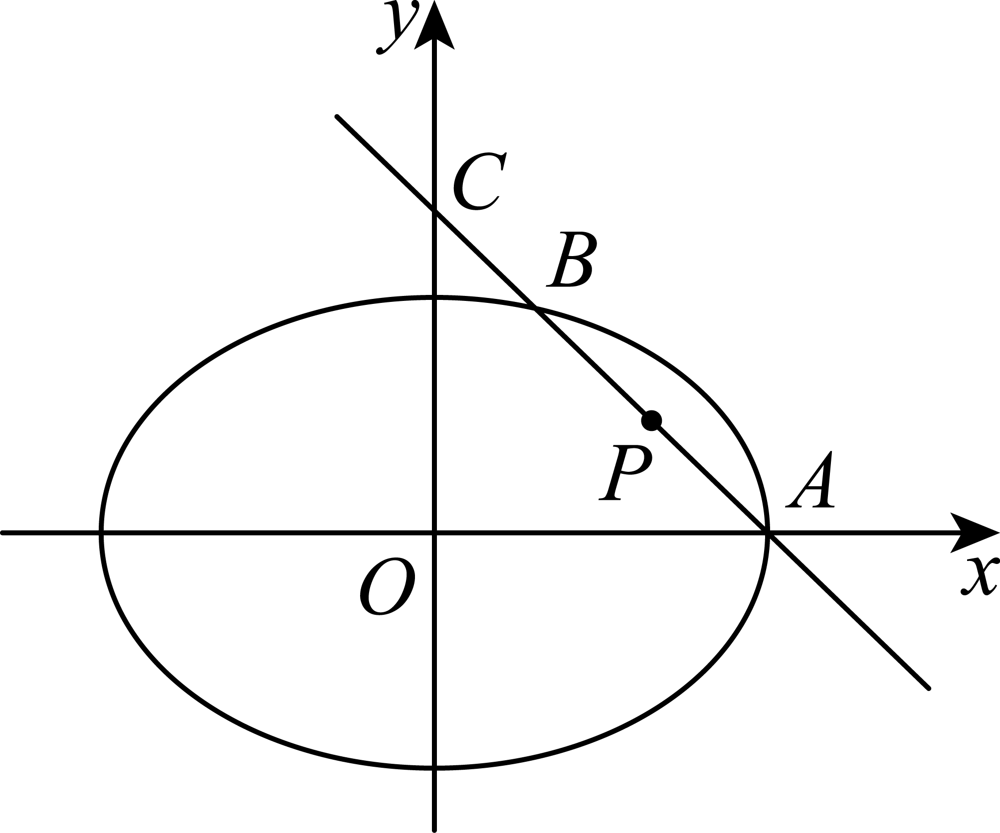

# Mathematics - 题目 2631

**ID**: 45559dd88977404887ecdcc42cfc8d01
**年级**: Grade 12
**难度**: Medium-Hard
**题型**: Calculation

## 题目
如图，在平面直角坐标系 $xOy$ 中，已知椭圆 $E:\frac {x{^{2}}}{a{^{2}}}+\frac {y{^{2}}}{b{^{2}}}=1\left ({a>b>0}\right )$ 的离心率 $e=\frac {\sqrt {2}}{2}$ ，且椭圆 $E$ 过点 $A\left ({2，0}\right )$ ，过点 $\mathrm{A}$ 作斜率为 $k\left ({k\ne 0}\right )$ 的直线 $l$ 交椭圆 $E$ 于点 $B$ ，交 $y$ 轴于点 $C$ ．（1）求椭圆 $E$ 的方程；​​​​​​​‌（2）已知 $P$ 为 $AB$ 的中点，是否存在定点 $Q$ ，对于任意的 $k\left ({k\ne 0}\right )$ 都有 $\overrightarrow {{OP}}\bot \overrightarrow {{CQ}}$ ，若存在，求出点 $Q$ 的坐标：若不存在说明理由．

## 解答

1. （1）解：因为椭圆 $E:\frac {x{^{2}}}{a{^{2}}}+\frac {y{^{2}}}{b{^{2}}}=1$ 的离心率 $e=\frac {\sqrt {2}}{2}$ ，且椭圆 $E$ 过点 $A\left ({2，0}\right )$ ，
2. 可得 $\begin{cases}\frac {c}{a}=\frac {\sqrt {2}}{2}\\a=2\\b{^{2}}=a{^{2}}-c{^{2}}\end{cases}$  ，解得 $a=2,b=\sqrt {2}$ ，所以椭圆 $E$ 的方程为 $\frac {x{^{2}}}{4}+\frac {y{^{2}}}{2}=1$ .
3. （2）解：由题意，显然直线 $AB$ 的斜率存在，设直线 $AB$ 的方程为 $y=k(x-2)$ ，
4. 联立方程组 $\begin{cases}y=k(x-2)\\\frac {x{^{2}}}{4}+\frac {y{^{2}}}{2}=1\end{cases}$ ，整理得 $(1+2k{^{2}})x{^{2}}-8k{^{2}}x+8k{^{2}}-4=0$ ，
5. 设 $A(x{{}_{1}},y{{}_{1}}),B(x{{}_{2}},y{{}_{2}})$ ，则 $x{{}_{1}}+x{{}_{2}}=\frac {8k{^{2}}}{1+2k{^{2}}},x{{}_{1}}x{{}_{2}}=\frac {8k{^{2}}-4}{1+2k{^{2}}}$ ，
6. 因为点 $P$ 为 $AB$ 的中点，可得 $x{{}_{P}}=\frac {x{{}_{1}}+x{{}_{2}}}{2}=\frac {4k{^{2}}}{1+2k{^{2}}}$ ，
7. 则 $y{{}_{P}}=k(x{{}_{P}}-2)=\frac {-2k}{1+2k{^{2}}}$ ，即 $P(\frac {4k{^{2}}}{1+2k{^{2}}},\frac {-2k}{1+2k{^{2}}})$ ，
8. 令 $x=0$ ，可得 $y{{}_{C}}=-2k$ ，即 $C(0,-2k)$ ，
9. 假设存在点 $Q(m,n)$ ，使得 $\overrightarrow {{OP}}\bot \overrightarrow {{CQ}}$ ，此时 $\overrightarrow {{OP}}\cdot \overrightarrow {{CQ}}=0$
10. 因为 $\overrightarrow {{OP}}=(\frac {4k{^{2}}}{1+2k{^{2}}},\frac {-2k}{1+2k{^{2}}}),\overrightarrow {{CQ}}=(m,n+2k)$ ，可得 $\overrightarrow {{OP}}\cdot \overrightarrow {{CQ}}=\frac {4mk{^{2}}}{1+2k{^{2}}}-\frac {2k(n+2k)}{1+2k{^{2}}}=0$ ，
11. 整理得 $2mk{^{2}}-k(n+2k)=0$ ，
12. 因为 $k\ne 0$ ，所以 $2mk-(n+2k)=0$ ，即 $(2m-2)k-n=0$ 恒成立，
13. 所以 $\begin{cases}2m-2=0\\n=0\end{cases}$  ，解得 $m=1,n=0$ ，即 $Q(1,0)$ ，
14. 即存在定点 $Q(1,0)$ ，使得 $\overrightarrow {{OP}}\bot \overrightarrow {{CQ}}$ .
15. 

## 知识点

**中文**:
  - 垂直平分问题
  - 由椭圆的几何性质求方程
  - 直线与椭圆的位置关系
  - 存在性或者探究性问题

**English**:
  - Perpendicular Bisector Problems
  - Finding Equation from Properties
  - Line-Ellipse Relationship
  - Existence and Inquiry Problems

---
