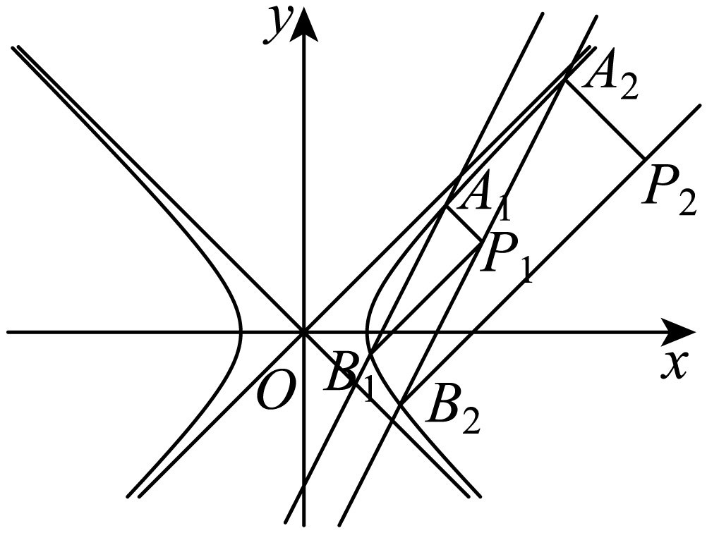

# Mathematics - 题目 2450

**ID**: 4b6fcc755cb94314be727e4d75967d0d
**年级**: Grade 12
**难度**: Medium-Hard
**题型**: Calculation

## 题目
已知双曲线C： $\frac {x{^{2}}}{a{^{2}}}-\frac {y{^{2}}}{b{^{2}}}=1\left ({a>0,b>0}\right )$ 的两条渐近线分别为 $l{{}_{1}}$ ： $y=x$ 和 $l{{}_{2}}$ ： $y=-x$ ，右焦点坐标为 $\left ({\sqrt {2},0}\right )$ ， $O$ 为坐标原点.​​​​​​​‌（1）求双曲线C的标准方程；（2）设M，N是双曲线C上不同的两点，Q是 $MN$ 的中点，直线 $MN$ ， $OQ$ 的斜率分别为 $k{{}_{1}}$ ， $k{{}_{2}}$ ，证明： $k{{}_{1}}\cdot k{{}_{2}}$ 为定值；（3）直线 $y=2x-3$ 与C的右支交于点 $A{{}_{1}}$ ， $B{{}_{1}}$ （ $A{{}_{1}}$ 在 $B{{}_{1}}$ 的上方），过点 $A{{}_{1}}$ ， $B{{}_{1}}$ 分别作 $l{{}_{2}}$ ， $l{{}_{1}}$ 的平行线，交于点 $P{{}_{1}}$ ，过点 $P{{}_{1}}$ 且斜率为2的直线与C的右支交于点 $A{{}_{2}}$ ， $B{{}_{2}}$ （ $A{{}_{2}}$ 在 $B{{}_{2}}$ 的上方），再过点 $A{{}_{2}}$ ， $B{{}_{2}}$ 分别作 $l{{}_{2}}$ ， $l{{}_{1}}$ 的平行线，交于点 $P{{}_{2}}$ ，…，这样一直操作下去，可以得到一系列点 $P{{}_{1}},P{{}_{2}},\cdot \cdot \cdot ,P{{}_{n}}$ ， $n\geqslant 3$ ， $n\in {\mathbf{N}}{^{*}}$ ，记 $P{{}_{n}}$ 的坐标为 $\left ({x{{}_{n}},y{{}_{n}}}\right )$ .证明： $P{{}_{1}},P{{}_{2}},\cdot \cdot \cdot ,P{{}_{n}}$ 共线.

## 解答

1. （1）由已知得 $\begin{cases}\frac {b}{a}=1\\{\left({\sqrt {2}}\right)^{2}}=a{^{2}}+b{^{2}}\end{cases}$ ，
2. 解得 $a=1$ ， $b=1$ ，
3. 故双曲线C的标准方程为： $x{^{2}}-y{^{2}}=1$ .
4. （2）证明：设 $M\left ({x{{}_{1}},y{{}_{1}}}\right )$ ， $N\left ({x{{}_{2}},y{{}_{2}}}\right )$ ， $Q\left ({\frac {x{{}_{1}}+x{{}_{2}}}{2},\frac {y{{}_{1}}+y{{}_{2}}}{2}}\right )$ ，
5. 因为M，N为双曲线C上的两点，所以 $\begin{cases}x{{}_{1}^{2}}-y{{}_{1}^{2}}=1\\x{{}_{2}^{2}}-y{{}_{2}^{2}}=1\end{cases}$ ，
6. 两式相减得 $\left ({x{{}_{1}}-x{{}_{2}}}\right )\left ({x{{}_{1}}+x{{}_{2}}}\right )=\left ({y{{}_{1}}-y{{}_{2}}}\right )\left ({y{{}_{1}}+y{{}_{2}}}\right )$ ，
7. 整理得 $\frac {x{{}_{1}}+x{{}_{2}}}{y{{}_{1}}+y{{}_{2}}}=\frac {y{{}_{1}}-y{{}_{2}}}{x{{}_{1}}-x{{}_{2}}}$ ，
8. 则 $k{{}_{1}}k{{}_{2}}=\frac {y{{}_{1}}-y{{}_{2}}}{x{{}_{1}}-x{{}_{2}}}\cdot \frac {\frac {y{{}_{1}}+y{{}_{2}}}{2}}{\frac {x{{}_{1}}+x{{}_{2}}}{2}}=\frac {y{{}_{1}}-y{{}_{2}}}{x{{}_{1}}-x{{}_{2}}}\cdot \frac {y{{}_{1}}+y{{}_{2}}}{x{{}_{1}}+x{{}_{2}}}=1$ ，得证.
9. （3）证明：设斜率为2且与双曲线右支相交于 $A{{}_{n}}$ ， $B{{}_{n}}$ 两点的直线方程为
10. $y=2x+m{{}_{n}}\left ({m{{}_{n}}<0}\right )$ ， $n\in {\mathbf{N}}{^{*}}$ ，
11. 联立 $\begin{cases}y=2x+m{{}_{n}}\\x{^{2}}-y{^{2}}=1\end{cases}$ ，整理得 $3x{^{2}}+4m{{}_{n}}x+m{{}_{n}^{2}}+1=0$ ，
12. 因为该方程有两个正根，则 $Δ>0$ ，解得 $m{{}_{n}}<-\sqrt {3}$ 或 $m{{}_{n}}>\sqrt {3}$ （舍），
13. 设 $A\left ({x{{}_{A{{}_{n}}}},y{{}_{A{{}_{n}}}}}\right )$ ， $B\left ({x{{}_{B{{}_{n}}}},y{{}_{B{{}_{n}}}}}\right )$ ，由韦达定理得 $x{{}_{A{{}_{n}}}}+x{{}_{B{{}_{n}}}}=-\frac {4m{{}_{n}}}{3}$ ， $x{{}_{A{{}_{n}}}}x{{}_{B{{}_{n}}}}=\frac {m{{}_{n}^{2}}+1}{3}$ ，
14. 直线 $A{{}_{n}}P{{}_{n}}$ 的方程为： $y-y{{}_{A{{}_{n}}}}=-\left ({x-x{{}_{A{{}_{n}}}}}\right )$ ，
15. 因为 $y{{}_{A{{}_{n}}}}=2x{{}_{A{{}_{n}}}}+m{{}_{n}}$ ，所以 $y=-x+3x{{}_{A{{}_{n}}}}+m{{}_{n}}$ ，①
16. 直线 $B{{}_{n}}P{{}_{n}}$ 的方程为 $y-y{{}_{B{{}_{n}}}}=x-x{{}_{B{{}_{n}}}}$ ，
17. 因为 $y{{}_{B{{}_{n}}}}=2x{{}_{B{{}_{n}}}}+m{{}_{n}}$ ，所以 $y=x+x{{}_{B{{}_{n}}}}+m{{}_{n}}$ ，②
18. 联立①②得 $y{{}_{n}}=y{{}_{P{{}_{n}}}}=\frac {3}{2}x{{}_{A{{}_{n}}}}+\frac {1}{2}x{{}_{B{{}_{n}}}}+m{{}_{n}}$ ， $x{{}_{n}}=x{{}_{P{{}_{n}}}}=\frac {3x{{}_{A{{}_{n}}}}-x{{}_{B{{}_{n}}}}}{2}$ ，
19. 所以 $P{{}_{n}}\left ({\frac {3x{{}_{A{{}_{n}}}}-x{{}_{B{{}_{n}}}}}{2},\frac {3}{2}x{{}_{A{{}_{n}}}}+\frac {1}{2}x{{}_{B{{}_{n}}}}+m{{}_{n}}}\right )$ ，
20. 因为 $x{{}_{A{{}_{n}}}}+x{{}_{B{{}_{n}}}}=-\frac {4m{{}_{n}}}{3}$ ，
21. 所以 $y{{}_{n}}=\frac {3}{2}x{{}_{A{{}_{n}}}}+\frac {1}{2}x{{}_{B{{}_{n}}}}+m{{}_{n}}=\frac {3}{2}x{{}_{A{{}_{n}}}}-\frac {1}{2}x{{}_{A{{}_{n}}}}-\frac {2m{{}_{n}}}{3}+m{{}_{n}}=x{{}_{A{{}_{n}}}}+\frac {m{{}_{n}}}{3}$ ，
22. $x{{}_{n}}=\frac {3x{{}_{A{{}_{n}}}}-x{{}_{B{{}_{n}}}}}{2}=\frac {3x{{}_{A{{}_{n}}}}-\left ({-x{{}_{A{{}_{n}}}}-\frac {4m{{}_{n}}}{3}}\right )}{2}=2x{{}_{A{{}_{n}}}}+\frac {2m{{}_{n}}}{3}=2\left ({x{{}_{A{{}_{n}}}}+\frac {m{{}_{n}}}{3}}\right )$ ，
23. 所以 $y{{}_{n}}=\frac {1}{2}x{{}_{n}}$ ，
24. 则 $P{{}_{1}},P{{}_{2}},\cdot \cdot \cdot ,P{{}_{n}}$ 都在直线 $y=\frac {1}{2}x$ 上，
25. 故 $P{{}_{1}},P{{}_{2}},\cdot \cdot \cdot ,P{{}_{n}}$ 共线.

## 知识点

**中文**:
  - 共线比例问题
  - 由双曲线的性质探求方程
  - 直线与双曲线的位置关系
  - 定点定值定直线问题

**English**:
  - Collinearity and Ratio Problems
  - Finding Equation from Properties
  - Line-Hyperbola Relationship
  - Fixed Point, Value, Line Problems

---
