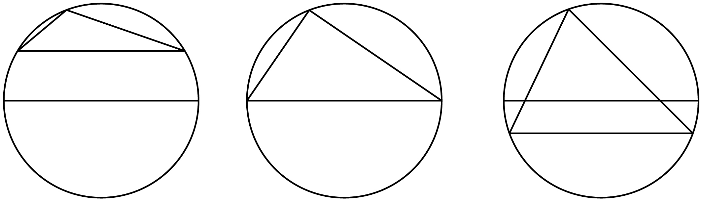

# Mathematics - 题目 2444

**ID**: 5641919bc1a947bc8d1881c2969456af
**年级**: Grade 12
**难度**: Medium-Hard
**题型**: Calculation

## 题目
在我们所作的三角形外接圆中，有常见的以下几种如图：(1)如图一，三角形不经过圆的直径，叫做“阿圆▲”，设该三角形为 $ABC$ ，其外接圆半径为 $\mathbf{R}$ ，角 $A,B,C$ 所对的边分别为 $a,b,c$ .​​​​​​​‌定义函数 $f\left ({x}\right )={\rm{s}}{\rm{i}}{\rm{n}}{^{2}}A{\rm{s}}{\rm{i}}{\rm{n}}x+{\rm{s}}{\rm{i}}{\rm{n}}{^{2}}B{\rm{c}}{\rm{o}}{\rm{s}}x$ ， $x\in \left [0,\frac {{\rm{π}}}{2}\right ]$ ，且 $f\left ({x}\right )$ 的最大值为 $\frac {\sqrt {2}}{4}$ ，若 $\mathbf{R}=2,a+b=4$ ，设D为三角形 $ABC$ 外接圆劣弧 $AB$ 上的一点，且不与 $A､B$ 重合，求 $\overrightarrow {{DA}}\cdot \overrightarrow {{DB}}$ 的取值范围.(2)如图二，三角形经过圆的直径，叫做“泰圆▲”，若该三角形为 ${\rm \mathit{ABC}，}A,B$ 为定点，C为动点，试用向量方法证明数学常见结论：“ $C=90{}\degree $ ”.(3)如图三，三角形包跨过圆的直径，叫做“秘圆▲”，假设该圆的直径为 $6$ ，其中一条边 $AB$ 的位置固定，长度为3，求满足条件的动点 $C$ 的运动轨迹方程.

## 解答

1. （1）由 $\frac {a}{\sin A}=\frac {b}{\sin B}=2R=4$ ，得 $\sin A=\frac {a}{4},\sin B=\frac {b}{4}$ ，
2. $\because f\left ({x}\right )={\rm{s}}{\rm{i}}{\rm{n}}{^{2}}A{\rm{s}}{\rm{i}}{\rm{n}}x+{\rm{s}}{\rm{i}}{\rm{n}}{^{2}}B{\rm{c}}{\rm{o}}{\rm{s}}x=\sqrt {\sin {^{4}}A+\sin {^{4}}B}\sin (x+φ),x\in \left [0,\frac {{\rm{π}}}{2}\right ]$ ，
3. 其中由 $\sin φ=\frac {\sin {^{2}}B}{\sqrt {\sin {^{4}}A+\sin {^{4}}B}}>0,{\cos}φ=\frac {\sin {^{2}}A}{\sqrt {\sin {^{4}}A+\sin {^{4}}B}}>0$ ，不妨取 $0<φ<\frac {{\rm{π}}}{2}$ ，
4. 由 $x\in \left [0,\frac {{\rm{π}}}{2}\right ]$ ，得 $x+φ\in \left [φ,φ+\frac {{\rm{π}}}{2}\right ]$ ，
5. $\therefore $ 当 $x+φ=\frac {{\rm{π}}}{2},x=\frac {{\rm{π}}}{2}-φ$ 时，
6. $f(x)$ 取最大值，最大值为 $\sqrt {\sin {^{4}}A+\sin {^{4}}B}=\sqrt {{\left({\frac {a}{4}}\right)^{4}}+{\left({\frac {b}{4}}\right)^{4}}}=\frac {\sqrt {2}}{4}$ ，
7. 化简得 $a{^{4}}+b{^{4}}=32$ ，又 $a+b=4$ ，
8. 由 $a{^{4}}+b{^{4}}=(a{^{2}}+b{^{2}}){^{2}}-2a{^{2}}b{^{2}}=\left [(a+b){^{2}}-2ab\right ]{^{2}}-2a{^{2}}b{^{2}}=32={\left({16-2ab}\right)^{2}}-2{\left({ab}\right)^{2}}$ ，
9. 解得 $ab=4$ 或 $28$ ，由 $ab\leqslant {\left({\frac {a+b}{2}}\right)^{2}}=4$ ，则 $ab=4$ ，联立 $a+b=4$ ，
10. 解得 $\begin{cases}a=2\\b=2\end{cases}$ ，则 $\sin A=\sin B=\frac {2}{4}=\frac {1}{2}$ ，则 $A=B=\frac {{\rm{π}}}{6}$ ，
11. 由题意， $\vartriangle ABC$ 为“阿圆▲”，即为钝角三角形，有一内角为钝角，
12. 而 $C=\frac {2{\rm{π}}}{3}$ ，满足题意，
13. 此时， $c{^{2}}=a{^{2}}+b{^{2}}-2ab{\cos}C=8-8{\cos}\frac {2{\rm{π}}}{3}=12,c=2\sqrt {3}$ ，
14. 如图，由题意D为三角形 $ABC$ 外接圆劣弧 $AB$ 上的一点，且不与 $A､B$ 重合， $O$ 为圆心，
15. 
16. 取 $AB$ 中点 $M$ ，连接 $OM,DM$ ，则 $OM\bot AB$ ， $CM\bot AB$ ， $O,M,C$ 三点共线，
17. 所以 $MA=MB=\sqrt {3},CM=1=OM$ .
18. $\overrightarrow {{DA}}\cdot \overrightarrow {{DB}}=\left ({\overrightarrow {{DM}}+\overrightarrow {{MA}}}\right )\cdot \left ({\overrightarrow {{DM}}+\overrightarrow {{MB}}}\right )=\left ({\overrightarrow {{DM}}+\overrightarrow {{MA}}}\right )\cdot \left ({\overrightarrow {{DM}}-\overrightarrow {{MA}}}\right )=\overrightarrow {{DM}}{^{2}}-\overrightarrow {{MA}}{^{2}}=\left |{\overrightarrow {{DM}}}\right |{^{2}}-3$ ，
19. 结合图形可知， $\left |{\overrightarrow {{DM}}}\right |{{}_{{\rm \min }}}=2-\left |{\overrightarrow {{OM}}}\right |=1$ ，且 $\left |{\overrightarrow {{DM}}}\right |<\left |{\overrightarrow {{AM}}}\right |=\sqrt {3}$ ，
20. 因此 $\left |{\overrightarrow {{DM}}}\right |\in \left [{1,\sqrt {3}}\right )$ ，故 $\overrightarrow {{DA}}\cdot \overrightarrow {{DB}}=\left |{\overrightarrow {{DM}}}\right |{^{2}}-3\in \left [{-2,0}\right )$ .
21. 即 $\overrightarrow {{DA}}\cdot \overrightarrow {{DB}}$ 的取值范围为 $\left [{-2,0}\right )$ .
22. （2）由题意，由 $\vartriangle ABC$ 为“泰圆▲”， $O$ 为外接圆圆心，则其中一边过圆心 $O$ ，即为直径，
23. 若 $C$ 为动点，要使 $\vartriangle ABC$ 恒为“泰圆▲”，则 $AB$ 为直径，
24. $\overrightarrow {{CA}}\cdot \overrightarrow {{CB}}=\left ({\overrightarrow {{CO}}+\overrightarrow {{OA}}}\right )\cdot \left ({\overrightarrow {{CO}}+\overrightarrow {{OB}}}\right )=\left ({\overrightarrow {{CO}}+\overrightarrow {{OA}}}\right )\cdot \left ({\overrightarrow {{CO}}-\overrightarrow {{OA}}}\right )=\overrightarrow {{CO}}{^{2}}-\overrightarrow {{OA}}{^{2}}=\left |{\overrightarrow {{CO}}}\right |{^{2}}-\left |{\overrightarrow {{OA}}}\right |{^{2}}=0$ ，
25. 由 $C,A,B$ 构成三角形，三点不共线，故 $\overrightarrow {{CA}}\bot \overrightarrow {{CB}}$ ，即 $CA\bot CB$ ，
26. 故 $\angle ACB\mathrm{=}90{}\degree $ ，结论得证.
27. 
28. （3）以 $AB$ 中点为坐标原点，以 $AB$ 所在直线为 $x$ 轴，建立如图所示的平面直角坐标系 $Oxy$ ，
29. 由题意 $AB=3$ ，则 $A(-\frac {3}{2},0),B(\frac {3}{2},0)$ ，设 $C(x,y)$ ，
30. 设 $\vartriangle ABC$ 外接圆圆心为 $M$ ，已知直径为 $6$ ，则 $AM=BM=CM=\frac {1}{2}\times 6=3$ ，
31. 由对称性可知，圆心 $M$ 在 $AB$ 的垂直平分线上，即 $y$ 轴上，
32. 设圆心 $M(0,a)$ ，则 $(\frac {3}{2}){^{2}}+a{^{2}}=3{^{2}}$ ，解得 $a{^{2}}=\frac {27}{4}$ ，则 $a=-\frac {3\sqrt {3}}{2}$ 或 $\frac {3\sqrt {3}}{2}$ .
33. 当 $a=\frac {3}{2}\sqrt {3}$ 时，点 $C$ 在圆 $x{^{2}}+{\left({y-\frac {3}{2}\sqrt {3}}\right)^{2}}=9$ 上，
34. 如图，连接 $AM,BM$ ，延长 $AM,BM$ 分别与圆 $M$ 交于点 $C{{}_{2}},C{{}_{1}}$ ，
35. 由题意， $\vartriangle ABC$ 为“秘圆▲”，即为锐角三角形，结合图形可知，
36. $C$ 的轨迹为圆 $M$ 上的劣弧 $C{{}_{1}}C{{}_{2}}$ ，且不包括端点 $C{{}_{1}},C{{}_{2}}$ ,所以 $y>3\sqrt {3}$ ，
37. 当 $a=-\frac {3\sqrt {3}}{2}$ 时，同理由对称性可得点 $C$ 的轨迹方程为 $x{^{2}}+{\left({y+\frac {3}{2}\sqrt {3}}\right)^{2}}=9(y<-3\sqrt {3})$ .
38. 综上所述，满足条件的动点 $C$ 的运动轨迹方程为
39. $x{^{2}}+{\left({y-\frac {3}{2}\sqrt {3}}\right)^{2}}=9(y>3\sqrt {3})$ 或 $x{^{2}}+{\left({y+\frac {3}{2}\sqrt {3}}\right)^{2}}=9(y<-3\sqrt {3})$ .
40. 

## 知识点

**中文**:
  - 向量在平面几何证明问题中的应用
  - 曲线与方程

**English**:
  - Applications in Plane Geometry Proofs
  - Curves and Equations

---
