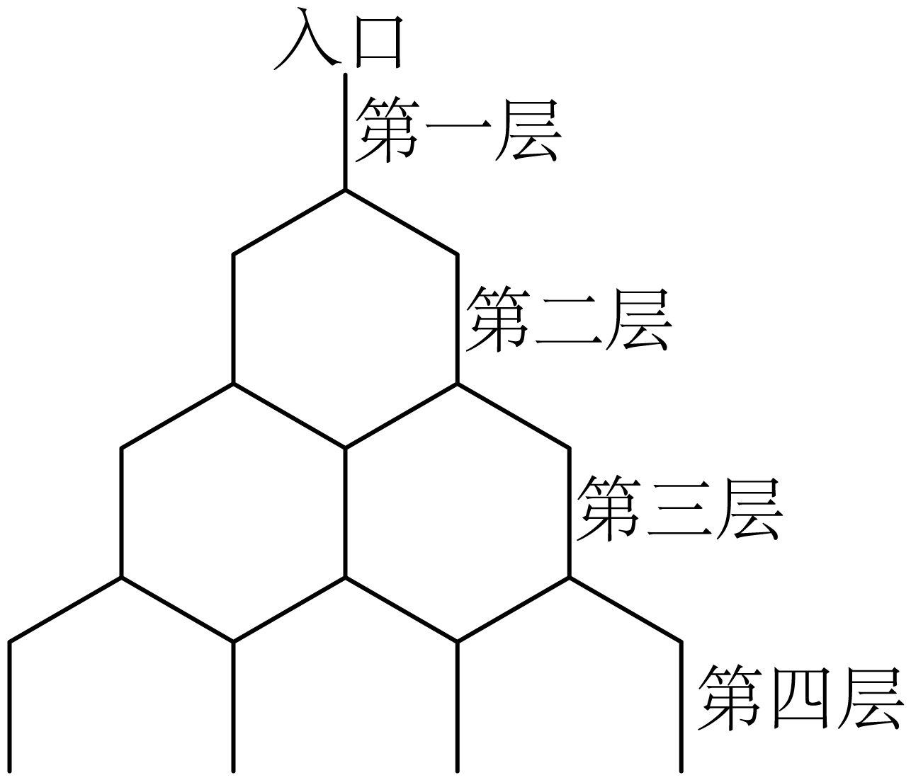

# Mathematics - 题目 2855

**ID**: 641421bd790842bfa1ce9a8313cd66eb
**年级**: Grade 12
**难度**: Medium-Hard
**题型**: Calculation

## 题目
如图所示是竖直平面内的一个“通道游戏”，图中竖直线段和斜线段都表示通道，竖直线段有一条的为第1层，有2条的为第2层，   ，依此类推，现有一个小球从第1层的通道里向下运动，在通道的分叉处，小球等可能地向左或向右落下，然后继续下落.​​​​​​​‌记小球落入第 $n$ 层第 $m$ 个竖直通道（从左向右）的概率为 $P\left ({n,m}\right )$ ， $m=1,2,\cdot \cdot \cdot ,n$ .（1）求 $P\left ({3,1}\right )$ ， $P\left ({4,2}\right )$ ， $P\left ({5,3}\right )$ ，的值，并写出 $P\left ({n,m}\right )$ 的表达式（只需写出结果，不必写过程）；（2）利用（1）的结论，证明： $P\left ({n,m-1}\right )+P\left ({n,m}\right )=2P\left ({n+1,m}\right )$ ；（3）设小球落入第 $n$ 层第 $m$ 个竖直通道的得分为 $X$ ，其中 $X=\frac {1}{m}$ ， $m=1,2,\cdot \cdot \cdot ,n$ ，证明： $X$ 的数学期望 $E\left ({X}\right )<\frac {2}{n}$ .

## 解答

1. （1） $P(3,1)$ ：小球要落入第 $3$ 层第 $1$ 个竖直通道，从第 $1$ 层开始，第一次有 $1$ 种选择（向左或向右），第二次有 $2$ 种选择（左左或右右），总共有 $2{^{2}}=4$ 种等可能的路径，而落入第 $3$ 层第 $1$ 个竖直通道的路径只有 $1$ 种（左左），所以 $P(3,1)=\frac {1}{4}$ .
2. $P(4,2)$ ：从第 $1$ 层到第 $4$ 层，总共有 $2{^{3}}=8$ 种等可能的路径，落入第 $4$ 层第 $2$ 个竖直通道的路径有 $3$ 种（左左右、左右左、右左左），所以 $P(4,2)=\frac {3}{8}$ .
3. $P(5,3)$ ：从第 $1$ 层到第 $5$ 层，总共有 $2{^{4}}=16$ 种等可能的路径，落入第 $5$ 层第 $3$ 个竖直通道的路径有 $6$ 种（左左左右、左左右左、左右左左、右左左左、左左右右、右左左右），所以 $P(5,3)=\frac {6}{16}=\frac {3}{8}$ .
4. $P(n,m)$ 的表达式： $P(n,m)=\frac {{\rm{C}}{{}_{n-1}^{m-1}}}{2{^{n-1}}}$ ，其中 ${\rm{C}}{{}_{n-1}^{m-1}}$ 是组合数，表示从 $n-1$ 个元素中选取 $m-1$ 个元素的组合数.
5. （2）由（1）得 $P\left ({n,m}\right )=\frac {{\rm{C}}{{}_{n-1}^{m-1}}}{2{^{n-1}}}$ ， $P\left ({n,m-1}\right )=\frac {{\rm{C}}{{}_{n-1}^{m-2}}}{2{^{n-1}}}$ ， $P\left ({n+1,m}\right )=\frac {{\rm{C}}{{}_{n}^{m-1}}}{2{^{n}}}$ ，
6. $\therefore P\left ({n,m-1}\right )+P\left ({n,m}\right )=\frac {{\rm{C}}{{}_{n-1}^{m-2}}}{2{^{n-1}}}+\frac {{\rm{C}}{{}_{n-1}^{m-1}}}{2{^{n-1}}}=\frac {{\rm{C}}{{}_{n-1}^{m-2}}+{\rm{C}}{{}_{n-1}^{m-1}}}{2{^{n-1}}}=\frac {{\rm{C}}{{}_{n}^{m-1}}}{2{^{n-1}}}=2P\left ({n+1,m}\right )$
7. （3）由题意得 $X$ 的分布列为：
8. $X$
9. 1
10. $\frac {1}{2}$
11. $\frac {1}{3}$
12. ...
13. $\frac {1}{m}$
14. ...
15. $\frac {1}{n}$
16. $P$
17. $P\left ({n,1}\right )$
18. $P\left ({n,2}\right )$
19. $P\left ({n,3}\right )$
20. ...
21. $P\left ({n,m}\right )$
22. ...
23. $P\left ({n,n}\right )$
24. $\therefore E\left ({X}\right )=\sum\limits_{m=1}^{n}\mathop{}\frac {1}{m}\cdot p\left ({n,m}\right )=\sum\limits_{m=1}^{n}\mathop{}\frac {1}{m}\cdot \frac {{\rm{C}}{{}_{n-1}^{m-1}}}{2{^{n-1}}}=\frac {1}{2{^{n-1}}}\sum\limits_{m=1}^{n}\mathop{}\frac {1}{m}\cdot \frac {\left ({n-1}\right )!}{\left ({m-1}\right )!\left ({n-m}\right )!}$
25. $=\frac {1}{2{^{n-1}}}\sum\limits_{m=1}^{n}\mathop{}\frac {1}{n}\cdot \frac {n!}{m!\left ({n-m}\right )!}=\frac {1}{n\cdot 2{^{n-1}}}\sum\limits_{m=1}^{n}\mathop{}{\rm{C}}{{}_{n}^{m}}=\frac {2{^{n}}-1}{n\cdot 2{^{n-1}}}=\frac {1}{n}\cdot \left ({2-\frac {1}{2{^{n-1}}}}\right )<\frac {2}{n}$ .

## 知识点

**中文**:
  - 概率与计数原理相结合的应用题
  - 离散型随机变量的分布列

**English**:
  - Combined Problems
  - Probability Distribution Table

---
