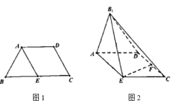

# Mathematics - 题目 1579

**ID**: 74383a852a054f6180b3e297620b70ec
**年级**: Grade 12
**难度**: Medium-Hard
**题型**: Calculation

## 题目
如图所示1，已知四边形ABCD满足 $AD//BC$ ， $BA=AD=DC=\frac {1}{2}BC=1$ ，E是BC的中点.​​​​​​​‌将 $\vartriangle BAE$ 沿着AE翻折成 $\mathrm{△}B{{}_{1}}AE$ ，使平面 $B{{}_{1}}AE\bot $ 平面AECD，F为CD的中点，如图所示2.（1）求证： $EF\bot $ 平面 $AB{{}_{1}}E$ ；（2）求AE到平面 $CB{{}_{1}}D$ 的距离.

## 解答

1. 证明：（1）如图，连接 $DE$ ，取 $AE$ 的中点 $G$ ,连接 $B{{}_{1}}G$ ,
2. 
3. 在四边形ABCD中，由 $AD//BC$ ， $BA=AD=DC=\frac {1}{2}BC=1$ ，E是BC的中点，
4. 易得四边形 $ABED$ 、四边形 $AECD$ 均为平行四边形，可得 $AE=DE=CE=1$ ,
5. $\Delta ABE、\Delta ADE、\Delta DCE$ 均为等边三角形，
6. 在等边 $ΔDCE$ 中，F为CD的中点，可得 $EF\bot CD$ ,且 $AE/\mskip-4mu/CD$ ,故 $EF\bot AE$ ,
7. 在等边 $ΔB{{}_{1}}AE$ , $G$ 为 $AE$ 的中点，故 $B{{}_{1}}G\bot AE$ ,又平面 $B{{}_{1}}AE\bot $ 平面AECD，
8. 平面 $B{{}_{1}}AE\cap $ 平面 $AECD=AE$ ,且 $B{{}_{1}}G\subset $ 平面 $B{{}_{1}}AE$ ，故可得： $B{{}_{1}}G\bot $ 平面AECD，
9. 故： $B{{}_{1}}G\bot EF$ ,由 $EF\bot AE$ ， $B{{}_{1}}G\cap AE=G$ ， $B{{}_{1}}G\subset $ 平面 $B{{}_{1}}AE$ ， $AE$  $\subset $ 平面 $B{{}_{1}}AE$ ，
10. 故： $EF\bot $ 平面 $AB{{}_{1}}E$ ；
11. （2）如图，连接 $GD$ ,取 $B{{}_{1}}D$ 的中点 $H$ 点，连接 $GH$ ,
12. 
13. 由（1）得： $B{{}_{1}}G\bot $ 平面AECD，故 $B{{}_{1}}G\bot CD$ ,
14. 且易得四边形 $DGEF$ 为平行四边形， $DG/\mskip-4mu/EF$ ，由 $CD\bot EF$ ,可得 $CD\bot GD$ ,
15. 由 $B{{}_{1}}G\cap GD=G$ ,且 $B{{}_{1}}G\subset $ 平面 $B{{}_{1}}GD$ , $GD\subset $ 平面 $B{{}_{1}}GD$ ,可得 $CD\bot $ 平面 $B{{}_{1}}GD$ ，
16. $CD\bot GH$ ,易得 $B{{}_{1}}G=GD=\frac {\sqrt {3}}{2}$ ，且 $H$ 点为 $B{{}_{1}}G$ 的中点，
17. 故 $GH\bot B{{}_{1}}D$ ,又 $B{{}_{1}}D\cap CD=D$ ,且 $B{{}_{1}}D\subset $ 平面 $B{{}_{1}}CD$ , $CD\subset $ 平面 $B{{}_{1}}CD$ ,
18. 故 $GH\bot $ 平面 $B{{}_{1}}CD$ ，易得AE到平面 $CB{{}_{1}}D$ 的距离即为点G到平面 $CB{{}_{1}}D$ 的距离，
19. 在 $RT\Delta B{{}_{1}}GD$ 中， $B{{}_{1}}G=GD=\frac {\sqrt {3}}{2}$ ，可得 $GH=\frac {\sqrt {6}}{4}$ ,
20. 即AE到平面 $CB{{}_{1}}D$ 的距离为 $\frac {\sqrt {6}}{4}$ .

## 知识点

**中文**:
  - 点与面之间的距离
  - 直线与平面垂直的判定
  - 翻折问题

**English**:
  - Point-Plane Distance
  - Line-Plane Perpendicularity Determination
  - Folding Problems

---
