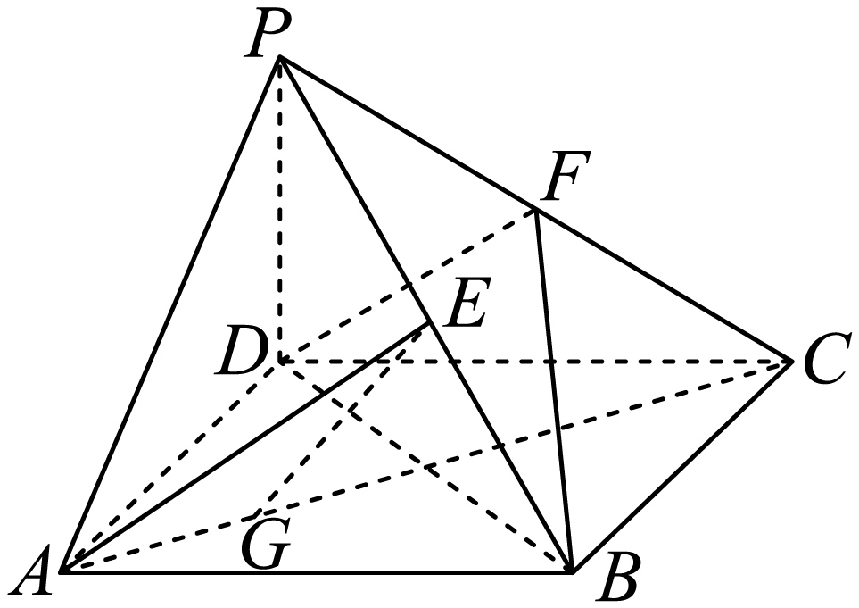

# Mathematics - 题目 3826

**ID**: 875a4688e7834052873318849bd61172
**年级**: Grade 12
**难度**: Medium-Hard
**题型**: Calculation

## 题目
如图，在四棱锥 $P-ABCD$ 中，底面 $ABCD$ 是正方形， $E,F$ 分别为 $PB,PC$ 的中点， $G$ 为线段 $AC$ 上一点，且 $CG=3AG$ .​​​​​​​‌(1)证明： $EG$  ${\rm{/}}{\rm{/}}$ 平面 $BDF$ ；(2)若 $PD\bot $ 平面 $ABCD$ ，且 $\frac {AD}{PD}=\frac {4}{3}$ ，求 $\mathrm{△}AEG$ 与 $\vartriangle BDF$ 的面积之比.

## 解答

1. （1）记 $O$ 为 $AC,BD$ 的交点，连接 $CE$ 交 $BF$ 于点 $K$ ，连接 $OK$ ，
2. 因为 $E,F$ 分别为 $PB,PC$ 的中点，则 $K$ 为 $\vartriangle BCP$ 的重心，故 $CK=2EK$ .
3. 又因为四边形 $ABCD$ 是正方形，故 $O$ 为 $AC$ 的中点，由于 $3AG=CG$ ，
4. 故 $OC=2OG,\frac {CK}{EK}=\frac {OC}{OG}=2$ ，所以 $OK$  $/\mskip-4mu/$  $EG$ .又因为 $OK\subset $ 平面 $BDF$ ，且 $EG\not\subset $ 平面 $BDF$ ，所以 $EG$  $/\mskip-4mu/$ 平面 $BDF$ .
5. 
6. （2）因为 $E,O$ 分别为 $PB,BD$ 的中点，连接 $OE$ ，所以 $OE$  $/\mskip-4mu/$  $PD$ ，且 $2OE=PD$ ，
7. 又因为 $PD\bot $ 平面 $ABCD$ ， 所以 $OE\bot $ 平面 $ABCD$ ， $AC\mathrm{⊂}$ 平面 $ABCD$ ，
8. 所以 $OE\bot AC$ ，
9. 设 $AD=AB=4a,PD=3a$ ，则 $AC=BD=4\sqrt {2}a,AG=\sqrt {2}a,OE=\frac {3a}{2}$ ，
10. 所以 $S{{}_{\vartriangle AEG}}=\frac {1}{2}AG\cdot OE=\frac {3\sqrt {2}a{^{2}}}{4}$ .
11. 取 $CD$ 的中点 $H$ ，过 $H$ 作 $HI\bot BD$ 于点 $I$ ，则 $HI=\sqrt {2}a,FH=\frac {1}{2}PD=\frac {3a}{2},FH$  $/\mskip-4mu/$  $PD$ ，
12. 所以 $FH\bot $ 平面 $ABCD,FH\bot BD,FH\bot HI$ ，又 $FH\cap HI=H$ ，
13. 所以 $BD\mathrm{⊥}$ 平面 $FHI$ ，故 $BD\bot FI$ ，且 $FI=\sqrt {FH{^{2}}+HI{^{2}}}=\frac {\sqrt {17}a}{2}$ ，
14. 所以 $S{{}_{\vartriangle BDF}}=\frac {1}{2}BD\cdot FI=\frac {1}{2}\times 4\sqrt {2}a\times \frac {\sqrt {17}a}{2}=\sqrt {34}a{^{2}}$ ，
15. 所以 $\frac {S{{}_{\vartriangle AEG}}}{S{{}_{\vartriangle BDF}}}=\frac {\frac {3\sqrt {2}a{^{2}}}{4}}{\sqrt {34}a{^{2}}}=\frac {3\sqrt {17}}{68}$ .
16. 

## 知识点

**中文**:
  - 直线与平面平行的判定

**English**:
  - Line-Plane Parallelism Determination

---
