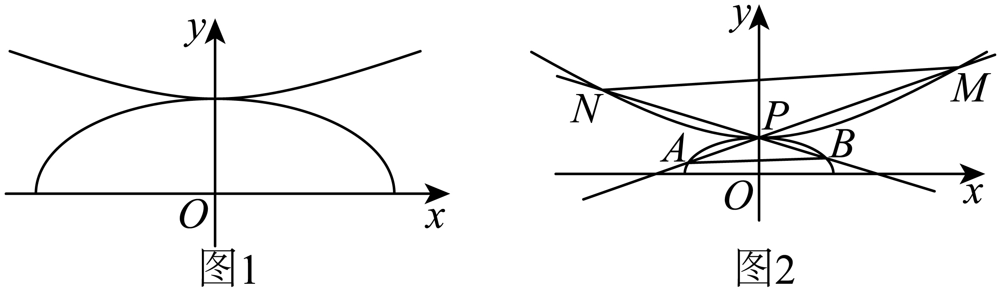

# Mathematics - 题目 2180

**ID**: 8833554c0ece4334ad0a826e1c4dc87a
**年级**: Grade 12
**难度**: Medium-Hard
**题型**: Calculation

## 题目
如图1，曲线 $Γ$ 是 $\frac {x{^{2}}}{4}+\frac {y{^{2}}}{b{^{2}}}=1\left ({y\geqslant 0}\right )$ 与 $\frac {y{^{2}}}{b{^{2}}}-\frac {x{^{2}}}{4}=1\left ({y\geqslant 0}\right )$ 组合的．（1） $\frac {x{^{2}}}{4}+\frac {y{^{2}}}{b{^{2}}}=1\left ({y\geqslant 0}\right )$ 过点 $\left ({-1,\frac {3}{2}}\right )$ ，求 $\frac {y{^{2}}}{b{^{2}}}-\frac {x{^{2}}}{4}=1\left ({y\geqslant 0}\right )$ 的渐近线方程；​​​​​​​‌（2） $b=\sqrt {2}$ ，设 $T\left ({0,t}\right )$ ， $t\in \left [-\frac {\sqrt {2}}{2},3\sqrt {2}\right ]$ ，曲线 $Γ$ 上找一个点 $Q$ ，使得 $\left |{\overrightarrow {{TQ}}}\right |$ 达到最小；（3）若 $b=1$ ，如图2，存在过点 $P(0,1)$ 的两条直线 $l{{}_{1}}$ ， $l{{}_{2}}$ 与曲线 $Γ$ 的交点分别是点 $\mathrm{A}$ 、点 $M$ 、点 $B$ 、点 $N$ ，点 $\mathrm{A}$ 在第二象限，点 $M$ 在第一象限．是否存在非零实数 $λ$ 使得 $\overrightarrow {{MN}}=λ\overrightarrow {{AB}}$ 成立，请说明理由．

## 解答

1. （1）将点 $\left ({-{{1}}{\rm{,}}\frac {{{3}}}{{{2}}}}\right )$ 代入 $\frac {x{^{2}}}{4}+\frac {y{^{2}}}{b{^{2}}}=1$ ，得 $\frac {1}{4}+\frac {9}{4b{^{2}}}=1$ ，得 $b{^{2}}=3$ ，
2. 所以 $\frac {y{^{2}}}{3}-\frac {x{^{2}}}{4}=1\left ({y\geqslant 0}\right )$ ，渐近线方程： $y=\pm \frac {\sqrt {3}}{2}x$ .
3. （2）因 $b=\sqrt {2}$ ，则 $\frac {x{^{2}}}{4}+\frac {y{^{2}}}{2}=1\left ({y\geqslant 0}\right )$ ， $\frac {y{^{2}}}{2}-\frac {x{^{2}}}{4}=1\left ({y\geqslant 0}\right )$ ，
4. ①当 $t\in \left [-\frac {\sqrt {2}}{2}，\sqrt {2}\right ]$ 时， $\left |{\overrightarrow {{QT}}}\right |$ 取到最小值时，点 $Q$ 一定在 $\frac {x{^{2}}}{4}+\frac {y{^{2}}}{2}=1\left ({y\geqslant 0}\right )$ 上，
5. 设点 $Q\left ({x,y}\right )$ ，则 $x{^{2}}=4\left ({1-\frac {y{^{2}}}{2}}\right )\left ({0\leqslant y\leqslant \sqrt {2}}\right )$ ，
6. 则 $\left |{\overrightarrow {{TQ}}}\right |=\sqrt {x{^{2}}+{\left({y-t}\right)^{2}}}=\sqrt {4-2y{^{2}}+y{^{2}}-2ty+t{^{2}}}=\sqrt {-{\left({y+t}\right)^{2}}+4+2t{^{2}}}\left ({0\leqslant y\leqslant \sqrt {2}}\right )$ ，
7. 当 $t=-\frac {\sqrt {2}}{2}$ 时，则 $y=0$ 或 $\sqrt {2}$ 时， $\left |{\overrightarrow {{QT}}}\right |$ 取最小值 $\frac {3\sqrt {2}}{2}$ ，此时 $Q\left ({\pm 2,0}\right )$ 或 $Q\left ({0,\sqrt {2}}\right )$ ，
8. 当 $-\frac {\sqrt {2}}{2}<t\leqslant \sqrt {2}$ 时，当 $y=\sqrt {2}$ 时， $\left |{\overrightarrow {{QT}}}\right |$ 取最小值 $\sqrt {2}-t$ ，此时 $Q\left ({0,\sqrt {2}}\right )$ ；
9. ②当 $t\in \left ({\sqrt {2}，3\sqrt {2}}\right ]$ 时， $\left |{\overrightarrow {{QT}}}\right |$ 取到最小值时，点 $Q$ 一定在 $\frac {y{^{2}}}{2}-\frac {x{^{2}}}{4}=1\left ({y\geqslant 0}\right )$ 上，
10. 设点 $Q\left ({x,y}\right )$ ，则 $x{^{2}}=4\left ({\frac {y{^{2}}}{2}-1}\right )\left ({y\geqslant \sqrt {2}}\right )$ ，
11. 则 $\left |{TQ}\right |=\sqrt {2y{^{2}}-4+y{^{2}}-2ty+t{^{2}}}=\sqrt {3{\left({y-\frac {t}{3}}\right)^{2}}+\frac {2}{3}t{^{2}}-4}\left ({y\geqslant \sqrt {2}}\right )$  ，
12. 因 $\sqrt {2}<t\leqslant 3\sqrt {2}$ ，则 $\frac {\sqrt {2}}{3}<\frac {t}{3}\leqslant \sqrt {2}$ ，
13. 故当 $y=\sqrt {2}$ 时，  $\left |{\overrightarrow {{QT}}}\right |$ 取最小值 $t-\sqrt {2}$ ，此时 $Q\left ({0,\sqrt {2}}\right )$ .
14. 综上可知，曲线 $Γ$ 上存在点 $Q\left ({0,\sqrt {2}}\right )$ ，使得 $\left |{\overrightarrow {{TQ}}}\right |$ 达到最小.
15. （3）设 $l{{}_{1}}:y=k{{}_{1}}x+1$ ， $l{{}_{2}}:y=k{{}_{2}}x+1$ ，
16. 设 $A\left ({x{{}_{1}},y{{}_{1}}}\right ),B\left ({x{{}_{2}},y{{}_{2}}}\right ),M\left ({x{{}_{3}},y{{}_{3}}}\right ),N\left ({x{{}_{4}},y{{}_{4}}}\right )$
17. 由 $\begin{cases}y=k{{}_{1}}x+1\\\frac {x{^{2}}}{4}+y{^{2}}=1\end{cases}$ ，得 $x{{}_{1}}=\frac {-8k{{}_{1}}}{4k{{}_{1}}{^{2}}+1}\left ({0<k{{}_{1}}<\frac {1}{2}}\right )$ ，则 $A\left ({\frac {-8k{{}_{1}}}{4k{{}_{1}}{^{2}}+1},\frac {-4k{{}_{1}}{^{2}}+1}{4k{{}_{1}}{^{2}}+1}}\right )$  ，
18. 由 $\begin{cases}y=k{{}_{2}}x+1\\\frac {x{^{2}}}{4}+y{^{2}}=1\end{cases}$  ，得 $x{{}_{2}}=\frac {-8k{{}_{2}}}{4k{{}_{2}}{^{2}}+1}\left ({-\frac {1}{2}<k{{}_{2}}<0}\right )$ ，则 $B\left ({\frac {-8k{{}_{2}}}{4k{{}_{2}}{^{2}}+1},\frac {-4k{{}_{2}}{^{2}}+1}{4k{{}_{2}}{^{2}}+1}}\right )$  ，
19. 由 $\begin{cases}y=k{{}_{1}}x+1\\y{^{2}}-\frac {x{^{2}}}{4}=1\end{cases}$ ，得 $x{{}_{3}}=\frac {-8k{{}_{1}}}{4k{{}_{1}}{^{2}}-1}\left ({0<k{{}_{1}}<\frac {1}{2}}\right )$ ，则 $M\left ({-\frac {8k{{}_{1}}}{4k{{}_{1}}{^{2}}-1},\frac {-4k{{}_{1}}{^{2}}-1}{4k{{}_{1}}{^{2}}-1}}\right )$  ，
20. 由 $\begin{cases}y=k{{}_{2}}x+1\\y{^{2}}-\frac {x{^{2}}}{4}=1\end{cases}$ ，得 $x{{}_{4}}=\frac {-8k{{}_{2}}}{4k{{}_{2}}{^{2}}-1}\left ({-\frac {1}{2}<k{{}_{2}}<0}\right )$ ，则 $N\left ({-\frac {8k{{}_{2}}}{4k{{}_{2}}{^{2}}-1},\frac {-4k{{}_{2}}{^{2}}-1}{4k{{}_{2}}{^{2}}-1}}\right )$  ，
21. 则 $k{{}_{AB}}=\frac {\frac {-4k{{}_{1}}{^{2}}+1}{4k{{}_{1}}{^{2}}+1}-\frac {-4k{{}_{2}}{^{2}}+1}{4k{{}_{2}}{^{2}}+1}}{\frac {-8k{{}_{1}}}{4k{{}_{1}}{^{2}}+1}-\frac {-8k{{}_{2}}}{4k{{}_{2}}{^{2}}+1}}=\frac {\left ({-4k{{}_{1}}{^{2}}+1}\right )\left ({4k{{}_{2}}{^{2}}+1}\right )-\left ({-4k{{}_{2}}{^{2}}+1}\right )\left ({4k{{}_{1}}{^{2}}+1}\right )}{\left ({-8k{{}_{1}}}\right )\left ({4k{{}_{2}}{^{2}}+1}\right )-\left ({-8k{{}_{2}}}\right )\left ({4k{{}_{1}}{^{2}}+1}\right )}$
22. $=\frac {k{{}_{2}^{2}}-k{{}_{1}^{2}}}{\left ({k{{}_{2}}-k{{}_{1}}}\right )\left ({1-4k{{}_{1}}k{{}_{2}}}\right )}=\frac {k{{}_{1}}+k{{}_{2}}}{1-4k{{}_{1}}k{{}_{2}}}$ ，
23. 同理可得， $k{{}_{MN}}=\frac {k{{}_{1}}+k{{}_{2}}}{1+4k{{}_{1}}k{{}_{2}}}$ ，
24. 若存在非零实数 $λ$ 使得 $\overrightarrow {{MN}}=λ\overrightarrow {{AB}}$ 成立，则 $k{{}_{AB}}=k{{}_{MN}}$ ，即 $\frac {k{{}_{1}}+k{{}_{2}}}{1-4k{{}_{1}}k{{}_{2}}}=\frac {k{{}_{1}}+k{{}_{2}}}{1+4k{{}_{1}}k{{}_{2}}}$ ，
25. 即 $k{{}_{1}}k{{}_{2}}\left ({k{{}_{1}}+k{{}_{2}}}\right )=0$ ，则 $k{{}_{1}}+k{{}_{2}}=0$ 或 $k{{}_{1}}k{{}_{2}}=0$ ，
26. 若 $k{{}_{1}}k{{}_{2}}=0$ ，则 $k{{}_{1}}=0$ 或 $k{{}_{2}}=0$ ，此时直线 $l{{}_{1}}$ 或 $l{{}_{2}}$ 的方程为 $y=1$ ，不符合题意，
27. 故当 $k{{}_{1}}+k{{}_{2}}=0$ 且 $k{{}_{1}}$ 、 $k{{}_{2}}$ 均不为零时，存在非零实数 $λ$ 使得 $\overrightarrow {{MN}}=λ\overrightarrow {{AB}}$ 成立

## 知识点

**中文**:
  - 渐近线
  - 直线的斜率公式
  - 直线与椭圆的位置关系

**English**:
  - Asymptotes
  - Slope Formula
  - Line-Ellipse Relationship

---
