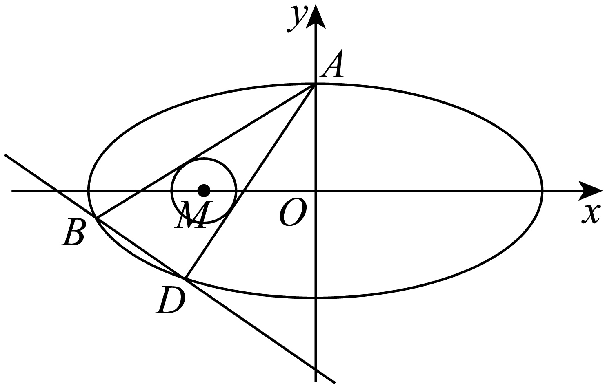

# Mathematics - 题目 2216

**ID**: 90fca30e15a0422ab7f90379b9a83c70
**年级**: Grade 12
**难度**: Medium-Hard
**题型**: Calculation

## 题目
已知分别为椭圆 $Γ:\frac {x{^{2}}}{4}+y{^{2}}=1$ 的左右焦点， $A,B$ 分别为上下顶点， $M$ 为 $Γ$ 上的点．（1）若点 $M$ 的坐标为 $\left ({1,\,m}\right )$ ，求 $△F{{}_{1}}MF{{}_{2}}$ 的面积；​​​​​​​‌（2）求 $\left |{\overrightarrow {{MA}}+3\overrightarrow {{MB}}}\right |$ 的取值范围；（3）如图，过点 $\mathrm{A}$ 作圆 $M:{\left({x+1}\right)^{2}}+y{^{2}}=r{^{2}}\left ({0<r<1}\right )$ 的两条切线分别与椭圆 $C$ 相交于点 $B,D$ （不同于点 $\mathrm{A}$ ），当 $r$ 变化时，试问直线 $BD$ 是否过某个定点？若是，求出该定点；若不是，请说明理由．

## 解答

1. （1）由题意知 $c=\sqrt {3}$ ，又 $\frac {1}{4}+m{^{2}}=1\Rightarrow m=\pm \frac {\sqrt {3}}{2}$ ，
2. 则 $△F{{}_{1}}MF{{}_{2}}$ 的面积为 $\frac {1}{2}\times 2\sqrt {3}\times \frac {\sqrt {3}}{2}=\frac {3}{2}$ ．
3. （2）设 $M\left ({x{{}_{0}},\,y{{}_{0}}}\right )$ ，则 $\frac {x{{}_{0}^{2}}}{4}+y{{}_{0}^{2}}=1\Rightarrow x{{}_{0}^{2}}=4\left ({1-y{{}_{0}^{2}}}\right )$ ，
4. 又 $A\left ({0,\,1}\right ),\,B\left ({0,\,-1}\right )$ ，则 $\overrightarrow {{MA}}+3\overrightarrow {{MB}}=\left ({-x{{}_{0}},\,1-y{{}_{0}}}\right )+3\left ({-x{{}_{0}},\,-1-y{{}_{0}}}\right )=\left ({-4x{{}_{0}},\,-2-4y{{}_{0}}}\right )$ ，
5. ∴ $\left |{\overrightarrow {{MA}}+3\overrightarrow {{MB}}}\right |=\sqrt {16x{{}_{0}^{2}}+{\left({-2-4y{{}_{0}}}\right)^{2}}}=\sqrt {64-64y{{}_{0}^{2}}+4+16y{{}_{0}}+16y{{}_{0}^{2}}}$
6. $=\sqrt {-48y{{}_{0}^{2}}+16y{{}_{0}}+68}=\sqrt {-48{\left({y{{}_{0}}-\frac {1}{6}}\right)^{2}}+\frac {208}{3}}\left ({-1\leqslant y{{}_{0}}\leqslant 1}\right )$ ，
7. 则当 $y{{}_{0}}=\frac {1}{6}$ 时，取到最大值 $\frac {4\sqrt {39}}{3}$ ，当 $y{{}_{0}}=-1$ 时，取到最小值2，
8. 则 $\left |{\overrightarrow {{MA}}+3\overrightarrow {{MB}}}\right |$ 的取值范围为 $\left [2,\,\frac {4\sqrt {39}}{3}\right ]$ ．
9. （3）设 $B\left ({x{{}_{1}},y{{}_{1}}}\right ),C\left ({x{{}_{2}},y{{}_{2}}}\right )$
10. 过点 $\mathrm{A}$ 切线方程为 $y=kx+1$ ，则 $\frac {\left |{1-k}\right |}{1+k{^{2}}}=r$ ，即 $\left ({1-r{^{2}}}\right )k{^{2}}-2k+1-r{^{2}}=0$ ，
11. 设两切线 $AB,AD$ 的斜率为 $k{{}_{1}},\,k{{}_{2}}\left ({k{{}_{1}}\ne k{{}_{2}}}\right )$ ，
12. 则 $k{{}_{1}},k{{}_{2}}$ 是上述方程的两根，∴ $k{{}_{1}}\cdot k{{}_{2}}=1$ ，
13. 由 $\begin{cases}y=k{{}_{1}}x+1\\\frac {x{^{2}}}{4}+y{^{2}}=1\end{cases}$ ，得： $\left ({1+4k{{}_{1}^{2}}}\right )x{^{2}}+8k{{}_{1}}x=0$ ，
14. ∴ $x{{}_{1}}=\frac {-8k{{}_{1}}}{1+4k{{}_{1}^{2}}},y{{}_{1}}=\frac {1-4k{{}_{1}^{2}}}{1+4k{{}_{1}^{2}}}$ ，
15. 同理可得： $x{{}_{2}}=\frac {-8k{{}_{2}}}{1+4k{{}_{2}^{2}}}=\frac {-8k{{}_{1}}}{k{{}_{1}^{2}}+4},y{{}_{2}}=\frac {1-4k{{}_{2}^{2}}}{1+4k{{}_{2}^{2}}}=\frac {k{{}_{1}^{2}}-4}{k{{}_{1}^{2}}+4}$ ，
16. ∴ $k{{}_{BD}}=\frac {\frac {k{{}_{1}^{2}}-4}{k{{}_{1}^{2}}+4}-\frac {1-k{{}_{1}^{2}}}{1+4k{{}_{1}^{2}}}}{\frac {-8k{{}_{1}}}{k{{}_{1}^{2}}+4}-\frac {-8k{{}_{1}}}{1+4k{{}_{1}^{2}}}}=-\frac {k{{}_{1}^{2}}+1}{3k{{}_{1}}}$ ，
17. 于是直线 $BD$ 方程为 $y-\frac {1-4k{{}_{1}^{2}}}{1+4k{{}_{1}^{2}}}=-\frac {k{{}_{1}^{2}}+1}{3k{{}_{1}}}\left ({x-\frac {-8k{{}_{1}}}{1+4k{{}_{1}^{2}}}}\right )$ ，
18. 令 $x=0$ ，得 $y=\frac {1-4k{{}_{1}^{2}}}{1+4k{{}_{1}^{2}}}+\frac {k{{}_{1}^{2}}+1}{3k{{}_{1}}}\times \frac {-8k{{}_{1}}}{1+4k{{}_{1}^{2}}}=\frac {-5-20k{{}_{1}^{2}}}{3\left ({1+4k{{}_{1}^{2}}}\right )}=-\frac {5}{3}$ ，
19. 故直线 $BD$ 过定点 $\left ({0,\,-\frac {5}{3}}\right )$ ．

## 知识点

**中文**:
  - 圆锥曲线与直线、圆相结合的问题
  - 弦长面积问题
  - 范围最值问题
  - 定点定值定直线问题
  - 存在性或者探究性问题

**English**:
  - Combined Problems with Lines and Circles
  - Chord Length and Area Problems
  - Range and Extrema Problems
  - Fixed Point, Value, Line Problems
  - Existence and Inquiry Problems

---
