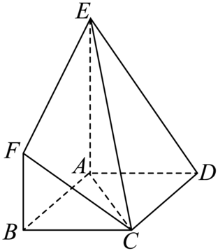

# Mathematics - 题目 1473

**ID**: a0b2cad9417648f2a2e6cf7753056d5c
**年级**: Grade 12
**难度**: Medium-Hard
**题型**: Calculation

## 题目
如图，在多面体 $ABCDEF$ 中，四边形 $ABCD$ 为菱形， $AE=2BF$ ， $BF//AE$ ， $BF$ ⊥ $AD$ ，且平面 $ACE$ ⊥平面 $ABCD$ .​​​​​​​‌(1)在DE上确定一点M，使得 $FM//$ 平面 $ABCD$ ；(2)若 $BF=BA=1$ ，且 $\angle ABC=60{}^\circ $ ，求多面体 $ABCDEF$ 的体积.

## 解答

1. （1）当M是ED的中点时，满足 $FM//$ 平面 $ABCD$ ，理由如下：
2. 取AD中点G，过点G作 $GM//AE$ 交DE于点M，则 $GM=\frac {1}{2}AE$ ，
3. 连接 $FM,BG$ ，
4. 又由题，有 $AE=2BF$ ， $BF//AE$ ，所以 $BF//GM$ ， $BF=GM$ ，
5. 即四边形 $BFGM$ 平行四边形，所以 $FM//BG$ .
6. 
7. 又 $FM\not\subset $ 平面 $ABCD$ ， $BG\subset $ 平面 $ABCD$ ，
8. 所以 $FM//$ 平面 $ABCD$ .
9. （2）取AB中点 $N$ ，连接 $CN$ ， $EC,BD$ ，
10. 由条件知 $\vartriangle ABC$ 是边长为1的正三角形，于是CN⊥AB，且 $CN=\frac {\sqrt {3}}{2}$ .
11. 因为四边形 $ABCD$ 为菱形，所以 $AC$ ⊥ $BD$ ，
12. 因为平面 $ACE$ ⊥平面 $ABCD$ ，交线为 $AC$ ，
13. 又 $BD⊂$ 平面 $ABCD$ ，所以 $BD$ ⊥平面 $ACE$ ，
14. 因为 $AE\subset $ 平面 $ACE$ ，所以 $BD$ ⊥ $AE$ ，
15. 因为 $BF//AE$ ，所以 $BD$ ⊥ $BF$ ，
16. 所以 $BF$ ⊥ $BD$ ，又BF⊥AD， $BD\cap AD=D,BD,AD\subset $ 平面 $ABCD$ ，
17. 所以 $BF$ ⊥平面 $ABCD$ ，
18. 因为 $CN\subset $ 平面 $ABCD$ ，
19. 所以 $BF$ ⊥ $CN$ ，
20. 因为 $AB\cap BF=B$ ， $AB,BF\subset $ 平面 $ABFE$ ，
21. 所以 $CN$ ⊥平面 $ABFE$ ，
22. 
23. 即CN是四棱锥C－ABFE的高..
24. 设梯形 $ABFE$ 的面积为 $S$ ，则 $S=\frac {\left ({BF+AE}\right )\cdot AB}{2}=\frac {{\rm{(}}{{1}}+{{2}}{\rm{)}}\times {{1}}}{2}=\frac {{{3}}}{2}$ ，
25. $\therefore V{{}_{C-ABFE}}=\frac {1}{3}S\cdot CN=\frac {1}{3}\times \frac {{{3}}}{2}\times \frac {\sqrt {3}}{2}=\frac {\sqrt {3}}{4}$ ，
26. 同理可知C点到平面ADE的距离也等于 $\frac {\sqrt {3}}{2}$ ，
27. 于是 $V{{}_{C-ADE}}=\frac {1}{3}S{{}_{\vartriangle ADE}}\times \frac {\sqrt {3}}{2}=\frac {1}{3}\times (\frac {{{1}}}{2}\times 2\times 1)\times \frac {\sqrt {3}}{2}=\frac {\sqrt {3}}{6}$ .
28. 于是多面体ABCDEF的体积 $V=V{{}_{C-ADE}}+V{{}_{C-ABFE}}=\frac {\sqrt {3}}{6}+\frac {\sqrt {3}}{4}=\frac {{{5}}\sqrt {3}}{{{1}}{{2}}}$ .

## 知识点

**中文**:
  - 直线与平面平行的判定
  - 简单组合体的表面积与体积

**English**:
  - Line-Plane Parallelism Determination
  - Area and Volume of Composite Solids

---
