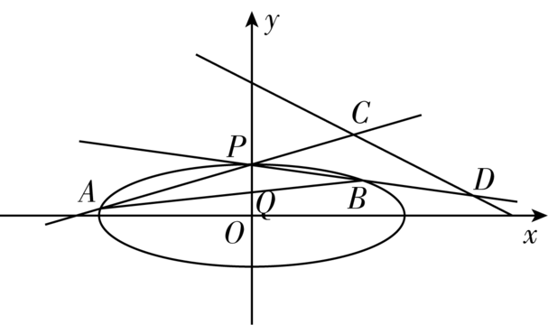

# Mathematics - 题目 1006

**ID**: a36a06d5f93f41789ec0d528706ec5fb
**年级**: Grade 12
**难度**: Medium-Hard
**题型**: 证明过程或演算步骤)

## 题目
(本小题满分15分)如图，已知椭圆 $\frac{{x}^{2}}{12}$ ＋y^{2}＝1.​​​​​​​‌设A，B是椭圆上异于P(0，1)的两点，且点Q $\begin{pmatrix}0,\frac{1}{2}\end{pmatrix}$ 在线段AB上，直线PA，PB分别交直线y＝－ $\frac{1}{2}$ x＋3于C，D两点．(1)求点P到椭圆上点的距离的最大值；(2)求|CD|的最小值．

## 解答

1. (1)设E(x，y)为椭圆上任意一点，则
2. |PE|＝ $\sqrt{{x}^{2}+{\left(y-1\right)^{2}}}$ ＝ $\sqrt{-11{y}^{2}-2y+13}$ ＝
3. $\sqrt{-11{\begin{pmatrix}y+\frac{1}{11}\end{pmatrix}}^{2}+\frac{144}{11}}$ ，
4. 因此，当E点坐标为 $\begin{pmatrix}±\frac{12\sqrt{10}}{11},-\frac{1}{11}\end{pmatrix}$ 时，|PE|取到最大值 $\frac{12\sqrt{11}}{11}$ .
5. (2)由题意，设AB的直线方程为y＝kx＋ $\frac{1}{2}$ ，A(x_{1}，y_{1})，B(x_{2}，y_{2})，
6. 由AB的直线方程与椭圆方程联立得
7. $\begin{cases}y=kx+\frac{1}{2},\\{x}^{2}+12{y}^{2}=12,\end{cases}$ 则(1＋12k^{2})x^{2}＋12kx－9＝0，
8. 从而x_{1}＋x_{2}＝ $\frac{-12k}{1+12{k}^{2}}$ ，x_{1}x_{2}＝ $\frac{-9}{1+12{k}^{2}}$ .
9. 设C(x_{C}，y_{C})，D(x_{D}，y_{D})，由PA与CD的直线方程联立得
10. $\begin{cases}y-1=\frac{{y}_{1}-1}{{x}_{1}}x,\\y=-\frac{1}{2}x+3,\end{cases}$ 解得x_{C}＝ $\frac{4{x}_{1}}{(2k+1){x}_{1}-1}$ .
11. 同理x_{D}＝ $\frac{4{x}_{2}}{(2k+1){x}_{2}-1}$ .
12. 那么，|CD|＝ $\sqrt{1+\frac{1}{4}}$ |x_{C}－x_{D}|
13. ＝2  $\sqrt{5}\begin{vmatrix}\frac{{x}_{2}-{x}_{1}}{{\left(2k+1\right)}^{2}{x}_{1}{x}_{2}-\left(2k+1\right)\left({x}_{1}+{x}_{2}\right)+1}\end{vmatrix}$
14. ＝ $\frac{3\sqrt{5}}{2}$   $\frac{\sqrt{16{k}^{2}+1}}{|3k+1|}$ .
15. 当k＝－ $\frac{1}{3}$ 时，PA∥CD或PB∥CD，不符合题意．
16. 令3k＋1＝t，则|CD|＝ $\frac{3\sqrt{5}}{2}$   $\sqrt{\frac{25}{9}{\begin{pmatrix}\frac{1}{t}-\frac{16}{25}\end{pmatrix}}^{2}+\frac{16}{25}}$ .
17. 因此，当k＝ $\frac{3}{16}$ 时，|CD|取得最小值，且最小值为 $\frac{6\sqrt{5}}{5}$ .
18. 

## 知识点

**中文**:
  - 直线与椭圆的位置关系
  - 范围最值问题

**English**:
  - Line-Ellipse Relationship
  - Range and Extrema Problems

---
