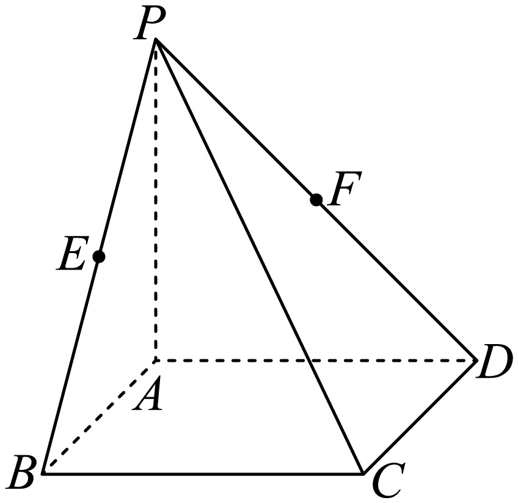

# Mathematics - 题目 3161

**ID**: b36ab7501f4a41bd8265f99568c766b4
**年级**: Grade 12
**难度**: Medium-Hard
**题型**: Calculation

## 题目
如图，在四棱锥 $P-ABCD$ 中， $CD\bot $ 平面 ${\rm \mathit{PAD}，}PA\bot AD$ ．（1）证明： $PA\bot $ 平面ABCD；​​​​​​​‌（2）若底面ABCD是正方形， $AP=AB=2{\rm ，\mathit{E}}$ 为PB中点，点F在棱PD上，且异面直线AF与PB所成的角为60°．（ⅰ）求 $PF$ 的长度；（ⅱ）平面AEF交PC于点G，点M在线段PB上，求EG与平面 $MAD$ 所成角的正弦值的取值范围．

## 解答

1. （1）证明：因为 $CD\bot $ 平面 $PAD$ ， $PA\subset $ 平面PAD，
2. 所以 $CD\bot PA$ ，
3. 又因为 $PA\bot AD,AD\subset $ 平面 ${\rm \mathit{ABCD}，}CD\subset $ 平面 ${\rm \mathit{ABCD}，}AD\cap CD=D$ ，
4. 所以 $PA\bot $ 平面ABCD．
5. （2）（i）由（1）可知 $PA\bot $ 平面ABCD，所以AB，AD，AP两两垂直，
6. 故以A为原点，以AB，AD，AP所在直线分别为x轴，y轴，z轴，
7. 建立如图所示的空间直角坐标系，
8. 
9. 依题意可得 $A\left ({0,0,0}\right ),B\left ({2,0,0}\right ),D\left ({0,2,0}\right ),P\left ({0,0,2}\right ),E\left ({1,0,1}\right )$ ，
10. 所以 $\overrightarrow {{AE}}=\left ({1,0,1}\right ),\overrightarrow {{PD}}=\left ({0,2,-2}\right ),\overrightarrow {{PB}}=\left ({2,0,-2}\right )$ ，
11. 设 $\overrightarrow {{PF}}=λ\overrightarrow {{PD}}=\left ({0,2λ,-2λ}\right )\left ({0\leqslant λ\leqslant 1}\right )$ ，
12. 则 $\overrightarrow {{AF}}=\overrightarrow {{AP}}+\overrightarrow {{PF}}=\left ({0,2λ,2-2λ}\right )$ ，
13. 因为异面直线AF与PB所成角为60°，
14. 所以 ${\cos}60{}\degree =\left |{{\cos}\left \langle {\overrightarrow {{AF}},\overrightarrow {{PB}}}\right \rangle }\right |=\frac {\left |{\overrightarrow {{AF}}\cdot \overrightarrow {{PB}}}\right |}{\left |{\overrightarrow {{AF}}}\right |\left |{\overrightarrow {{PB}}}\right |}=\frac {\left |{4λ-4}\right |}{\sqrt {4λ{^{2}}+4{\left({λ-1}\right)^{2}}}\times 2\sqrt {2}}=\frac {1}{2}$ ，
15. 解得 $λ=\frac {1}{2}$ ，所以 $PF=\frac {1}{2}PD=\sqrt {2}$ ．
16. （ⅱ）设 $\overrightarrow {{PG}}=μ\overrightarrow {{PC}}\left ({0\leqslant μ\leqslant 1}\right )$ ，
17. 则 $\overrightarrow {{AG}}=\overrightarrow {{AP}}+\overrightarrow {{PG}}=\overrightarrow {{AP}}+μ\overrightarrow {{PC}}=\left ({0,0,2}\right )+μ\left ({2,2,-2}\right )=\left ({2μ,2μ,2-2μ}\right )$ ，
18. $\overrightarrow {{AE}}=\left ({1,0,1}\right ),\overrightarrow {{AF}}=\left ({0,1,1}\right )$ ，
19. 设平面AEF的法向量为 $\overrightarrow n=\left ({x,y,z}\right )$ ，则 $\begin{cases}\overrightarrow n\cdot \overrightarrow {{AE}}=0\\\overrightarrow n\cdot \overrightarrow {{AF}}=0\end{cases}$ ，即 $\begin{cases}x+z=0\\y+z=0\end{cases}$ ，
20. 取 $x=-1,y=-1,z=1$ ，得 $\overrightarrow n=\left ({-1,-1,1}\right )$ ，
21. 因为 $\overrightarrow {{n}}\bot \overrightarrow {{AG}}$ ，所以 $\overrightarrow {{n}}\cdot \overrightarrow {{AG}}=0$ ，即 $-2μ-2μ+\left ({2-2μ}\right )=0$ ，解得 $μ=\frac {1}{3}$ ，
22. 所以 $G\left ({\frac {2}{3},\frac {2}{3},\frac {4}{3}}\right )$ ，所以 $\overrightarrow {{EG}}=\left ({-\frac {1}{3},\frac {2}{3},\frac {1}{3}}\right )$ ，
23. 因为M在线段PB上，所以 $\overrightarrow {{PM}}=t\overrightarrow {{PB}}=\left ({2t,0,-2t}\right )\left ({0\leqslant t\leqslant 1}\right )$ ，
24. 则 $M\left ({2t,0,2-2t}\right ),\overrightarrow {{AD}}=\left ({0,2,0}\right ),\overrightarrow {{AM}}=\left ({2t,0,2-2t}\right )$ ，
25. 设平面MAD的法向量 $\overrightarrow m=\left ({x{{}_{1}},y{{}_{1}},z{{}_{1}}}\right )$ ，则 $\begin{cases}\overrightarrow m\cdot \overrightarrow {{AD}}=0\\\overrightarrow m\cdot \overrightarrow {{AM}}=0\end{cases}$ ，即 $\begin{cases}y{{}_{1}}=0\\tx{{}_{1}}+\left ({1-t}\right )z{{}_{1}}=0\end{cases}$ ，
26. 取 $x{{}_{1}}=t-1,y{{}_{1}}=0,z{{}_{1}}=t$ ，得 $\overrightarrow m=\left ({t-1,0,t}\right )$ ，
27. 设EG与平面MAD所成角为 $θ$ ，
28. 则 $\sin θ=\left |{{\cos}\left \langle {\overrightarrow {{EG}},\overrightarrow m}\right \rangle }\right |=\frac {\left |{\overrightarrow {{EG}}\cdot \overrightarrow m}\right |}{\left |{\overrightarrow {{EG}}}\right |\left |{\overrightarrow m}\right |}=\frac {\left |{\left ({-\frac {1}{3}}\right )\left ({t-1}\right )+\frac {1}{3}t}\right |}{\frac {\sqrt {6}}{3}\times \sqrt {{\left({t-1}\right)^{2}}+t{^{2}}}}=\frac {1}{\sqrt {6}\times \sqrt {2t{^{2}}-2t+1}}=\frac {1}{2\sqrt {3}\times \sqrt {{\left({t-\frac {1}{2}}\right)^{2}}+\frac {1}{4}}}$ ，
29. 因为 $t\in \left [0,1\right ]$ ，所以 ${\left({t-\frac {1}{2}}\right)^{2}}+\frac {1}{4}\in \left [\frac {1}{4},\frac {1}{2}\right ]$ ，所以 $\sin θ\in \left [\frac {\sqrt {6}}{6},\frac {\sqrt {3}}{3}\right ]$ ，
30. 即EG与平面MAD所成角的正弦值的取值范围为 $\left [\frac {\sqrt {6}}{6},\frac {\sqrt {3}}{3}\right ]$ .

## 知识点

**中文**:
  - 向量法求异面直线所成角
  - 直线与平面垂直的判定
  - 向量法求线面角

**English**:
  - Angle between Skew Lines
  - Line-Plane Perpendicularity Determination
  - Line-Plane Angle

---
