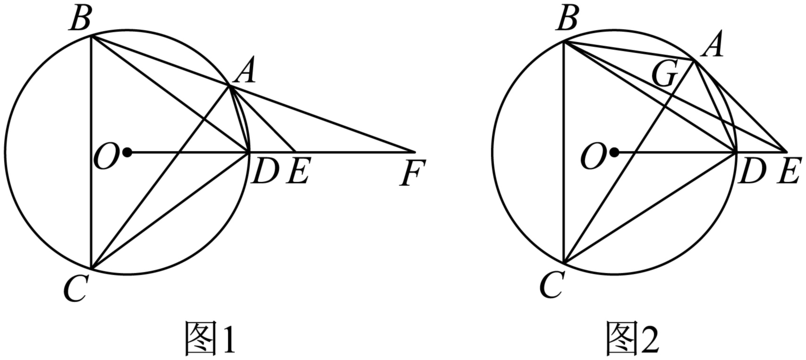

# Mathematics - 题目 1327

**ID**: b76cb85d864f48b199d88af1d5a4b3ad
**年级**: Grade 12
**难度**: Medium-Hard
**题型**: Calculation

## 题目
如图，四边形 $ABCD$ 内接于 $\odot O$ ， $D$ 是 $\overset{\frown}{{BAC}}$ 的中点， $\angle ACB=\angle ODC$ ， $OD$ 的延长线上有一点 $E$ ， $\angle AEO=45{}\degree $ ，连结 $AC$ ， $BD$ .​​​​​​​‌(1)证明： $AC⊥BD$ ；(2)如图1，设 $BA$ ， $OD$ 的延长线交于点 $F$ ，若 $AE$ 平分 $\angle DAF$ ，证明： $AC=AF$ ；(3)如图2，连结 $BE$ 交 $CA$ 于点 $G$ ，若 $AD+BC=2OE$ ，求 $\frac {BG}{GE}$ .

## 解答

1. （1）延长 $DO$ 交 $BC$ 于 $R$ ， $D$ 是 $\overset{\frown}{{BAC}}$ 的中点，根据圆的对称性知道，
2. $\angle ACB=\angle ODC=90\degree -\angle BCD=90\degree -\angle CBD=90\degree -\angle CAD$ ，则 $\angle ACB+\angle CBD=90\degree $ ，根据三角形内角和及垂直定义，可知 $AC⊥BD$ .
3. （2）
4. 
5. 设 $\angle DAE=x$ ，则 $∠DAF=180{}\degree -∠BAD=∠BCD=∠CAD=∠CBD=2x$ ，
6. 前面已经证明 $AC⊥BD$ ，所以 $∠ADB=90{}\degree -∠CAD=90{}\degree -2x$ ,
7. $∠ODB=90{}\degree -∠CBD=90{}\degree -2x$ ,
8. 则 $∠ADO=∠ADB+∠ODB=180{}\degree -4x$ ，
9. 又 $∠ADO=∠AED+∠DAE=45{}\degree +x$ ，
10. 故 $45{}\degree +x=180{}\degree -4x$ ， $x=27{}\degree $ ， $∠ACD=∠BCD-∠ACB=∠BCD-∠ADB=2x-(90{}\degree -2x)=18{}\degree $ ，
11. $∠F=∠AED-∠EAF=45{}\degree -x=18{}\degree =∠ACD$ ，
12. 所以 $\vartriangle ADF≌\vartriangle ADC\left ({{\rm{A}}{\rm{A}}{\rm{S}}}\right )$ ，
13. 所以 $AC=AF$ .
14. （3）设 $AD+BC=2OE=2a$ ，设 $AD=m$ ， $OD=1$ ，
15. 如图，延长 $AD$ 到点 $N$ ，延长 $DO$ 与圆 $O$ 交于 $M$ ，使 $AM=AN$ .由 $∠ANM=∠AEM$ 得到 $\mathrm{A}$ ， $E$ ， $M$ ， $N$ 四点共圆，
16. 
17. 相交弦定理： $DA\cdot DN=DE\cdot DM\Rightarrow m\left ({2a-2m}\right )=\left ({a-1}\right )2$ ，
18. 这即 $2m\left ({a-m}\right )=2\left ({a-1}\right )$ ，得到 $m=1$ ，
19. ∴ $\angle ADM=30{}\degree $ ，故 $AB//ME$ ，故 $\frac {BG}{GE}=\frac {AB}{OE}=\sqrt {3}-1$ .

## 知识点

**中文**:
  - 图形的性质

**English**:
  - Properties of Geometric Figures

---
