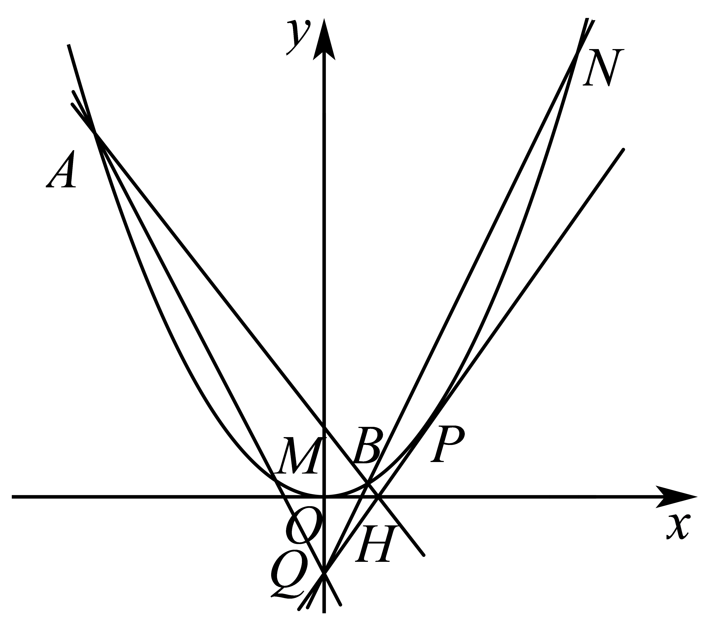

# Mathematics - 题目 2685

**ID**: c1c58631e9254a6dac087870e7c5df15
**年级**: Grade 12
**难度**: Medium-Hard
**题型**: Calculation

## 题目
已知抛物线 $C:x{^{2}}=2py\left ({0<p<1}\right )$ 的焦点为 $F$ ，点 $P\left ({1,m}\right )$ 在抛物线 $C$ 上，且 $\left |{PF}\right |=\frac {5}{4}$ ．(1)求实数 $m$ 的值及抛物线 $C$ 的标准方程；​​​​​​​‌(2)如图，过点 $P$ 的直线 $l$ 交 $y$ 轴于点 $Q$ ，点 $H$ 在线段 $PQ$ 上，过点 $H$ 的直线交抛物线 $C$ 于不同两点 $A,B$ （点 $A,B$ 异于点 $P$ ），直线 $AQ,BQ$ 分别交抛物线 $C$ 于不同的两点 $M,N$ ．从下面①②③中选取两个作为条件，证明另外一个成立．① $H$ 为 $PQ$ 的中点；②直线 $l$ 为抛物线 $C$ 的切线；③ $PQ$∥$MN$ ．

## 解答

1. （1）由题意可知， $\left |{PF}\right |=\frac {5}{4}=m+\frac {p}{2}$ ，
2. 又因为点 $P\left ({1,m}\right )$ 在抛物线 $C$ 上，则 $2pm=1$ ，
3. 解得， $p=\frac {1}{2},m=1$ 或 $p=2,m=\frac {1}{4}$ ，因为 $0<p<1$ ，
4. 所以 $p=\frac {1}{2},m=1$ ，
5. 则实数 $m$ 的值为 $1$ ，抛物线方程为 $x{^{2}}=y$ .
6. （2）选①②证明③.
7. 由（1）知，抛物线的方程为 $x{^{2}}=y$ ，则 $y^{′}=2x$ ，
8. 所以抛物线过点 $P(1,1)$ 的切线 $l$ 的方程为 $y=2x-1$ ，则 $Q(0,-1),H(\frac {1}{2},0)$ ，
9. 根据题意可知，过点 $H(\frac {1}{2},0)$ 的直线的斜率存在且不为零，
10. 设其方程为 $y=k(x-\frac {1}{2})$ ， $A(x{{}_{1}},y{{}_{1}}),B(x{{}_{2}},y{{}_{2}})$ ，
11. 联立方程组 $\left \{\hspace{-0.5em}\begin{array}{l}y=k(x-\frac {1}{2})\\x{^{2}}=y\end{array}\hspace{-0.5em}\right.$ ，整理可得 $x{^{2}}-kx+\frac {k}{2}=0$ ，
12. 则 $\Delta =k{^{2}}-2k>0$ ，可得 $k>2$ 或 $k<0$ ，所以 $x{{}_{1}}+x{{}_{2}}=k,x{{}_{1}}x{{}_{2}}=\frac {k}{2}$ ，
13. 则 $AQ$ 所在直线方程为 $y=\frac {y{{}_{1}}+1}{x{{}_{1}}}x-1$ ， $BQ$ 所在直线方程为 $y=\frac {y{{}_{2}}+1}{x{{}_{2}}}x-1$ ，
14. 设 $M(x{{}_{3}},y{{}_{3}})$ ， $N(x{{}_{4}},y{{}_{4}})$ ,
15. 联立 $\left \{\hspace{-0.5em}\begin{array}{l}y=\frac {y{{}_{1}}+1}{x{{}_{1}}}x-1\\x{^{2}}=y\end{array}\hspace{-0.5em}\right.$ ，整理可得 $x{^{2}}-\frac {y{{}_{1}}+1}{x{{}_{1}}}x+1=0$ ，
16. $x{{}_{1}}+x{{}_{3}}=\frac {y{{}_{1}}+1}{x{{}_{1}}}x$ ， $x{{}_{1}}x{{}_{3}}=1$ ，则 $x{{}_{3}}=\frac {1}{x{{}_{1}}}$ ， $y{{}_{3}}=\frac {y{{}_{1}}+1}{x{{}_{1}^{2}}}-1$ ，则 $M(\frac {1}{x{{}_{1}}},\frac {y{{}_{1}}+1}{x{{}_{1}^{2}}}-1)$ ，
17. 同理 $N(\frac {1}{x{{}_{2}}},\frac {y{{}_{2}}+1}{x{{}_{2}^{2}}}-1)$ ,
18. 则 $k{{}_{MN}}=\frac {\frac {y{{}_{2}}+1}{x{{}_{2}^{2}}}-1-\frac {y{{}_{1}}+1}{x{{}_{1}^{2}}}+1}{\frac {1}{x{{}_{2}}}-\frac {1}{x{{}_{1}}}}=\frac {\frac {y{{}_{2}}+1}{x{{}_{2}^{2}}}-\frac {y{{}_{1}}+1}{x{{}_{1}^{2}}}}{\frac {x{{}_{1}}-x{{}_{2}}}{x{{}_{2}}x{{}_{1}}}}=\frac {\frac {x{{}_{1}^{2}}(y{{}_{2}}+1)-x{{}_{2}^{2}}(y{{}_{1}}+1)}{x{{}_{1}^{2}}x{{}_{2}^{2}}}}{\frac {x{{}_{1}}-x{{}_{2}}}{x{{}_{2}}x{{}_{1}}}}$
19. $=\frac {x{{}_{1}^{2}}[k(x{{}_{2}}-\frac {1}{2})+1]-x{{}_{2}^{2}}[k(x{{}_{1}}-\frac {1}{2})+1]}{x{{}_{2}}x{{}_{1}}(x{{}_{1}}-x{{}_{2}})}$
20. $=\frac {kx{{}_{1}}x{{}_{2}}(x{{}_{1}}-x{{}_{2}})-(\frac {k}{2}-1)(x{{}_{1}}-x{{}_{2}})(x{{}_{1}}+x{{}_{2}})}{x{{}_{1}}x{{}_{2}}(x{{}_{1}}-x{{}_{2}})}$
21. $=\frac {kx{{}_{1}}x{{}_{2}}-(\frac {k}{2}-1)(x{{}_{1}}+x{{}_{2}})}{x{{}_{1}}x{{}_{2}}}=k-\frac {(\frac {k}{2}-1)\times k}{\frac {k}{2}}=2=k{{}_{PQ}}$ ，
22. 所以 $PQ//MN$ .
23. 若选①③证明②，设直线 $PQ$ 的方程为： $y=k(x-1)+1$ ，令 $x=0$ 可得 $y=1-k$ ，
24. 则 $Q(0,1-k)$ ，因为 $P(1,1)$ ， $H$ 为 $PQ$ 的中点，所以 $H(\frac {1}{2},\frac {2-k}{2})$ ，
25. 由题意知，直线 $AB$ 的斜率存在且不为零，
26. 设过点 $H$ 的直线 $AB$ 的方程为： $y=t(x-\frac {1}{2})+\frac {2-k}{2}(t\ne k)$ ， $A(x{{}_{A}},y{{}_{A}}),B(x{{}_{B}},y{{}_{B}})$ ,
27. 联立方程组 $\left \{\hspace{-0.5em}\begin{array}{l}y=t(x-\frac {1}{2})+\frac {2-k}{2}\\y=x{^{2}}\end{array}\hspace{-0.5em}\right.$ ，整理可得 $x{^{2}}-tx+\frac {t}{2}-\frac {2-k}{2}=0$ ，
28. 则 $x{{}_{A}}+x{{}_{B}}=t$ ， $x{{}_{A}}x{{}_{B}}=\frac {t-2+k}{2}$ ，
29. 设 $AQ$ 所在直线方程为： $y=\frac {y{{}_{A}}-1+k}{x{{}_{A}}}x+1-k=\frac {t(x{{}_{A}}-\frac {1}{2})+\frac {k}{2}}{x{{}_{A}}}x+1-k$ ， $M(x{{}_{M}},y{{}_{M}})$
30. 联立 $\left \{\hspace{-0.5em}\begin{array}{l}y=\frac {t(x{{}_{A}}-\frac {1}{2})+\frac {k}{2}}{x{{}_{A}}}x+1-k\\y=x{^{2}}\end{array}\hspace{-0.5em}\right.$ ，整理可得 $x{^{2}}-\frac {t(x{{}_{A}}-\frac {1}{2})+\frac {k}{2}}{x{{}_{A}}}x+k-1=0$ ，
31. 则 $x{{}_{A}}\cdot x{{}_{M}}=k-1$ ， $x{{}_{M}}=\frac {k-1}{x{{}_{A}}}$ , $y{{}_{M}}=\frac {(k-1)t(x{{}_{A}}-\frac {1}{2})+\frac {k}{2}(k-1)}{x{{}_{A}^{2}}}+1-k$ ，
32. 同理可得， $x{{}_{N}}=\frac {k-1}{x{{}_{B}}}$ , $y{{}_{M}}=\frac {(k-1)t(x{{}_{B}}-\frac {1}{2})+\frac {k}{2}(k-1)}{x{{}_{B}^{2}}}+1-k$ ，
33. 所以 $k{{}_{MN}}=\frac {y{{}_{M}}-y{{}_{N}}}{x{{}_{M}}-x{{}_{N}}}=\frac {\frac {(k-1)t(x{{}_{A}}-\frac {1}{2})+\frac {k}{2}(k-1)}{x{{}_{A}^{2}}}-\frac {(k-1)t(x{{}_{B}}-\frac {1}{2})+\frac {k}{2}(k-1)}{x{{}_{B}^{2}}}}{\frac {k-1}{x{{}_{A}}}-\frac {k-1}{x{{}_{B}}}}$
34. $=\frac {(k-1)tx{{}_{A}}x{{}_{B}^{2}}-\frac {(k-1)}{2}tx{{}_{B}^{2}}+\frac {k}{2}(k-1)x{{}_{B}^{2}}-(k-1)tx{{}_{A}^{2}}x{{}_{B}}+\frac {(k-1)}{2}tx{{}_{A}^{2}}-\frac {k}{2}(k-1)x{{}_{A}^{2}}}{(k-1)x{{}_{A}}x{{}_{B}}(x{{}_{B}}-x{{}_{A}})}$
35. $=\frac {(k-1)tx{{}_{A}}x{{}_{B}}(x{{}_{B}}-x{{}_{A}})+\frac {k-t}{2}(k-1)(x{{}_{B}^{2}}-x{{}_{A}^{2}})}{(k-1)x{{}_{A}}x{{}_{B}}(x{{}_{B}}-x{{}_{A}})}$
36. $=t+\frac {\frac {k-t}{2}(x{{}_{B}}+x{{}_{A}})}{x{{}_{A}}x{{}_{B}}}=t+\frac {(k-t)t}{t-2+k}$ ，
37. 因为 $PQ//MN$ ，所以 $k{{}_{MN}}=k{{}_{PQ}}=k$ ，
38. 则有 $t+\frac {(k-t)t}{t-2+k}=k$ ，整理可得 $(k-t)(k-2)=0$ ，由题意知， $k\ne t$ ，
39. 解得， $k=2$ ，所以直线 $PQ$ 的直线方程为 $y=2x-1$ ，
40. 与抛物线方程联立可得， $x{^{2}}-2x+1=0$ ， $\Delta =4-4=0$ ，
41. 则直线 $l$ 为抛物线 $C$ 的切线.
42. 若选②③证明①
43. 因为直线 $l$ 为抛物线 $C$ 的切线，则 $y^{′}=2x$ ，
44. 所以抛物线过点 $P(1,1)$ 的切线 $l$ 的方程为 $y=2x-1$ ，则 $Q(0,-1)$ ，
45. 设点 $H(m,t)$ ，根据题意可知，过点 $H(m,t)$ 的直线的斜率存在且不为零，
46. 设其方程为 $y=k(x-m)+t$ ， $A(x{{}_{A}},y{{}_{A}}),B(x{{}_{B}},y{{}_{B}})$ ，
47. 联立方程组 $\left \{\hspace{-0.5em}\begin{array}{l}y=k(x-m)+t\\y=x{^{2}}\end{array}\hspace{-0.5em}\right.$ ，整理可得 $x{^{2}}-kx+km-t=0$ ，
48. 则有 $x{{}_{A}}+x{{}_{B}}=k$ ， $x{{}_{A}}x{{}_{B}}=km-t$ ，
49. 设 $AQ$ 所在直线方程为： $y=\frac {y{{}_{A}}+1}{x{{}_{A}}}x-1=\frac {k(x{{}_{A}}-m)+t}{x{{}_{A}}}x-1$ ， $M(x{{}_{M}},y{{}_{M}})$
50. 联立 $\left \{\hspace{-0.5em}\begin{array}{l}y=\frac {k(x{{}_{A}}-m)+t}{x{{}_{A}}}x-1\\y=x{^{2}}\end{array}\hspace{-0.5em}\right.$ ，整理可得 $x{^{2}}-\frac {k(x{{}_{A}}-m)+t}{x{{}_{A}}}x+1=0$ ，
51. 则 $x{{}_{A}}\cdot x{{}_{M}}=1$ ， $x{{}_{M}}=\frac {1}{x{{}_{A}}}$ , $y{{}_{M}}=\frac {k(x{{}_{A}}-m)+t+1}{x{{}_{A}^{2}}}-1$ ，
52. 同理可得， $x{{}_{N}}=\frac {1}{x{{}_{B}}}$ , $y{{}_{N}}=\frac {k(x{{}_{B}}-m)+t+1}{x{{}_{B}^{2}}}-1$ ，
53. 所以 $k{{}_{MN}}=\frac {y{{}_{M}}-y{{}_{N}}}{x{{}_{M}}-x{{}_{N}}}=\frac {\frac {k(x{{}_{A}}-m)+t+1}{x{{}_{A}^{2}}}-1-\frac {k(x{{}_{B}}-m)+t+1}{x{{}_{B}^{2}}}+1}{\frac {1}{x{{}_{A}}}-\frac {1}{x{{}_{B}}}}$
54. $=\frac {kx{{}_{A}}x{{}_{B}}(x{{}_{B}}-x{{}_{A}})+(t+1-km)(x{{}_{B}^{2}}-x{{}_{A}^{2}})}{x{{}_{A}}x{{}_{B}}(x{{}_{B}}-x{{}_{A}})}$
55. $=k+\frac {(t+1-km)(x{{}_{B}}+x{{}_{A}})}{x{{}_{B}}x{{}_{A}}}=k+\frac {(t+1-km)k}{km-t}$ ，
56. 因为 $PQ//MN$ ，所以 $k{{}_{MN}}=k{{}_{PQ}}=2$ ，
57. 则有 $k+\frac {(t+1-km)k}{km-t}=2$ ，整理可得 $k(2m-1)-2t=0$ ，
58. 由题意知 $\left \{\hspace{-0.5em}\begin{array}{l}2m-1=0\\2t=0\end{array}\hspace{-0.5em}\right.$ ，解得 $\left \{\hspace{-0.5em}\begin{array}{l}m=\frac {1}{2}\\t=0\end{array}\hspace{-0.5em}\right.$ ，所以 $H(\frac {1}{2},0)$ ，
59. 又因为 $P(1,1),Q(0,-1)$ ，所以 $H$ 为 $PQ$ 的中点.

## 知识点

**中文**:
  - 由抛物线的几何性质求方程
  - 直线的斜率公式
  - 直线与抛物线的位置关系

**English**:
  - Finding Equation from Properties
  - Slope Formula
  - Line-Parabola Relationship

---
