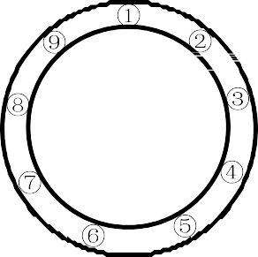

# Mathematics - 题目 1851

**ID**: c70cd0660c4d431896e45f6ac275cde6
**年级**: Grade 12
**难度**: Medium-Hard
**题型**: Calculation

## 题目
向日葵是菊科向日葵属的一年生草本植物．因花序随太阳转动而得名，深受人们喜欢，某向日葵基地为促进该基地旅游业发展，特邀请一文旅公司制作文旅创收方案．（1）公司调查发现该基地成熟向日葵花盘直径 $d$ （单位：cm）近似服从正态分布 $N(24,9)$ ．试估计一游客在该基地任摘一颗成熟向日葵，其花盘直径在 $[21,30]$ 的概率；（2）该公司特设置一游戏，根据游戏结果对游客全程所有消费进行打折，该游戏有两种方案，游客在这两种方案中任选一种参加游戏．方案一：不透明袋子里装有2个红球，4个白球，顾客从中一次性摸出3个球，若摸出2个红球1个白球获得“六折优惠”，若摸出1个红球2个白球获得“八折优惠”，若摸出3个白球不优惠．方案二：如图游客开始站在①位置，游客每掷一次骰子，就沿顺时针方向移动一次．若掷出正面朝上数字为奇数，游客就向前移动1格；若掷出正面朝上数字为偶数，游客就向前移动2格．游客重复掷骰子直到游客第一次到达⑨位置获得“九折优惠”或第2次到达①位置获得“七点五折优惠”游戏结束．若想要获得最大优惠，游客应选哪个方案？说明理由．参考数据：若 $X\sim N\left ({μ,σ{^{2}}}\right )$ ，则 $P(μ-σ\leqslant X\leqslant μ+σ)=0.​​​​​​​‌6827$ ． $P(μ-2σ\leqslant X\leqslant μ+2σ)=0.9545$ ．

## 解答

1. （1） $\because $  $d\sim N(24,9)$ ，则 $μ=24$ ， $σ=3$ ，结合正态分布的性质： $P(μ-σ\leqslant X\leqslant μ+σ)=0.6827$ 和  $P(μ-2σ\leqslant X\leqslant μ+2σ)=0.9545$
2. $\therefore $  $\begin{matrix}P(21\leqslant d\leqslant 30)=P(24-3\leqslant d-μ\leqslant 24+6)\\=P(μ-σ\leqslant d\leqslant μ+2σ)=\frac {1}{2}P(μ-σ\leqslant d\leqslant μ+σ)+\frac {1}{2}P(μ-2σ\leqslant d\leqslant μ+2σ)\\=\frac {0.6827+0.9545}{2}=0.8186\end{matrix}$ ．
3. 即一游客在该基地任摘一颗成熟向日葵，其花盘直径在 $[21,30]$ 的概率为0．8186．
4. （2）设方案一的折扣为 $X$ ，则 $X$ 可以取 $60\%$ ， $80\%$ ， $100\%$ ，
5. $P\left ({X=60{\rm{\%}}}\right )=\frac {{\rm{C}}{{}_{2}^{2}}{\rm{C}}{{}_{4}^{1}}}{{\rm{C}}{{}_{6}^{3}}}=\frac {1}{5}$ ， $P\left ({X=80{\rm{\%}}}\right )=\frac {{\rm{C}}{{}_{2}^{1}}{\rm{C}}{{}_{4}^{2}}}{{\rm{C}}{{}_{6}^{3}}}=\frac {3}{5}$ ， $P\left ({X=100{\rm{\%}}}\right )=\frac {{\rm{C}}{{}_{4}^{3}}}{{\rm{C}}{{}_{6}^{3}}}=\frac {1}{5}$ ，
6. $\therefore $  $E(X)=\frac {60}{100}\times \frac {1}{5}+\frac {80}{100}\times \frac {3}{5}+1\times \frac {1}{5}=0.8$ ．
7. 设方案二的折扣为 $Y$ ，则 $Y$ 可以取 $75\%$ ， $90\%$ ，
8. 用 $P{{}_{i}}$ ， $i\in \{1,2,3,\cdots 9\}$ 表示游客首次在第 $i$ 位置的概率，
9. 则 $P{{}_{1}}=1$ ， $P{{}_{2}}=1\times \frac {1}{2}=\frac {1}{2}$ ， $P{{}_{3}}=P{{}_{1}}\times \frac {1}{2}+P{{}_{2}}\times \frac {1}{2}=\frac {3}{4}$ ．
10. 由题知，游客到达 $i$ ， $i\in \{3,4,\cdots 9\}$ 位置，只有两种途径，
11. 一种是从 $i-2$ 位置，掷到偶数，其概率为 $\frac {1}{2}P{{}_{i-2}}$ ，
12. 另一种是从 $i-1$ 位置，掷到奇数，其概率为 $\frac {1}{2}P{{}_{i-1}}$ ，
13. $\therefore $  $P{{}_{i}}=\frac {1}{2}P{{}_{i-2}}+\frac {1}{2}P{{}_{i-1}}$ ， $P{{}_{i}}-P{{}_{i-1}}=-\frac {1}{2}\left ({P{{}_{i-1}}-P{{}_{i-2}}}\right )$ ， $P{{}_{2}}-P{{}_{1}}=-\frac {1}{2}$ ．
14. $\therefore $ 当 $i\in \{3,4,\cdots 9\}$ 时，数列 $\left \{P{{}_{i}}-P{{}_{i-1}}\right \}$ 是以 $-\frac {1}{2}$ 为首项， $-\frac {1}{2}$ 为公比的等比数列．
15. $\therefore $  $P{{}_{3}}-P{{}_{2}}={\left({-\frac {1}{2}}\right)^{2}}$ ， $P{{}_{4}}-P{{}_{3}}={\left({-\frac {1}{2}}\right)^{3}}$ ， $P{{}_{5}}-P{{}_{4}}={\left({-\frac {1}{2}}\right)^{4}}$ ， $\ldots $ ， $P{{}_{i}}-P{{}_{i-1}}={\left({-\frac {1}{2}}\right)^{i-1}}$ ，
16. 又 $\because $  $P{{}_{2}}-P{{}_{1}}={\left({-\frac {1}{2}}\right)^{1}}$ ，
17. $\therefore $  $P{{}_{i}}-P{{}_{1}}={\left({-\frac {1}{2}}\right)^{1}}+{\left({-\frac {1}{2}}\right)^{2}}+{\left({-\frac {1}{2}}\right)^{3}}+\cdots {\left({-\frac {1}{2}}\right)^{i-1}}$ ， $i\in \{2,3,\cdots 9\}$ ，
18. $\therefore $  $P{{}_{i}}=\frac {2}{3}\left [1-{\left({-\frac {1}{2}}\right)^{i}}\right ]$ ， $i\in \{2,3,\cdots 9\}$ ，且 $P{{}_{1}}=\frac {2}{3}\left [1-{\left({-\frac {1}{2}}\right)^{1}}\right ]=1$
19. $\therefore $  $P{{}_{i}}=\frac {2}{3}\left [1-{\left({-\frac {1}{2}}\right)^{i}}\right ]$ ， $i\in \{1,2,3,\cdots 9\}$ ．
20. $\therefore $  $P{{}_{9}}=\frac {2}{3}\left [1-{\left({-\frac {1}{2}}\right)^{9}}\right ]=\frac {2}{3}+\frac {1}{3}\times {\left({\frac {1}{2}}\right)^{8}}$
21. 第二次到达①位置的概率 $P{{}_{1}}{^{\prime }}=\frac {1}{2}P{{}_{8}}=\frac {1}{3}-\frac {1}{3}\times {\left({\frac {1}{2}}\right)^{8}}$ ．
22. $\therefore $  $E(Y)=\frac {90}{100}\times P{{}_{9}}+\frac {75}{100}\times P{{}_{1}}{^{\prime }}=0.85+\frac {1}{10}\times {\left({\frac {1}{2}}\right)^{9}}$ ．
23. $\because $  $E(X)<E(Y)$ ， $\therefore $ 若想要获得最大优惠，游客应选方案二．

## 知识点

**中文**:
  - 正态分布的“3σ”原则
  - 离散型随机变量的分布列
  - 正态曲线及其特点

**English**:
  - Three-Sigma Rule
  - Probability Distribution Table
  - Normal Curve and Characteristics

---
