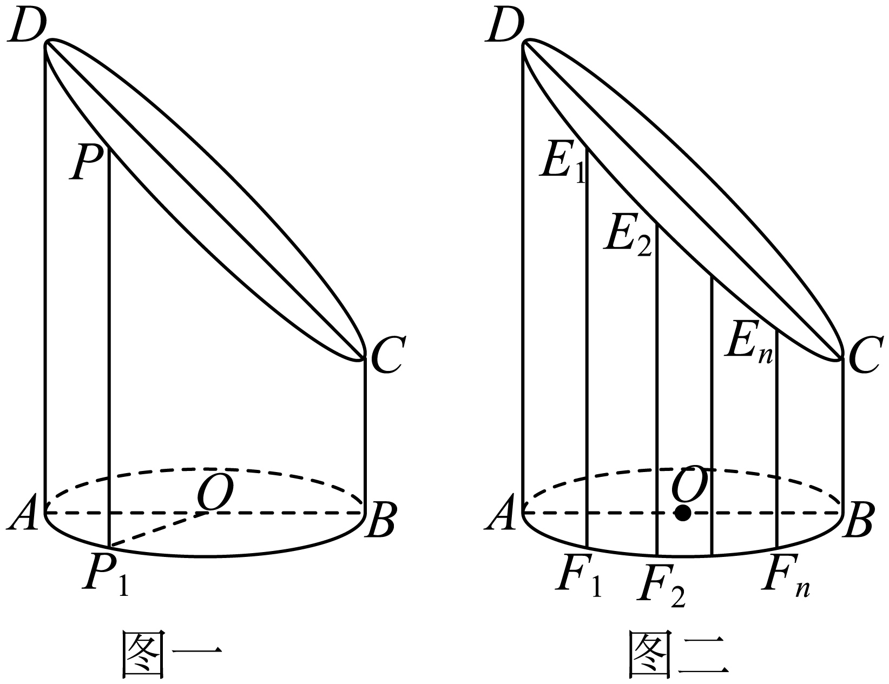

# Mathematics - 题目 3275

**ID**: d12ae4add4b04438b77795a2194cbf48
**年级**: Grade 12
**难度**: Medium-Hard
**题型**: Calculation

## 题目
如图所示，用一个不平行于圆柱底面的平面截该圆柱所得的截面为椭圆面，得到的几何体称之为“斜截圆柱”.​​​​​​​‌图一与图二是完全相同的“斜截圆柱”， $AB$ 是底面圆 $O$ 的直径， $AB=2BC=2$ ，椭圆所在平面垂直于平面 $ABCD$ ，且与底面所成的二面角的大小为 $45{^{\circ }}$ .在图一中， $P$ 是椭圆上的动点，点 $P$ 在底面上的投影为点 $P{{}_{1}}$ .在图二中，椭圆上的点 $E{{}_{i}}\left ({i=1,2,3,\cdots ,n}\right )$ 在底面上的投影分别为点 $F{{}_{i}}$ ，且点 $F{{}_{i}}$ 均在直径 $AB$ 的同一侧.（1）当 $∠AOP{{}_{1}}=\frac {{\rm{π}}}{2}$ 时，求 $PP{{}_{1}}$ 的长度；当 $\angle AOP{{}_{1}}=θ$ 时，试将 $PP{{}_{1}}$ 的长度表示成关于 $θ$ 的表达式；（2）（i）在图二中，当 $n=4$ 时，若点 $F{{}_{1}},F{{}_{2}},F{{}_{3}},F{{}_{4}}$ 将半圆均分成5等份，求 $\left ({E{{}_{1}}F{{}_{1}}-2}\right )\cdot \left ({E{{}_{2}}F{{}_{2}}-2}\right )\cdot \left ({E{{}_{3}}F{{}_{3}}-2}\right )\cdot \left ({E{{}_{4}}F{{}_{4}}-2}\right )$ ；${\rm （ii）}$ 证明： $\overset{\frown}{{AF{{}_{1}}}}\cdot E{{}_{1}}F{{}_{1}}+\overset{\frown}{{F{{}_{1}}F{{}_{2}}}}\cdot E{{}_{2}}F{{}_{2}}+\cdots +\overset{\frown}{{F{{}_{n-1}}}}\cdot E{{}_{n}}F{{}_{n}}+\overset{\frown}{{F{{}_{n}}B}}\cdot BC<2{\rm{π}}$ .

## 解答

1. （1）如图1，取 $CD$ 的中点 $M$ ，过点 $M$ 作与该斜截圆柱的底面平行的平面，
2. 交 $DA$ 于点 $G$ ，交 $BC$ 的延长线于点 $H$ ，与 $PP{{}_{1}}$ 交于点 $I$ .
3. 
4. 因为 $MH=MG=1,∠CMH=∠DMG=45{^{\circ }}$ ，
5. 所以 $DG=HC=1,AG=2$ .
6. 过点 $M$ 作 $GH$ 的垂线，交圆 $M$ 于 $J,K$ 两点，过点 $I$ 作 $IN\bot JK$ 交 $JK$ 于点 $N$ ，
7. 又 ${\rm \mathit{PI}}\bot $ 圆面 $M,JK\subset $ 圆面 $M$ ，所以 $PI\bot JK$ .
8. 又因为 $PI\cap IN=I$ ，所以 $JK\bot $ 平面 $PIN$ .
9. 因为 $PN\subset $ 平面 $PIN$ ，所以 $PN\bot JK$ ，所以 $\angle PNI$ 为椭圆面与圆 $M$ 所在平面的夹角，
10. 即为椭圆面与底面所成的角，所以 $∠PNI=45{^{\circ }}$ ，则 $\vartriangle PNI$ 为等腰直角三角形， $PI=IN$ .
11. 设 $\angle AOP{{}_{1}}=θ$ ，如图2，作圆 $M$ 所在平面的俯视图，则 $\angle GMI=θ$ ，
12. 
13. 由 $GH\bot JK,IN\bot JK$ ，得 $GH$  $\mathrm{/\mskip-4mu/}$  $IN$ ，则 $\angle NIM=\angle GMI=θ$ ，
14. 得 $IN=MI{\rm{c}}{\rm{o}}{\rm{s}}θ={\rm{c}}{\rm{o}}{\rm{s}}θ$ ，
15. 所以 $PP{{}_{1}}=IP{{}_{1}}+PI=IP{{}_{1}}+IN=2+{\rm{c}}{\rm{o}}{\rm{s}}θ$ ，
16. 当 $θ=\frac {{\rm{π}}}{2}$ 时， $PP{{}_{1}}=2+{\rm{c}}{\rm{o}}{\rm{s}}\frac {{\rm{π}}}{2}=2$ .
17. （2）（i）当 $n=4$ 时， $θ=\frac {{\rm{π}}}{5}$ ，
18. 则 $E{{}_{1}}F{{}_{1}}=2+{\rm{c}}{\rm{o}}{\rm{s}}\frac {{\rm{π}}}{5}$ ， $E{{}_{2}}F{{}_{2}}=2+{\rm{c}}{\rm{o}}{\rm{s}}\frac {2{\rm{π}}}{5}$ ， $E{{}_{3}}F{{}_{3}}=2+{\rm{c}}{\rm{o}}{\rm{s}}\frac {3{\rm{π}}}{5}$ ， $E{{}_{4}}F{{}_{4}}=2+{\rm{c}}{\rm{o}}{\rm{s}}\frac {4{\rm{π}}}{5}$ .
19. 则 $\left ({E{{}_{1}}F{{}_{1}}-2}\right )\cdot \left ({E{{}_{2}}F{{}_{2}}-2}\right )\cdot \left ({E{{}_{3}}F{{}_{3}}-2}\right )\cdot \left ({E{{}_{4}}F{{}_{4}}-2}\right )={\rm{c}}{\rm{o}}{\rm{s}}\frac {{\rm{π}}}{5}{\rm{c}}{\rm{o}}{\rm{s}}\frac {2{\rm{π}}}{5}{\rm{c}}{\rm{o}}{\rm{s}}\frac {3{\rm{π}}}{5}{\rm{c}}{\rm{o}}{\rm{s}}\frac {4{\rm{π}}}{5}$ .
20. $=\frac {{\rm{s}}{\rm{i}}{\rm{n}}\frac {2{\rm{π}}}{5}}{2{\rm{s}}{\rm{i}}{\rm{n}}\frac {{\rm{π}}}{5}}\times \frac {{\rm{s}}{\rm{i}}{\rm{n}}\frac {4{\rm{π}}}{5}}{2{\rm{s}}{\rm{i}}{\rm{n}}\frac {2{\rm{π}}}{5}}\times \frac {{\rm{s}}{\rm{i}}{\rm{n}}\frac {6{\rm{π}}}{5}}{2{\rm{s}}{\rm{i}}{\rm{n}}\frac {3{\rm{π}}}{5}}\times \frac {{\rm{s}}{\rm{i}}{\rm{n}}\frac {8{\rm{π}}}{5}}{2{\rm{s}}{\rm{i}}{\rm{n}}\frac {4{\rm{π}}}{5}}$
21. $=\frac {1}{16}$ ，
22. ${\rm （ii）}$ 由（1）知 $PP{{}_{1}}=2+{\rm{c}}{\rm{o}}{\rm{s}}θ$ ，即 $PP{{}_{1}}$ 是关于 $θ$ 的函数，
23. 即将斜截圆柱的侧面沿着 $AD$ 展开，其椭圆面的轮廓线即为函数 $y=2+{\rm{c}}{\rm{o}}{\rm{s}}x$ 的图象，
24. 如图3所示.
25. 
26. 如图4，将 $E{{}_{1}}F{{}_{1}},E{{}_{2}}F{{}_{2}},\cdots ,E{{}_{n}}F{{}_{n}},BC$ 绘制于函数 $y=2+{\rm{c}}{\rm{o}}{\rm{s}}x$ 的图象上，
27. 并以 $E{{}_{i}}F{{}_{i}},F{{}_{i-1}}F{{}_{i}}\left ({i=2,3,\cdots ,n}\right )$ 为边作矩形，则矩形的面积即为 $\overset{\frown}{{F{{}_{i-1}}F{{}_{i}}}}\cdot E{{}_{i}}F{{}_{i}}$ ，
28. 
29. 所以 $\overset{\frown}{{AF{{}_{1}}}}\cdot E{{}_{1}}F{{}_{1}}+\overset{\frown}{{F{{}_{1}}F{{}_{2}}}}\cdot E{{}_{2}}F{{}_{2}}+\cdots +\overset{\frown}{{F{{}_{n-1}}}}\cdot E{{}_{n}}F{{}_{n}}+\overset{\frown}{{F{{}_{n}}B}}\cdot BC$ 即为这些矩形的面积之和.
30. 而两个该斜截圆柱可拼成一个底面半径为1，高为4的圆柱，
31. 因此该斜截圆柱的侧面积为 $\frac {1}{2}\times 2{\rm{π}}\times 4=4{\rm{π}}$ ，
32. 所以函数 $y=2+{\rm{c}}{\rm{o}}{\rm{s}}x\left ({0\leqslant x\leqslant {\rm{π}}}\right )$ 图象与坐标轴围成的图形的面积为 $\frac {1}{2}\times 4{\rm{π}}=2{\rm{π}}$ .
33. 又因为无论点 $F{{}_{i}}\left ({i=1,2,3,\cdots ,n-1}\right )$ 是否均匀分布在半圆弧 $AB$ 上，
34. 这些矩形的面积之和都小于函数 $y=2+{\rm{c}}{\rm{o}}{\rm{s}}x\left ({0\leqslant x\leqslant {\rm{π}}}\right )$ 图象与坐标轴围成的图形的面积，
35. 所以 $\overset{\frown}{{AF{{}_{1}}}}\cdot E{{}_{1}}F{{}_{1}}+\overset{\frown}{{F{{}_{1}}F{{}_{2}}}}\cdot E{{}_{2}}F{{}_{2}}+\cdots +\overset{\frown}{{F{{}_{n-1}}}}\cdot E{{}_{n}}F{{}_{n}}+\overset{\frown}{{F{{}_{n}}B}}\cdot BC<2{\rm{π}}$ ，得证.

## 知识点

**中文**:
  - 圆柱、圆锥、圆台的表面积（侧面积）

**English**:
  - Surface Area of Revolving Solids

---
