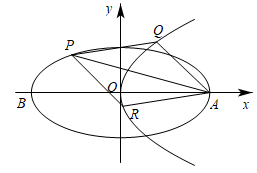

# Mathematics - 题目 442

**ID**: d4b9100b846f486d80e474f8b33a1164
**年级**: Grade 12
**难度**: Medium-Hard
**题型**: Calculation

## 题目
已知椭圆 $C{{}_{1}}:\frac {x{^{2}}}{a{^{2}}}+\frac {y{^{2}}}{b{^{2}}}=1\left ({a>b>0}\right )$ 的离心率为 $\frac {\sqrt {3}}{2}$ ，且 $ab=2$ .​​​​​​​‌（1）求椭圆 $C{{}_{1}}$ 的方程；（2）已知点 $B,A$ 为椭圆 $C{{}_{1}}$ 的左､右顶点，点 $P$ 为椭圆 $C{{}_{1}}$ 上不同于A､ $B$ 的任一点，在抛物线 $ C{{}_{2}}:y{^{2}}=2px\left ({p>0}\right )$ 上存在两点 $Q,R$ ，使得四边形 $AQPR$ 为平行四边形，求 $p$ 的最小值.

## 解答

1. 解：（1）由题意得： $\begin{cases}e=\frac {c}{a}=\frac {\sqrt {3}}{2}\\ab=2\\a{^{2}}=b{^{2}}+c{^{2}}\end{cases}$ ，解得 $\begin{cases}a=2\\b=1\\c=\sqrt {3}\end{cases}$
2. $\therefore C{{}_{1}}:\frac {x{^{2}}}{4}+y{^{2}}=1$
3. （2）由（1）知 $A\left ({2,0}\right )$ ，设 $Q\left ({x{{}_{1}},y{{}_{1}}}\right )$ ， $R\left ({x{{}_{2}},y{{}_{2}}}\right )$ ， $P\left ({x{{}_{3}},y{{}_{3}}}\right )$ ，
4. 
5. 连接 $AP,QR$ 设交于 $D\left ({x{{}_{0}},y{{}_{0}}}\right )$
6. $\because $ 四边形 $AQPR$ 为平行四边形，
7. $\therefore $  $D$ 为 $AP,QR$ 的中点且 $QR$ 与 $x$ 轴既不垂直也不平行，
8. 设 $QR:y=kx+m\left ({k\ne 0}\right )$ ，
9. $QR$ 与 $C{{}_{2}}$ 联立消 $y$ 得 $k{^{2}}x{^{2}}+2\left ({km-p}\right )x+m{^{2}}=0$  （*）
10. 则 $x{{}_{1}},x{{}_{2}}$ 是（*）的二根，
11. $\therefore \begin{cases}x{{}_{1}}+x{{}_{2}}=\frac {2\left ({km-p}\right )}{k{^{2}}}\\x{{}_{1}}x{{}_{2}}=\frac {m{^{2}}}{k{^{2}}}\end{cases}$ ，且 $\Delta =4{\left({km-p}\right)^{2}}-4k{^{2}}m{^{2}}>0$ ，即 $-2km+p>0$ ①
12. $\therefore x{{}_{0}}=\frac {x{{}_{1}}+x{{}_{2}}}{2}=-\frac {km-p}{k{^{2}}}$ ， $y{{}_{0}}=kx{{}_{0}}+m=\frac {p}{k}$ ，
13. $\because x{{}_{0}}=\frac {x{{}_{3}}+2}{2}$ ， $y{{}_{0}}=\frac {y{{}_{3}}}{2}$
14. $\therefore $ 得 $x{{}_{3}}=2x{{}_{0}}-2=-\frac {2\left ({km-p}\right )}{k{^{2}}}-2$ ， $y{{}_{3}}=2y{{}_{0}}=\frac {2p}{k}$
15. $\therefore P\left ({-\frac {2\left ({km-p}\right )}{k{^{2}}}-2,\frac {2p}{k}}\right )$
16. $\because $ 点 $P$ 在曲线 $C{{}_{1}}$ 上，代入可得 $\frac {\left [-\frac {2\left ({km-p}\right )}{k{^{2}}}-2\right ]{^{2}}}{4}+{\left({\frac {2p}{k}}\right)^{2}}=1$ ，
17. 即 ${\left({\frac {km-p}{k{^{2}}}+1}\right)^{2}}+{\left({\frac {2p}{k}}\right)^{2}}=1$
18. 令 $\begin{cases}\frac {2p}{k}={\sin}θ②\\\frac {km-p}{k{^{2}}}+1={\cos}θ③\end{cases}$ ，其中 $θ\ne kπ,k\in Z$
19. 由②得 $k=\frac {2p}{{\sin}θ}$ 代入③得 $km=p-\frac {4p{^{2}}}{1+{\cos}θ}$ 代入①得 $-2km+p=-2p+\frac {8p{^{2}}}{1+{\cos}θ}+p>0$
20. 解得 $p>\frac {1+{\cos}θ}{8}$
21. $\because {\sin}θ\ne 0$ ， $\therefore {\cos}θ<1$ ， $\therefore \frac {1+{\cos}θ}{8}<\frac {1}{4}$ ， $\therefore p\geqslant \frac {1}{4}$
22. $\therefore p$ 的最小值为 $\frac {1}{4}$ .

## 知识点

**中文**:
  - 圆锥曲线性质综合应用
  - 由椭圆的几何性质求方程
  - 直线与椭圆的位置关系
  - 范围最值问题

**English**:
  - Comprehensive Application of Properties
  - Finding Equation from Properties
  - Line-Ellipse Relationship
  - Range and Extrema Problems

---
