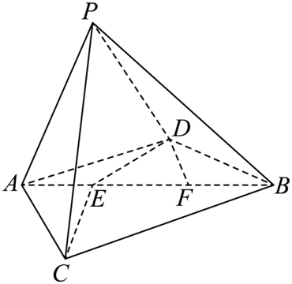

# Mathematics - 题目 1409

**ID**: d77ad6a29bbf4faeb992f652c7218f50
**年级**: Grade 12
**难度**: Medium-Hard
**题型**: Calculation

## 题目
三棱锥 $P-ABC$ 中，底面 $\vartriangle ABC$ 为等腰直角三角形， $CA=CB=2\sqrt {2}$ ， $PA=\sqrt {10}$ ．点P在底面 $ABC$ 上的射影E是线段 $AB$ 靠近点A的四等分点．（1）求 $PB$ 与平面 $PCE$ 所成角的正弦值；​​​​​​​‌（2）求三棱锥 $P-ABC$ 外接球体积；（3）设 $AB$ 靠近B的四等分点为F，D是平面ABC内的动点，且C，D在直线 $AB$ 的两侧，满足 $\left |{DE}\right |+\left |{DF}\right |=4$ ．试探究是否存在点D使得平面 $PBD\bot $ 平面 $PBC$ ?若存在，请求出DE的长度；若不存在，请说明理由．

## 解答

1. （1）法一：等体积法： $AE=1$ ， $PE=3$ ， $PB=\sqrt {PE{^{2}}+BE{^{2}}}=3\sqrt {2}$
2. $\therefore CE=\sqrt {CA{^{2}}+AE{^{2}}-2CA\times AE\times {\rm{c}}{\rm{o}}{\rm{s}}45{}\degree }=\sqrt {8+1-2\times 2\sqrt {2}\times 1\times \frac {\sqrt {2}}{2}}=\sqrt {5}$ ，
3. ∴由 $V{{}_{B-PCE}}=V{{}_{P-BCE}}$ ，则 $\frac {1}{3}S{{}_{△PCE}}·h{{}_{B}}=\frac {1}{3}S{{}_{△BCE}}·PE$ ，
4. $\therefore h{{}_{B}}=\frac {S{{}_{△BCE}}·PE}{S{{}_{△PCE}}}=\frac {3\times 3}{\frac {1}{2}\times 3\times \sqrt {5}}=\frac {6\sqrt {5}}{5}$
5. $\therefore {\rm{s}}{\rm{i}}{\rm{n}}θ=\frac {h{{}_{B}}}{PB}=\frac {\sqrt {10}}{5}$ ．
6. 法二：连接PE，因为P在底面ABC上的射影E是线段AB靠近点A的四等分点，
7. 可得 $PE\bot ABC$ ，因为 $AB\subset $ 平面 $ABC$ ，所以 $PE\bot AB$ ，
8. 在直角 $△PAE$ 中，可得 $PE=\sqrt {PA{^{2}}-AE{^{2}}}=3$ ，
9. 又因为 $PE\subset $ 平面 $PEC$ ，所以平面 $PEC\bot $ 平面 $ABC$ ，且交线为CE，
10. 过B作 $BG\bot CE$ 于点G，连接PG，
11. 因为 $BG\subset $ 平面 $ABC$ ，由面面垂直的性质，可得 $BG\bot $ 平面 $PEC$ ，
12. 故 $\angle BPG$ 为PB与平面PCE所成角，
13. 在 $\vartriangle BCE$ 中， $CB=2\sqrt {2}$ ， $BE=3$ ， $\angle CBE=\frac {{\rm{π}}}{4}$ ，
14. 由余弦定理得 $CE{^{2}}=CB{^{2}}+BE{^{2}}-2CB\cdot BE{\rm{c}}{\rm{o}}{\rm{s}}\angle CBE=5$ ，所以 $CE=\sqrt {5}$ ，
15. 又由 $S{{}_{△BCE}}=\frac {1}{2}CE·BG=\frac {1}{2}BC·BE{\rm{s}}{\rm{i}}{\rm{n}}\frac {{\rm{π}}}{4}$ ，所以 $BG=\frac {6}{\sqrt {5}}$ ，
16. 在 $\vartriangle BPG$ 中，由 $PB=\sqrt {PE{^{2}}+BE{^{2}}}=3\sqrt {2}$ ，所以 ${\rm{s}}{\rm{i}}{\rm{n}}\angle BPG=\frac {BG}{BP}=\frac {\sqrt {10}}{5}$ ，
17. 即直线PB与平面PCE所成角的正弦值为 $\frac {\sqrt {10}}{5}$ ；
18. 
19. （2）由几何性质知，球心M在过AB中点O且与面CAB垂直的垂线上，
20. 建立AB中点O为空间坐标原点，OC所在直线为x轴，BO所在直线为y轴，过点O平行于 $PE$ 的直线为 $z$ 轴的空间直角坐标系，
21. 则 $A\left ({0,-2,0}\right )$ ， $P\left ({0,-1,3}\right )$ ，设 $M\left ({0,0,t}\right )$ ，
22. 由 $∣MA∣=∣MP∣=R$ ， $\therefore 4+t{^{2}}=1+{\left({t-3}\right)^{2}}$ ，
23. $\therefore t=1$ ，故 $M\left ({0,0,1}\right )$ ， $\therefore R=\sqrt {5}$ ，
24. 故 $V{{}_{球}}=\frac {4{\rm{π}}}{3}R{^{3}}=\frac {20\sqrt {5}}{3}{\rm{π}}$ ；
25. 
26. （3）则由几何关系可得 $C\left ({2,0,0}\right )$ ， $B\left ({0,2,0}\right )$ ， $E\left ({0,-1,0}\right )$ ， $F\left ({0,1,0}\right )$ ， $D\left ({a,b,0}\right )(a<0)$ ，由 $∣DE∣+∣DF∣=4>∣EF∣=2$ ，
27. $\therefore $ 在平面xOy中，D在以E、F为焦点的椭圆上，故 $\frac {b{^{2}}}{4}+\frac {a{^{2}}}{3}=1$ ①
28. 设面PBC的法向量 $\overrightarrow {{n{{}_{1}}}}=\left ({x{{}_{1}}{\rm{,}}y{{}_{1}}{\rm{,}}z{{}_{1}}}\right )$ ， $\overrightarrow {{PB}}=\left ({0{\rm{,}}3{\rm{,}}-3}\right )$ ， $\overrightarrow {{PC}}=\left ({2{\rm{,}}1{\rm{,}}-3}\right )$ ，由 $\begin{cases}\overrightarrow {{PB}}\cdot \overrightarrow {{n{{}_{1}}}}=0\\\overrightarrow {{PC}}\cdot \overrightarrow {{n{{}_{1}}}}=0\end{cases}$ ，
29. 有 $\begin{cases}3y{{}_{1}}+3z{{}_{1}}=0\\2x{{}_{1}}+y{{}_{1}}-3z{{}_{1}}=0\end{cases}$ ，令 $z{{}_{1}}=1$ ，得 $\overrightarrow {{n{{}_{1}}}}=\left ({1{\rm{,}}1{\rm{,}}1}\right )$
30. 设面PBD的法向量 $\overrightarrow {{n{{}_{2}}}}=\left ({x{{}_{2}}{\rm{,}}y{{}_{2}}{\rm{,}}z{{}_{2}}}\right )$ ， $\overrightarrow {{BD}}=\left ({a{\rm{,}}b-2{\rm{,}}0}\right )$ ， $\overrightarrow {{PD}}=\left ({a{\rm{,}}b+1{\rm{,}}-3}\right )$ ，由 $\begin{cases}\overrightarrow {{BD}}\cdot \overrightarrow {{n{{}_{2}}}}=0\\\overrightarrow {{PD}}\cdot \overrightarrow {{n{{}_{2}}}}=0\end{cases}$ ，
31. $\therefore \begin{cases}ax{{}_{2}}+\left ({b-2}\right )y{{}_{2}}=0\\ax{{}_{2}}+\left ({b+1}\right )y{{}_{2}}-3z{{}_{2}}=0\end{cases}$ ，取 $x{{}_{2}}=2-b$ ，则 $\overrightarrow {{n{{}_{2}}}}=\left ({2-b{\rm{,}}a{\rm{,}}a}\right )$ ，
32. 故 $\overrightarrow {{n{{}_{1}}}}\cdot \overrightarrow {{n{{}_{2}}}}=0$ 得 $b=2a+2$ ②代入①得 $\begin{cases}a=0\\b=2\end{cases}$ （舍）或 $\begin{cases}a=-\frac {3}{2}\\b=-1\end{cases}$ ．
33. 而 $E\left ({0,-1,0}\right )$ ，故 $∣ED∣=\frac {3}{2}$ .

## 知识点

**中文**:
  - 球
  - 直线与平面所成的角
  - 用向量证明垂直问题

**English**:
  - Sphere
  - Line-Plane Angle
  - Proving Perpendicularity

---
