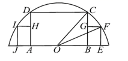

# Mathematics - 题目 936

**ID**: d91f42d152d141a0ba1f9833bf3b3a5c
**年级**: Grade 12
**难度**: Medium-Hard
**题型**: Calculation

## 题目
如图，有一个半圆形场馆，政府计划改建为一个方舱医院，改建后的场馆由病床区（矩形 $ABCD$ ）及左右两侧两个大小相同的休闲区（矩形 $AHLJ$ 和 $BEFG$ ）组成，其中半圆的圆心为 $O$ ，半径为50米，矩形 $BEFG$ 的一边 $BG$ 在 $BC$ 上，矩形 $AHLJ$ 的一边 $AH$ 在 $AD$ 上，点 $C$ ， $D$ ， $F$ ， $I$ 在圆周上， $E$ ， $J$ 在直径上，且 $\angle EOF=\frac {π}{6}$ ，设 $\angle BOC=θ$ ．若每平方米病床区的造价和休闲区造价分别为 $\frac {\sqrt {3}}{20}$ 万元和 $\frac {1}{10}$ 万元，记病床区及休闲区的总造价为 $f\left ({θ}\right )$ （单位：万元）.​​​​​​​‌（1）求 $f\left ({θ}\right )$ 的表达式；（2）为进行改建预算，当 $θ$ 为何值时，总造价最大？并求出总造价的最大值．

## 解答

1. 解：（1）设 $R=50$ ，由图可知在矩形 $ABCD$ 中，
2. 
3. $BC=R{\sin}θ$ ， $OB=R{\cos}θ$
4. 所以 $S{{}_{ABCD}}=2OB\times BC=2R{^{2}}{\sin}θ{\cos}θ=R{^{2}}{\sin}2θ$
5. 在矩形 $BEFG$ 中，
6. $EF=R{\sin}\frac {π}{6}=\frac {R}{2},BE=R{\cos}\frac {π}{6}-R{\cos}θ=\left ({\frac {\sqrt {3}}{2}-{\cos}θ}\right )R$
7. 所以 $2S{{}_{BEFG}}=2EF\times BE=\left ({\frac {\sqrt {3}}{2}-{\cos}θ}\right )R{^{2}}$
8. 因为病床区每平方米的造价为 $\frac {\sqrt {3}}{20}$ 万元，休闲区每平方米造价为 $\frac {1}{10}$ 万元，
9. $\therefore f(θ)=S{{}_{ABCD}}\times \frac {\sqrt {3}}{20}+2S{{}_{BEFG}}\times \frac {1}{10}=\frac {1}{20}\times 50{^{2}}(\sqrt {3}{\sin}2θ-2{\cos}θ+\sqrt {3})$
10. $\therefore f(θ)=125(\sqrt {3}{\sin}2θ-2{\cos}θ+\sqrt {3})$ （万元）， $θ\in \left ({\frac {π}{6},\frac {π}{2}}\right )$ .
11. （2）由（1）得， $f^{′}(θ)=125(2\sqrt {3}{\cos}2θ+2{\sin}θ)=250\left ({\sqrt {3}-2\sqrt {3}{\sin}{^{2}}θ+{\sin}θ}\right )$
12. $=-250(2{\sin}θ-\sqrt {3})(\sqrt {3}{\sin}θ+1)$
13. 因为 $θ\in \left ({\frac {π}{6},\frac {π}{2}}\right )$ ，所以 ${\sin}θ\in \left ({\frac {1}{2},1}\right )$
14. 令 $f^{′}(θ)=0$ ，解得 ${\sin}θ=\frac {\sqrt {3}}{2}$ ，因为 $θ\in \left ({\frac {π}{6},\frac {π}{2}}\right )$ ，所以 $θ=\frac {π}{3}$
15. 当 $θ$ 变化时， $f(θ)$ ， $f^{′}(θ)$ 的变化情况如下表：
16. $θ$
17. $\left ({\frac {π}{6},\frac {π}{3}}\right )$
18. $\frac {π}{3}$
19. $\left ({\frac {π}{3},\frac {π}{2}}\right )$
20. $f^{′}(θ)$
21. $+$
22. $0$
23. $-$
24. $f(θ)$
25. $\nearrow $
26. 极大值
27. $\searrow $
28. 所以当 $θ=\frac {π}{3}$ 时，总造价 $f(θ)$ 取得极大值 $\frac {125}{2}(1+2\sqrt {3})$
29. 即当 $θ=\frac {π}{3}$ 时，总造价的最大值为 $\frac {125}{2}(1+2\sqrt {3})$ 万元.

## 知识点

**中文**:
  - 在实际问题中建立三角函数模型
  - 导数在优化问题中的应用

**English**:
  - Modeling Real-world Problems
  - Optimization Problems

---
