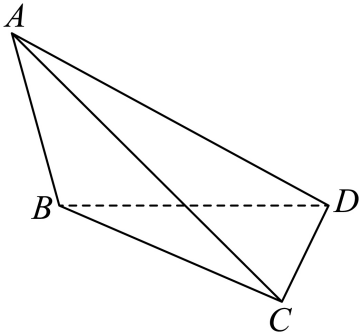

# Mathematics - 题目 3045

**ID**: e1f0a68f16ab4d20ab4f7ad385ec0eb4
**年级**: Grade 12
**难度**: Medium-Hard
**题型**: Calculation

## 题目
如图，在三棱锥 $A-BCD$ 中，侧面 $ABD,ACD$ 是全等的直角三角形， $AD$ 是公共的斜边，且 $AD=\sqrt {3}$ ， $BD=CD=1$ ，另一个侧面是正三角形．(1)求证： $BC\bot AD$ ；​​​​​​​‌(2)在图中作出点 $A$ 到底面 $BCD$ 的距离，并说明理由；(3)在线段 $AC$ 上是否存在一点 $E$ ，使 $ED$ 与平面 $ABC$ 成 $30{}^\circ $ 角？若存在，确定 $E$ 的位置；若不存在，说明理由．

## 解答

1. （1）如图所示，取 $BC$ 中点 $M$ ，连接 $AM,DM$ ，
2. 因为 $BD=CD$ ，所以 $DM\bot BC$ ，
3. 又因为 $AB=AC$ ，所以 $AM\bot BC$ ，
4. 又因为 $DM\cap AM=M$ ，且 $DM,AM\subset $ 平面 $ADM$ ，所以 $BC\bot $ 平面 $ADM$ ，
5. 因为 $AD\subset $ 平面 $ADM$ ，所以 $AD\bot BC$ ；
6. （2）作 $AH\bot DM$ 于点 $H$ ，
7. 因为 $BC\bot $ 平面 $ADM$ ， $AH\subset $ 平面 $ADM$ ，所以 $AH\bot BC$ ，
8. 因为 $DM\cap BC=M$ ，且 $DM,BC\subset $ 平面 $BCD$ ，所以 $AH\bot $ 平面 $BCD$ ，
9. 在 ${\rm{R}}{\rm{t}}\mathrm{△}ABD,{\rm{R}}{\rm{t}}\mathrm{△}ACD$ 中， $AD=\sqrt {3}$ ， $BD=CD=1$ ，
10. 则 $AB=AC=\sqrt {2}$ ，所以 $BC=\sqrt {2}$ ，故 $AM=\frac {\sqrt {6}}{2}$ ，
11. 因为 $BD{^{2}}+CD{^{2}}=BC{^{2}}$ ，所以 $BD\bot CD$ ，故 $DM=\frac {\sqrt {2}}{2}$ ，
12. 在 $△ADM$ 中， ${\cos}\angle AMD=\frac {\frac {3}{2}+\frac {1}{2}-3}{2\times \frac {\sqrt {6}}{2}\times \frac {\sqrt {2}}{2}}=-\frac {\sqrt {3}}{3}$ ，
13. 所以 $∠AMD$ 为钝角，所以点 $H$ 在 $DM$ 延长线上，
14. 在 ${\rm{R}}{\rm{t}}\mathrm{△}AHM$ 中， ${\cos}\angle AMH=\frac {\sqrt {3}}{3}$ ，故 ${\sin}\angle AMH=\frac {\sqrt {6}}{3}$ ，
15. 所以 $AH=AM{\sin}\angle AMH=1$ ，
16. 所以 $BH=CH=1$ ，所以垂足 $H$ 与 $B,C,D$ 构成一个正方形 $BHCD$ ，
17. 故线段 $AH$ 即为点 $A$ 到底面 $BCD$ 的距离；
18. 
19. （3）结合（2）过 $E$ 作 $ET{\rm{/}}{\rm{/}}AH$ 交 $HC$ 于 $T$ ，连接 $DT$ ，
20. 因此 $ET\bot $ 平面 $BCD$ ，所以 $\angle EDT=30{}^\circ $ ，
21. 记 $CE=m$ ，则 $ET=\frac {\sqrt {2}}{2}m$ ， $DT=\sqrt {DC{^{2}}+TC{^{2}}}=\sqrt {1+\frac {1}{2}m{^{2}}}$ ，
22. 所以 $\frac {\frac {\sqrt {2}}{2}m}{\sqrt {1+\frac {1}{2}m{^{2}}}}={\tan}30{}^\circ =\frac {\sqrt {3}}{3}$ ，解得 $m=1$ ，
23. 即存在点 $E$ ，且点 $E$ 在 $CE=1$ 的位置．

## 知识点

**中文**:
  - 点与面之间的距离
  - 直线与平面垂直的判定
  - 直线与平面垂直的性质
  - 直线与平面所成的角

**English**:
  - Point-Plane Distance
  - Line-Plane Perpendicularity Determination
  - Properties of Line-Plane Perpendicularity
  - Line-Plane Angle

---
