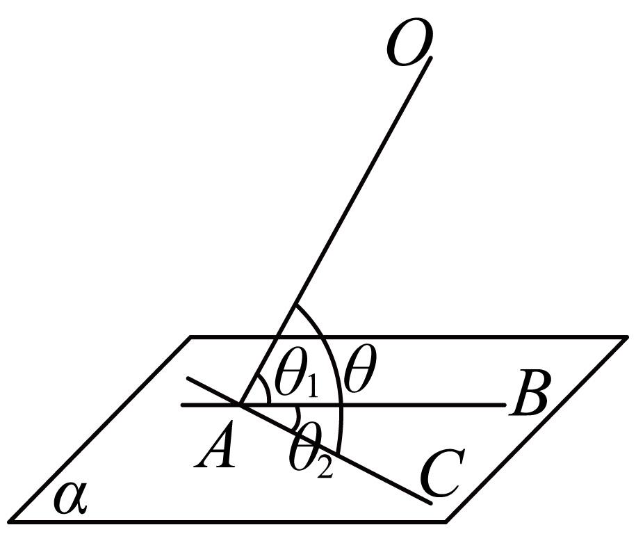
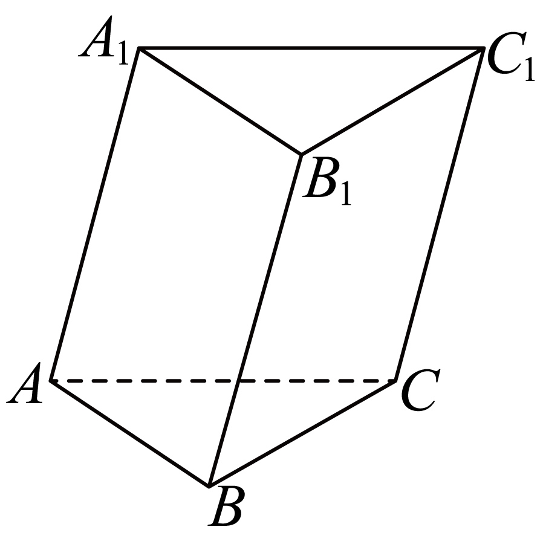
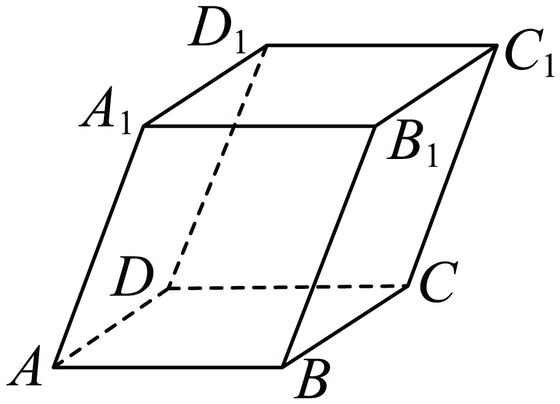

# Mathematics - 题目 1913

**ID**: e88d120386184604b7180802b5650a3a
**年级**: Grade 12
**难度**: Medium-Hard
**题型**: Calculation

## 题目
三余弦定理：设A为平面 $α$ 内一点，过点A的斜线 $AO$ 在平面 $α$ 上的正投影为直线 $AB$ ． $AC$ 为平面 $α$ 内的一条直线，记斜线 $AO$ 与直线 $AB$ 的夹角（即直线 $AO$ 与平面 $α$ 所成角）为 $θ{{}_{1}}$ ，直线 $AB$ 与直线 $AC$ 的夹角为 $θ{{}_{2}}$ ，直线 $AO$ 与直线 $AC$ 的夹角为 $θ$ ，则 ${\rm{c}}{\rm{o}}{\rm{s}}θ=$  ${\rm{c}}{\rm{o}}{\rm{s}}θ{{}_{1}}{\rm{c}}{\rm{o}}{\rm{s}}θ{{}_{2}}$ ．三余弦定理描述了线面角是斜线与平面内任意直线所成角的最小值，又称最小角定理．（1）证明三余弦定理；​​​​​​​‌（2）如图，已知三棱柱 $ABC-A{{}_{1}}B{{}_{1}}C{{}_{1}}$ ， $\vartriangle ABC$ 为正三角形， $\angle BAA{{}_{1}}=\angle CAA{{}_{1}}=\frac {{\rm{π}}}{3}$ ，求直线 $AA{{}_{1}}$ 与底面 $ABC$ 所成角的正弦值；（3）已知平行六面体 $ABCD-A{{}_{1}}B{{}_{1}}C{{}_{1}}D{{}_{1}}$ ，记 $V$ 为平行六面体体积， $\mathrm{S}$ 为平行六面体表面积， $l$ 为平行六面体棱长总和，求证： $S{^{2}}\geqslant 3Vl$ ．

## 解答

1. （1）如图，不妨设 $O$ 在平面 $α$ 的射影为 $B$ ，则 $OB\bot α$ ，过点 $B$ 作 $BC\bot AC$ 交直线 $AC$ 于点 $C$ ，连接 $OC$ ，
2. $\therefore \angle OAB$ 即为斜线 $AO$ 与平面 $α$ 所成角 $θ{{}_{1}}$ ，
3. $∠BAC$ 即为斜线 $ΛO$ 在平面 $α$ 的射影直线 $ΛB$ 与平面 $α$ 内的直线 $AC$ 所成角 $θ{{}_{2}}$ ， $\angle OAC$ 即为斜线 $AO$ 与平面 $α$ 内的直线 $AC$ 所成角 $θ$ ，
4. $\because OB\bot α$ ， $AC\subset α$ ， $\therefore OB\bot AC$ ，
5. 又 $BC\bot AC$ ， $OB\cap BC=B$ ， $OB$ ， $OC\subset $ 平面 $OBC$ ，
6. $\therefore AC\bot $ 平面 $OBC$ ，
7. $\because OC\subset $ 平面 $OBC$ ， $\therefore AC\bot OC$ ，
8. 根据几何关系可得 ${\rm{c}}{\rm{o}}{\rm{s}}θ{{}_{1}}=\frac {AB}{AO}$ ， ${\rm{c}}{\rm{o}}{\rm{s}}θ{{}_{2}}=\frac {AC}{AB}$ ， ${\rm{c}}{\rm{o}}{\rm{s}}θ=\frac {AC}{AO},$
9. $\therefore {\rm{c}}{\rm{o}}{\rm{s}}θ={\rm{c}}{\rm{o}}{\rm{s}}θ{{}_{1}}{\rm{c}}{\rm{o}}{\rm{s}}θ{{}_{2}}$ ．
10. 
11. （2）取 $BC$ 中点为 $M$ ，连接 $A{{}_{1}}B$ ， $A{{}_{1}}C$ ， $A{{}_{1}}M$ ， $AM$ ，易知 $\vartriangle ABA{{}_{1}}\cong \vartriangle ACA{{}_{1}}$ ，
12. $\therefore A{{}_{1}}C=A{{}_{1}}B$ ， $\therefore A{{}_{1}}M\bot BC$ ．
13. 又 $AM\bot BC$ ， $A{{}_{1}}M\cap AM=M$ ， $A{{}_{1}}M$ ， $AM\subset $ 平面 $AMA{{}_{1}}$ ， $\therefore BC\bot $ 平面 $AMA{{}_{1}}$ ，
14. $\because BC\subset $ 平面 $ABC$ ，
15. $\therefore $ 平面 $AMA{{}_{1}}\bot $ 平面 $ABC$ ，
16. $\therefore $ 直线 $AA{{}_{1}}$ 在平面 $ABC$ 上的射影必在交线 $AM$ 上，
17. $\therefore $ 直线 $AA{{}_{1}}$ 与底面 $ABC$ 所成角为 $\angle A{{}_{1}}AM$ ，
18. $\because \angle MAB=\frac {{\rm{π}}}{6}$ ， $\angle A{{}_{1}}AB=\frac {{\rm{π}}}{3}$ ，
19. 由三余弦定理得 ${\rm{c}}{\rm{o}}{\rm{s}}\frac {{\rm{π}}}{3}={\rm{c}}{\rm{o}}{\rm{s}}∠A{{}_{1}}AM\cdot {\rm{c}}{\rm{o}}{\rm{s}}\frac {{\rm{π}}}{6}$ ，得 ${\rm{c}}{\rm{o}}{\rm{s}}\angle A{{}_{1}}AM=\frac {\sqrt {3}}{3}$ ，
20. $\therefore {\rm{s}}{\rm{i}}{\rm{n}}∠A{{}_{1}}AM=\frac {\sqrt {6}}{3}$ ，
21. 即直线 $AA{{}_{1}}$ 与底面 $ABC$ 所成角的正弦值为 $\frac {\sqrt {6}}{3}$ ．
22. 
23. （3）证明：设 $AB=a$ ， $AD=b$ ， $AA{{}_{1}}=c$ ， $\angle BAD=α$ ， $\angle DAA{{}_{1}}=β$ ， $\angle BAA{{}_{1}}=γ$ ，直线 $AA{{}_{1}}$ 与底面 $ABCD$ 所成角为 $θ$ ，直线 $AA{{}_{1}}$ 在底面 $ABCD$ 投影与AB夹角为 $α{{}_{1}}$ ， $AA{{}_{1}}$ 在底面 $ABCD$ 投影与AC夹角 $α{{}_{2}}$ ．
24. 由平行六面体的对称性，不妨令 ${\rm{s}}{\rm{i}}{\rm{n}}α\leqslant {\rm{s}}{\rm{i}}{\rm{n}}β$ ， ${\rm{s}}{\rm{i}}{\rm{n}}α\leqslant {\rm{s}}{\rm{i}}{\rm{n}}γ$ ，
25. 由三余弦定理 ${\cos}β={\cos}θ{\cos}α{{}_{1}}，{\cos}γ={\cos}θ{\cos}α{{}_{2}}\Rightarrow {\cos}θ\geqslant {\cos}β，{\cos}θ\geqslant {\cos}γ$ ，
26. 则 ${\rm{s}}{\rm{i}}{\rm{n}}β\geqslant {\rm{s}}{\rm{i}}{\rm{n}}θ，{\rm{s}}{\rm{i}}{\rm{n}}γ\geqslant {\rm{s}}{\rm{i}}{\rm{n}}θ$ .
27. 由题意得 $V=ab{\rm{s}}{\rm{i}}{\rm{n}}α\cdot c{\rm{s}}{\rm{i}}{\rm{n}}θ=abc{\rm{s}}{\rm{i}}{\rm{n}}α{\rm{s}}{\rm{i}}{\rm{n}}θ$ ，
28. $l=4\left ({a+b+c}\right )$
29. $S=2\left ({ab{\rm{s}}{\rm{i}}{\rm{n}}α+bc{\rm{s}}{\rm{i}}{\rm{n}}β+ac{\rm{s}}{\rm{i}}{\rm{n}}γ}\right )$ ，
30. $S{^{2}}=4{\left({ab{\rm{s}}{\rm{i}}{\rm{n}}α+bc{\rm{s}}{\rm{i}}{\rm{n}}β+ac{\rm{s}}{\rm{i}}{\rm{n}}γ}\right)^{2}}$
31. 
32. ，
33. $3Vl=3abc{\rm{s}}{\rm{i}}{\rm{n}}α{\rm{s}}{\rm{i}}{\rm{n}}θ\cdot 4\left ({a+b+c}\right )$
34. ，
35. 由 ${\rm{s}}{\rm{i}}{\rm{n}}β\geqslant {\rm{s}}{\rm{i}}{\rm{n}}θ，{\rm{s}}{\rm{i}}{\rm{n}}γ\geqslant {\rm{s}}{\rm{i}}{\rm{n}}θ$ ，可得：
36. $3Vl$
37. 则
38. 
39. ，
40. 当且仅当 $α=β=γ=θ=\frac {{\rm{π}}}{2}$ 且 $a=b=c$ 时等号成立．
41. 

## 知识点

**中文**:
  - 直线与平面垂直的判定
  - 直线与平面所成的角

**English**:
  - Line-Plane Perpendicularity Determination
  - Line-Plane Angle

---
