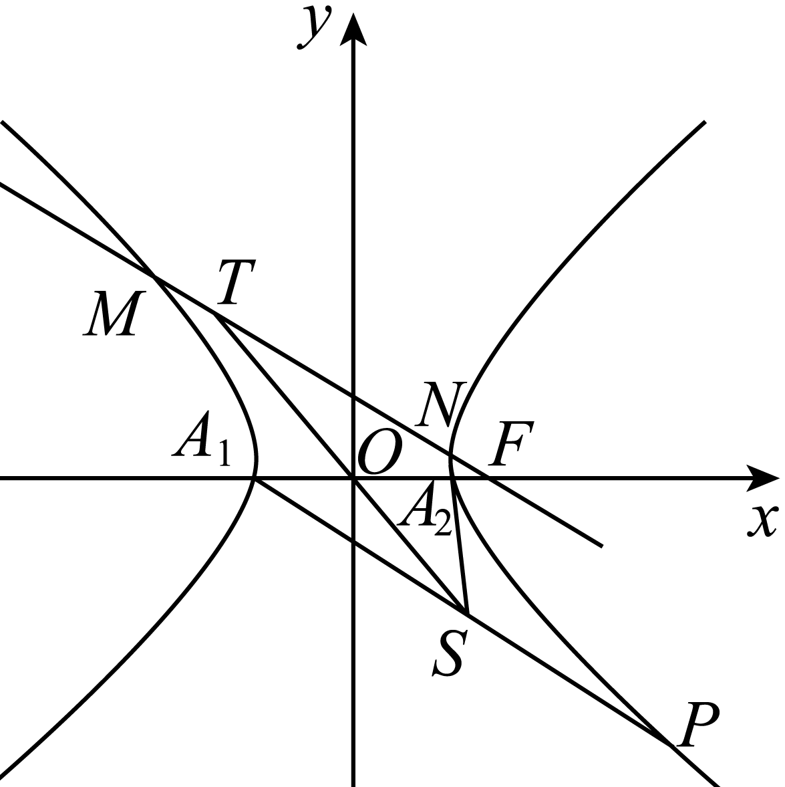

# Mathematics - 题目 3197

**ID**: ffd97e3594b844ff89bbd41122914c4f
**年级**: Grade 12
**难度**: Medium-Hard
**题型**: Calculation

## 题目
已知过右焦点 $F\left ({3,0}\right )$ 的直线交双曲线 $C:\frac {x{{}^{2}}}{a{{}^{2}}}-\frac {y{{}^{2}}}{b{{}^{2}}}=1(a,b>0)$ 于 $M,N$ 两点，曲线 $C$ 的左右顶点分别为 $A{{}_{1}},A{{}_{2}}$ ，虚轴长与实轴长的比值为 $\frac {\sqrt {5}}{2}$ ．(1)求曲线 $C$ 的方程；​​​​​​​‌(2)如图，点 $M$ 关于原点 $O$ 的对称点为点 $P$ ，直线 $A{{}_{1}}P$ 与直线 $A{{}_{2}}N$ 交于点 $S$ ，直线 $OS$ 与直线 $MN$ 交于点 $T$ ，求 $T$ 的轨迹方程．

## 解答

1. （1）由题意得 $c=3,\frac {2b}{2a}=\frac {b}{a}=\frac {\sqrt {5}}{2}$ ，又 $a{{}^{2}}+b{{}^{2}}=c{{}^{2}}$ ，则 $a{{}^{2}}=4,b{{}^{2}}=5$ ，曲线 $C$ 的方程为 $\frac {x{{}^{2}}}{4}-\frac {y{{}^{2}}}{5}=1$ ；
2. （2）设直线 $A{{}_{2}}M,A{{}_{2}}N$ 的斜率分別为 $k{{}_{1}},k{{}_{2}}$ ，直线 $MN$ 为 $x=my+3,M\left ({x{{}_{1}},y{{}_{1}}}\right ),N\left ({x{{}_{2}},y{{}_{2}}}\right )$ ，
3. 由 $\left \{\hspace{-0.5em}\begin{array}{l}x=my+3\\\frac {x{{}^{2}}}{4}-\frac {y{{}^{2}}}{5}=1\end{array}\hspace{-0.5em}\right.$ ，得 $\left ({5m{{}^{2}}-4}\right )y{{}^{2}}+30my+25=0$ ，
4. $\left \{\hspace{-0.5em}\begin{array}{l}5m{{}^{2}}-4\ne 0\\{\rm{Δ}}=900m{{}^{2}}-4\left ({5m{{}^{2}}-4}\right )\times 25>0\end{array}\hspace{-0.5em},m\ne \pm \frac {2\sqrt {5}}{5}\right.$ ，
5. $y{{}_{1}}+y{{}_{2}}=-\frac {30m}{5m{{}^{2}}-4},y{{}_{1}}y{{}_{2}}=\frac {25}{5m{{}^{2}}-4}$ ，
6. 则 $k{{}_{1}}\cdot k{{}_{2}}=\frac {y{{}_{1}}-0}{x{{}_{1}}-2}\cdot \frac {y{{}_{2}}-0}{x{{}_{2}}-2}=\frac {y{{}_{1}}y{{}_{2}}}{x{{}_{1}}x{{}_{2}}-2\left ({x{{}_{1}}+x{{}_{2}}}\right )+4}$
7. $=\frac {y{{}_{1}}y{{}_{2}}}{\left ({my{{}_{1}}+3}\right )\left ({my{{}_{2}}+3}\right )-2\left ({my{{}_{1}}+my{{}_{2}}+6}\right )+4}$
8. $=\frac {y{{}_{1}}y{{}_{2}}}{m{{}^{2}}y{{}_{1}}y{{}_{2}}+m\left ({y{{}_{1}}+y{{}_{2}}}\right )+1}$
9. $=\frac {25}{25m{{}^{2}}-30m{{}^{2}}+5m{{}^{2}}-4}=-\frac {25}{4}$ ，
10. $k{{}_{1}}+k{{}_{2}}=\frac {y{{}_{1}}-0}{x{{}_{1}}-2}+\frac {y{{}_{2}}-0}{x{{}_{2}}-2}=\frac {y{{}_{1}}\left ({x{{}_{2}}-2}\right )+y{{}_{2}}\left ({x{{}_{1}}-2}\right )}{\left ({x{{}_{1}}-2}\right )\left ({x{{}_{2}}-2}\right )}$
11. $=\frac {x{{}_{1}}y{{}_{2}}+x{{}_{2}}y{{}_{1}}-2\left ({y{{}_{1}}+y{{}_{2}}}\right )}{x{{}_{1}}x{{}_{2}}-2\left ({x{{}_{1}}+x{{}_{2}}}\right )+4}$
12. $=\frac {\left ({my{{}_{1}}+3}\right )y{{}_{2}}+\left ({my{{}_{2}}+3}\right )y{{}_{1}}-2\left ({y{{}_{1}}+y{{}_{2}}}\right )}{\left ({my{{}_{1}}+3}\right )\left ({my{{}_{2}}+3}\right )-2\left ({my{{}_{1}}+my{{}_{2}}+6}\right )+4}$
13. $=\frac {2my{{}_{1}}y{{}_{2}}+\left ({y{{}_{1}}+y{{}_{2}}}\right )}{m{{}^{2}}y{{}_{1}}y{{}_{2}}+m\left ({y{{}_{1}}+y{{}_{2}}}\right )+1}$
14. $=\frac {50m-30m}{25m{{}^{2}}-30m{{}^{2}}+5m{{}^{2}}-4}=-5m$ ，
15. 由于点 $M$ 关于原点 $O$ 的对称点为点 $P$ ， $A{{}_{1}}P{\rm{/}}{\rm{/}}A{{}_{2}}M$ ，
16. 则直线 $A{{}_{1}}P$ 为 $y=k{{}_{1}}\left ({x+2}\right )$ ，直线 $A{{}_{2}}N$ 为 $y=k{{}_{2}}\left ({x-2}\right )$ ，显然 $k{{}_{1}}\ne k{{}_{2}}$ ，
17. 由 $\left \{\hspace{-0.5em}\begin{array}{l}y=k{{}_{1}}\left ({x+2}\right )\\y=k{{}_{2}}\left ({x-2}\right )\end{array}\hspace{-0.5em}\right.$ ，得 $\left \{\hspace{-0.5em}\begin{array}{l}x=\frac {2\left ({k{{}_{1}}+k{{}_{2}}}\right )}{k{{}_{2}}-k{{}_{1}}}=-\frac {10m}{k{{}_{2}}-k{{}_{1}}}\\y=\frac {4k{{}_{1}}k{{}_{2}}}{k{{}_{2}}-k{{}_{1}}}=-\frac {25}{k{{}_{2}}-k{{}_{1}}}\end{array}\hspace{-0.5em}\right.$ ，
18. 即 $S\left ({-\frac {10m}{k{{}_{2}}-k{{}_{1}}},-\frac {25}{k{{}_{2}}-k{{}_{1}}}}\right )$ ，
19. 则直线 $OS$ 的方程为 $y=\frac {5}{2m}x$ ，
20. 由 $\left \{\hspace{-0.5em}\begin{array}{l}y=\frac {5}{2m}x\\x=my+3\end{array}\hspace{-0.5em}\right.$ 得 $\left \{\hspace{-0.5em}\begin{array}{l}x=-2\\y=-\frac {5}{m}\end{array}\hspace{-0.5em}\right.$ ，即 $T\left ({-2,-\frac {5}{m}}\right )$ ，
21. 当 $m=0$ 时，由对称性可知 $S$ 在 $y$ 轴上，
22. 此时直线 $OS$ 平行于直线 $MN$ ，不符合题意，
23. 故 $T$ 的轨迹方程为 $x=-2\left ({y\ne 0,\pm \frac {5\sqrt {5}}{2}}\right )$ ．
24. 【点睛】关键点点睛：第二位关键点是利用韦达定理得 $k{{}_{1}}\cdot k{{}_{2}}$ 、 $k{{}_{1}}+k{{}_{2}}$ 的值，直线 $OS$ 的方程与直线 $MN$ 方程联立得 $T$ 点坐标，考查了学生发现问题解决问题的能力．

## 知识点

**中文**:
  - 由双曲线的性质探求方程
  - 直线与双曲线的位置关系

**English**:
  - Finding Equation from Properties
  - Line-Hyperbola Relationship

---
