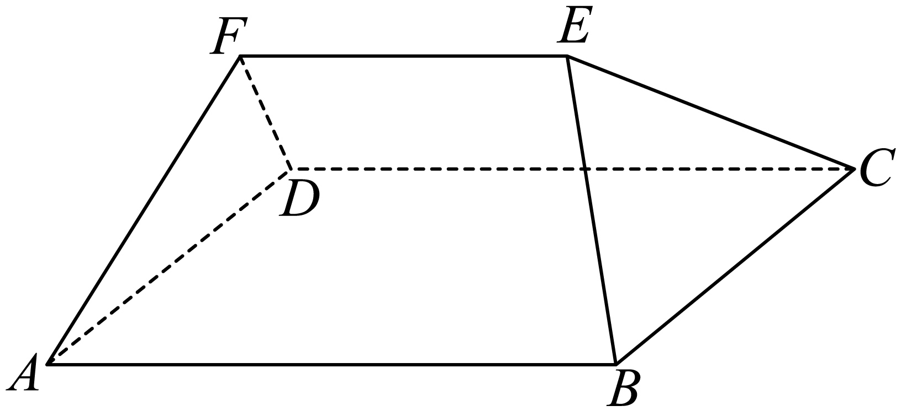

# Mathematics - 题目 3297

**ID**: e0c46bf5478442cda569381e450f9c9d
**年级**: Grade 12
**难度**: Medium-Hard
**题型**: 双空题

## 题目
中国古代数学名著《九章算术》中记载：“刍甍（chú méng）者，下有袤有广，而上有袤无广，刍，草也．甍，屋盖也．”其释义为：刍甍，底面有长有宽的矩形，顶部只有长没有宽为一条棱的五面体．刍甍字面意思为茅屋屋顶．如图所示，现有刍甍 $ABCDEF$ ，所有顶点都在球O的球面上，球心O在矩形 $ABCD$ 所在的平面内， $AB=4$ ， $BC=2\sqrt {2}$ ，该刍甍的体积最大时， $EF=$，体积的最大值为．​​​​​​​‌

## 解答

1. 连接 $AC,BD$ 交于点 $O$ ，取 $EF$ 中点 $M$ ,连接 $OE,OF,OM$ ,补几何体为直三棱柱 $LAD-KBC$ ，如图，
2. 
3. 因为顶点都在球O的球面上，球心O在矩形 $ABCD$ 所在的平面内，故球心为 $AC,BD$ 的交点 $O$ ,故 $OC=OB=OA=OD=OE=OF=R=\frac {1}{2}\sqrt {AB{^{2}}+BC{^{2}}}=\sqrt {6}$ ,
4. 设 $EF=2x$ ，则 $\mathrm{R}\mathrm{t}\mathrm{△}OEM$ 中， $OM=\sqrt {R{^{2}}-x{^{2}}}=\sqrt {6-x{^{2}}}$  $\left ({0<x<\sqrt {6}}\right )$ ，
5. 设刍甍的体积为 $V$ ，则 $V=V{{}_{LAD-KBC}}-V{{}_{F-BCK}}-V{{}_{E-ADL}}$ ,
6. 即 $V=\frac {1}{2}\cdot BC\cdot OM\cdot AB-\left ({\frac {1}{3}\times \frac {1}{2}\cdot BC\cdot OM\cdot FK+\frac {1}{3}\times \frac {1}{2}\cdot BC\cdot OM\cdot LE}\right )$
7. $=\frac {1}{2}\cdot BC\cdot OM\cdot AB-\frac {1}{6}BC\cdot OM\cdot (AB-EF)=\frac {2\sqrt {2}}{3}(x+4)\cdot \sqrt {6-x{^{2}}},\left ({0<x<\sqrt {6}}\right )$ ，
8. 令 $f(x)=\left ({6-x{^{2}}}\right ){\left({x+4}\right)^{2}}=-x{^{4}}-8x{^{3}}-10x{^{2}}+48x+96,\left ({0<x<\sqrt {6}}\right )$ ，
9. $f^{′}(x)=-4x{^{3}}-24x{^{2}}-20x+48$ ，
10. 令 $h(x)=-4x{^{3}}-24x{^{2}}-20x+48$ ，则 $h^{′}(x)=-12x{^{2}}-48x-20$ ，
11. 当 $0<x<\sqrt {6}$ 时， $h^{′}(x)<0$ ，故 $h(x)$ 单调递减，令 $h(x)=0$ 解得 $x=1$ ，
12. 所以当 $0<x<1$ 时， $h(x)>0$ ，即 $f^{′}(x)>0$ ， $f(x)$ 单调递增，
13. 当 $1<x<\sqrt {6}$ 时， $h(x)<0$ ，即 $f^{′}(x)<0$ ， $f(x)$ 单调递减，
14. 故当 $x=1,EF=2$ 时， $f(x){{}_{{\rm \max }}}=f(1)=125$ ，
15. 此时 $V{{}_{{\rm \max }}}=\frac {2\sqrt {2}}{3}\times 5\sqrt {5}=\frac {10\sqrt {10}}{3}$ .
16. 故答案为：2； $\frac {10\sqrt {10}}{3}$ .

## 知识点

**中文**:
  - 导数在优化问题中的应用
  - 球
  - 简单组合体的表面积与体积

**English**:
  - Optimization Problems
  - Sphere
  - Area and Volume of Composite Solids

---
