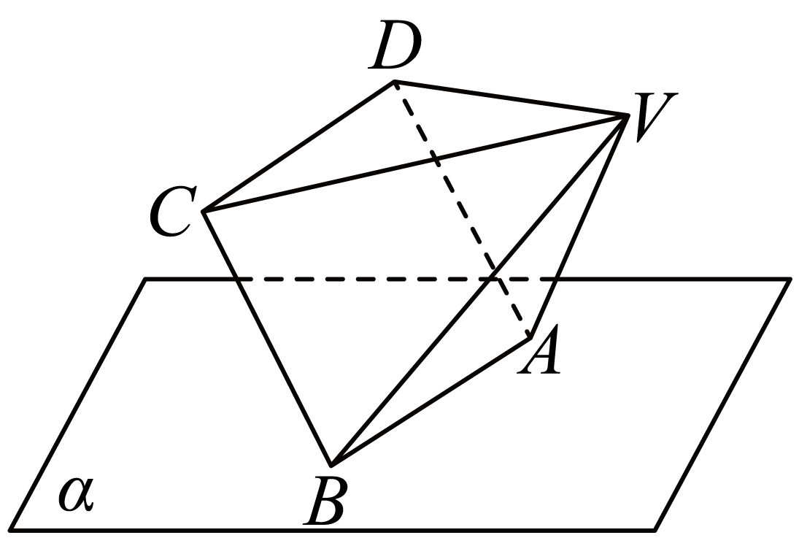

# Mathematics - 题目 2256

**ID**: 0e7a50b26c0c414f819c85ef253f560b
**年级**: Grade 12
**难度**: Medium-Hard
**题型**: Fill-in-the-blank

## 题目
如图，已知正四棱锥 $V-ABCD$ 中， $AB$ 在平面 $α$ 内，正四棱锥可绕着 $AB$ 任意旋转， $CD//$ 平面 $α$ ．若 $AB=2,VA=\sqrt {5}$ ，则正四棱锥 $V-ABCD$ 顶点 $V$ 在平面 $α$ 内的投影 $H$ 到 $CD$ 的距离的取值范围是．​​​​​​​‌

## 解答

1. 如图，因H为顶点 $V$ 在平面 $α$ 内的投影，则 $VH\bot AB$ .
2. 因几何体为正四棱锥，则三角形 $VAB$ 为等腰三角形，
3. 取AB中点为E，连接VE，则 $VE\bot AB$ ，又 $VH，VE\subset $ 平面 $VEH$ ， $VH\cap VE=V$ ，
4. 则 $AB\bot $ 平面 $VEH$ .连接EH，因 $EH\subset $ 平面 $VEH$ ，则 $AB\bot EH$ .
5. 取CD中点为F，连接EF，FH，由题有 $CD\bot EF$ ，又 $CD//AB$ ，则 $CD\bot EH$ .
6. 因 $EF，EH\subset $ 平面 $EFH$ ， $EF\cap EH=E$ ，则 $CD\bot $ 平面 $EFH$ .
7. 又 $FH\subset $ 平面 $EFH$ ，则 $CD\bot FH$ ，从而 $FH$ 为所求距离.
8. 因E为AB中点，则 $AE=\frac {1}{2}AB=1$ ，又 $VE\bot AB$ ， $VA=\sqrt {5}$ ，
9. 可得 $VE=2$ ，同理可得 $VF=2$ ，结合 $EF=2$ ，可得 $\vartriangle FEV$ 为等边三角形，
10. 则 $\angle FEV=\frac {{\rm{π}}}{3}$ .
11. 因为 $AB\bot $ 平面 $VEH$ ，且 $AB\bot $ 平面 $EFH$ ，所以 $F,E,H,V$ 四点共面.
12. 当H在E点右侧时，
13. 设 $\angle VEH=θ,θ\in \left [{0,\frac {{\rm{π}}}{2}}\right )$ ，有 $EH=VE{\cos}θ=2{\cos}θ$ ，
14. 则 $FH{^{2}}=FE{^{2}}+EH{^{2}}-2FE\cdot EH{\cos}\left ({θ+\frac {{\rm{π}}}{3}}\right )\Rightarrow $  $FH{^{2}}=4+4{\cos}{^{2}}θ-8{\cos}θ{\cos}\left ({θ+\frac {{\rm{π}}}{3}}\right )$ .
15. 注意到 $FH{^{2}}=4+4{\cos}θ\left [{\cos}θ-2{\cos}\left ({θ+\frac {{\rm{π}}}{3}}\right )\right ]=4+4\sqrt {3}{\cos}θ\sin θ=4+2\sqrt {3}\sin 2θ$ .
16. 因 $θ\in \left [{0,\frac {{\rm{π}}}{2}}\right )$ ，则 $2θ\in \left [{0,{\rm{π}}}\right )$ ， $\sin 2θ\in \left [0,1\right ]$ ，则 $FH{^{2}}\in \left [4,4+2\sqrt {3}\right ]\Rightarrow FH\in \left [2,\sqrt {3}+1\right ]$ ；
17. 当H与E重合时， $FH=2$ ；
18. 当H在E点左侧时，设 $\angle VEH=φ,φ\in \left ({\frac {{\rm{π}}}{3},\frac {{\rm{π}}}{2}}\right )$ ，则 $EH=VE{\cos}φ=2{\cos}φ$ .
19. 则 $FH{^{2}}=FE{^{2}}+EH{^{2}}-2FE\cdot EH{\cos}\left ({φ-\frac {{\rm{π}}}{3}}\right )\Rightarrow $  $FH{^{2}}=4+4{\cos}{^{2}}φ-8{\cos}φ{\cos}\left ({φ-\frac {{\rm{π}}}{3}}\right )$ .
20. 注意到 $FH{^{2}}=4+4{\cos}φ\left [{\cos}φ-2{\cos}\left ({φ-\frac {{\rm{π}}}{3}}\right )\right ]=4-4\sqrt {3}{\cos}φ\sin φ=4-2\sqrt {3}\sin 2φ$ .
21. 因 $φ\in \left ({\frac {{\rm{π}}}{3},\frac {{\rm{π}}}{2}}\right )$ ，则 $2φ\in \left ({\frac {2{\rm{π}}}{3},{\rm{π}}}\right )$ ， $\sin 2φ\in \left ({0,\frac {\sqrt {3}}{2}}\right )$ ，则 $FH{^{2}}\in \left ({1,4}\right )\Rightarrow FH\in \left ({1,2}\right )$ .
22. 综上可得 $FH\in \left ({1,1+\sqrt {3}}\right ]$ .
23. 

## 知识点

**中文**:
  - 直线与平面垂直的判定
  - 直线与平面垂直的性质

**English**:
  - Line-Plane Perpendicularity Determination
  - Properties of Line-Plane Perpendicularity

---
