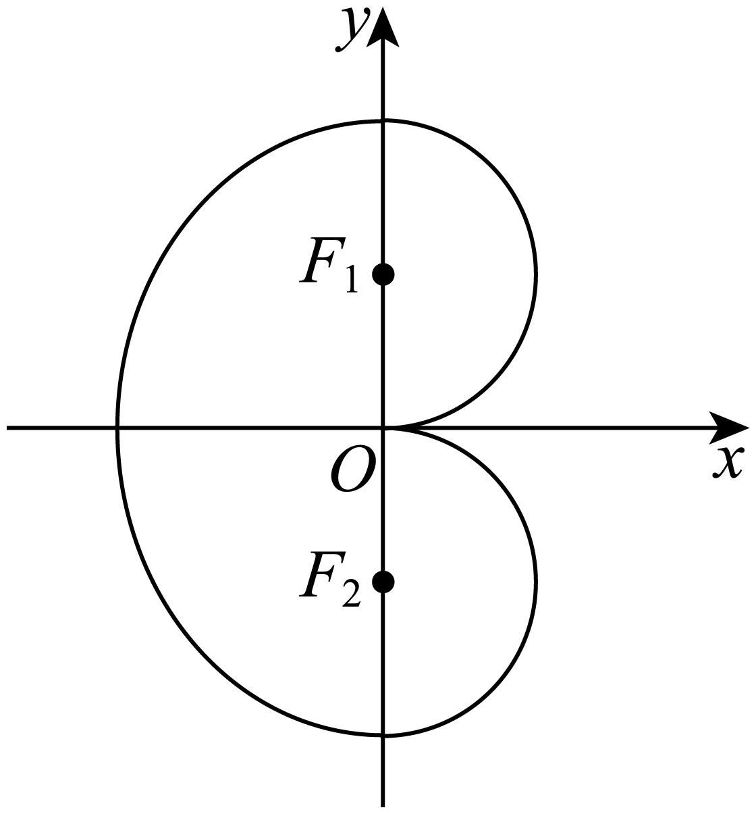

# Mathematics - 题目 775

**ID**: 3d130da3ee06479c90dbcabad113303f
**年级**: Grade 12
**难度**: Medium-Hard
**题型**: Fill-in-the-blank

## 题目
如图所示，由半椭圆 $C{{}_{1}}:\frac {x{^{2}}}{a{^{2}}}+\frac {y{^{2}}}{16}=1\left ({x\leqslant 0}\right )$ 和两个半圆 $C{{}_{2}}:x{^{2}}+{\left({y-2}\right)^{2}}=4\left ({x\geqslant 0}\right )$ ， $C{{}_{3}}:x{^{2}}+{\left({y+2}\right)^{2}}=4\left ({x\geqslant 0}\right )$ 组成曲线 $C:F\left ({x,y}\right )=0$ ，其中点 $F{{}_{1}}$ 、 $F{{}_{2}}$ 分别是 $C{{}_{1}}$ 的上、下焦点和 $C{{}_{2}}$ 、 $C{{}_{3}}$ 的圆心，若过点 $F{{}_{1}}$ 、 $F{{}_{2}}$ 作两条平行线 $l{{}_{1}}$ 、 $l{{}_{2}}$ 分别与 $C{{}_{1}}$ 、 $C{{}_{2}}$ 和 $C{{}_{1}}$ 、 $C{{}_{3}}$ 交于 $P$ 、 $Q$ 和 $M$ 、 $N$ ，则 $\left |{MN}\right |+\left |{PQ}\right |$ 的最小值为.​​​​​​​‌

## 解答

1. 已知半圆 $C{{}_{2}}:x{^{2}}+{\left({y-2}\right)^{2}}=4\left ({x\geqslant 0}\right )$ 的圆心为 $F{{}_{1}}\left ({0,2}\right )$ ，半径为 $2$ ，
2. 半圆 $C{{}_{3}}:x{^{2}}+{\left({y+2}\right)^{2}}=4\left ({x\geqslant 0}\right )$ 的圆心为 $F{{}_{2}}\left ({0,-2}\right )$ ，半径为 $2$ ，
3. 对于椭圆 $\frac {x{^{2}}}{a{^{2}}}+\frac {y{^{2}}}{16}=1$ 的焦距为 $\left |{F{{}_{1}}F{{}_{2}}}\right |=4$ ，则 $16-a{^{2}}=4$ ，可得 $a{^{2}}=12$ ，
4. 所以椭圆 $C{{}_{1}}$ 的方程为 $\frac {x{^{2}}}{12}+\frac {y{^{2}}}{16}=1$ ，如图所示，
5. 
6. 设直线 $l{{}_{1}}$ 与椭圆 $\frac {x{^{2}}}{12}+\frac {y{^{2}}}{16}=1$ 的另一个交点为 $E$ ，
7. 由椭圆的对称性可知，点 $E$ 与点 $M$ 关于原点对称，
8. 即点 $O$ 为线段 $EM$ 、 $F{{}_{1}}F{{}_{2}}$ 的中点，所以四边形 $EF{{}_{1}}MF{{}_{2}}$ 为平行四边形，所以 $\left |{EF{{}_{1}}}\right |=\left |{F{{}_{2}}M}\right |$ ，
9. $\left |{MN}\right |+\left |{PQ}\right |=\left |{MF{{}_{2}}}\right |+\left |{F{{}_{2}}N}\right |+\left |{PF{{}_{1}}}\right |+\left |{QF{{}_{1}}}\right |=\left |{PF{{}_{1}}}\right |+\left |{MF{{}_{2}}}\right |+4=\left |{PE}\right |+4$ ，
10. 若 $l{{}_{1}}$ 的斜率不存在，则直线 $l{{}_{1}}$ 过点 $F{{}_{2}}$ ，不合乎题意，所以直线 $l{{}_{1}}$ 的斜率存在，
11. 设直线 $l{{}_{1}}$ 的方程为 $y=kx+2$ ，设点 $P\left ({x{{}_{1}},y{{}_{1}}}\right )$ 、 $E\left ({x{{}_{2}},y{{}_{2}}}\right )$ ，
12. 联立 $\begin{cases}y=kx+2\\4x{^{2}}+3y{^{2}}=48\end{cases}$ ，可得 $\left ({3k{^{2}}+4}\right )x{^{2}}+12kx-36=0$ ，
13. $Δ=144k{^{2}}+4\times 36\left ({3k{^{2}}+4}\right )=144\times 4\left ({k{^{2}}+1}\right )$ ，
14. 由韦达定理可得 $x{{}_{1}}+x{{}_{2}}=-\frac {12k}{3k{^{2}}+4}$ ， $x{{}_{1}}x{{}_{2}}=-\frac {36}{3k{^{2}}+4}$ ，
15. 所以 $\left |{PE}\right |=\sqrt {1+k{^{2}}}\left |{x{{}_{1}}-x{{}_{2}}}\right |=\sqrt {1+k{^{2}}}\cdot \sqrt {{\left({x{{}_{1}}+x{{}_{2}}}\right)^{2}}-4x{{}_{1}}x{{}_{2}}}=\frac {24\left ({k{^{2}}+1}\right )}{3k{^{2}}+4}=\frac {8\left ({3k{^{2}}+4}\right )-8}{3k{^{2}}+4}$
16. $=8-\frac {8}{3k{^{2}}+4}$ ，故当 $k=0$ 时， $\left |{PE}\right |$ 取最小值 $8-\frac {8}{4}=6$ ，
17. 所以 $\left |{MN}\right |+\left |{PQ}\right |$ 的最小值为 $6+4=10$ .

## 知识点

**中文**:
  - 对称性
  - 椭圆的标准方程及应用
  - 直线与椭圆的位置关系
  - 范围最值问题

**English**:
  - Symmetry
  - Standard Equation and Applications
  - Line-Ellipse Relationship
  - Range and Extrema Problems

---
