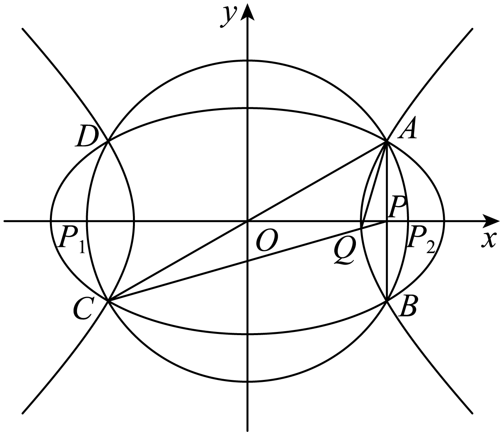

# Mathematics - 题目 3200

**ID**: 4b203237725c4f56b6a5773e851ca747
**年级**: Grade 12
**难度**: Medium-Hard
**题型**: Fill-in-the-blank

## 题目
如图，已知有公共焦点 $P{{}_{1}}(-c,0)$ 、 $P{{}_{2}}(c,0)$ 的椭圆 $C{{}_{1}}$ 和双曲线 $C{{}_{2}}$ 相交于A、B、C、D四个点，且满足 $\left |{OA}\right |=\left |{OB}\right |=\left |{OC}\right |=\left |{OD}\right |=c$ ，直线AB与x轴交于点P，直线CP与双曲线 $C{{}_{2}}$ 交于点Q，记直线AC、AQ的斜率分别为 $k{{}_{1}}$ 、 $k{{}_{2}}$ ，若 $k{{}_{1}}\cdot k{{}_{2}}=2$ ，则椭圆 $C{{}_{1}}$ 的离心率为.​​​​​​​‌

## 解答

1. 设椭圆 $C{{}_{1}}$ 的方程为 $\frac {x{{}^{2}}}{a{{}^{2}}}+\frac {y{{}^{2}}}{b{{}^{2}}}=1\left ({a>b>0}\right )$ ，
2. 双曲线 $C{{}_{2}}$ 的方程为 $\frac {x{{}^{2}}}{s{{}^{2}}}-\frac {y{{}^{2}}}{t{{}^{2}}}=1\left ({s>0.t>0}\right )$ ，
3. 因为椭圆 $C{{}_{1}}$ 和双曲线 $C{{}_{2}}$ 有公共焦点 $P{{}_{1}}(-c,0)$ 、 $P{{}_{2}}(c,0)$ ，
4. 所以 $a{{}^{2}}-b{{}^{2}}=s{{}^{2}}+t{{}^{2}}=c{{}^{2}}$ ，
5. 因为 $\left |{OA}\right |=\left |{OB}\right |=\left |{OC}\right |=\left |{OD}\right |=c$ ，
6. 联立 $\left \{\hspace{-0.5em}\begin{array}{l}\frac {x{{}^{2}}}{a{{}^{2}}}+\frac {y{{}^{2}}}{b{{}^{2}}}=1\\\frac {x{{}^{2}}}{s{{}^{2}}}-\frac {y{{}^{2}}}{t{{}^{2}}}=1\end{array}\hspace{-0.5em}\right.$ ，可得 $\left ({\frac {b{{}^{2}}}{a{{}^{2}}}+\frac {t{{}^{2}}}{s{{}^{2}}}}\right )x{{}^{2}}=b{{}^{2}}+t{{}^{2}}$ ，
7. 所以 $x=\pm \frac {as}{c}$ ，
8. 所以点 $A,B,C,D$ 的坐标分别为 $\left ({\frac {as}{c},\frac {bt}{c}}\right )$ ， $\left ({\frac {as}{c},-\frac {bt}{c}}\right )$ ， $\left ({-\frac {as}{c},-\frac {bt}{c}}\right )$ ， $\left ({-\frac {as}{c},\frac {bt}{c}}\right )$ ，
9. 所以直线 $AC$ 的斜率 $k{{}_{1}}=\frac {bt}{as}$ ，直线 $AB$ 的方程为 $x=\frac {as}{c}$ ，
10. 所以点 $P$ 的坐标为 $\left ({\frac {as}{c},0}\right )$ ，
11. 所以直线 $CP$ 的斜率为 $\frac {-\frac {bt}{c}}{-\frac {2as}{c}}=\frac {bt}{2as}$ ，
12. 所以直线 $CP$ 的方程为 $y=\frac {bt}{2as}\left ({x-\frac {as}{c}}\right )$ ，
13. 联立 $\left \{\hspace{-0.5em}\begin{array}{l}y=\frac {bt}{2as}\left ({x-\frac {as}{c}}\right )\\\frac {x{{}^{2}}}{s{{}^{2}}}-\frac {y{{}^{2}}}{t{{}^{2}}}=1\end{array}\hspace{-0.5em}\right.$ ，消 $y$ 得，
14. $\left ({4a{{}^{2}}-b{{}^{2}}}\right )x{{}^{2}}+2b{{}^{2}}\frac {as}{c}x-a{{}^{2}}s{{}^{2}}\left ({\frac {b{{}^{2}}}{c{{}^{2}}}+4}\right )=0$ ，
15. 设点 $Q$ 的坐标为 $\left ({x{{}_{0}},y{{}_{0}}}\right )$ ，
16. 则 $\left ({-\frac {as}{c}}\right )x{{}_{0}}=\frac {-a{{}^{2}}s{{}^{2}}\left ({\frac {b{{}^{2}}}{c{{}^{2}}}+4}\right )}{4a{{}^{2}}-b{{}^{2}}}$ ，
17. 所以 $x{{}_{0}}=\frac {as\left ({4c{{}^{2}}+b{{}^{2}}}\right )}{\left ({4a{{}^{2}}-b{{}^{2}}}\right )c}$ ， $y{{}_{0}}=\frac {bt}{2c}\left ({\frac {4c{{}^{2}}+b{{}^{2}}}{4a{{}^{2}}-b{{}^{2}}}-1}\right )=-\frac {b{{}^{3}}t}{c\left ({4a{{}^{2}}-b{{}^{2}}}\right )}$ ，
18. 所以直线 $AQ$ 的斜率 $k{{}_{2}}=\frac {-bt\left ({\frac {b{{}^{2}}}{4a{{}^{2}}-b{{}^{2}}}+1}\right )}{as\left ({\frac {4c{{}^{2}}+b{{}^{2}}}{4a{{}^{2}}-b{{}^{2}}}-1}\right )}=\frac {2at}{bs}$ ，又 $k{{}_{1}}=\frac {bt}{as}$ ， $k{{}_{1}}\cdot k{{}_{2}}=2$ ，
19. 所以 $s{{}^{2}}=t{{}^{2}}$ ，又 $s{{}^{2}}+t{{}^{2}}=c{{}^{2}}$ ，
20. 所以 $s{{}^{2}}=t{{}^{2}}=\frac {1}{2}c{{}^{2}}$ ，
21. 因为点 $A\left ({\frac {as}{c},\frac {bt}{c}}\right )$ ， $\left |{OA}\right |=c$ ，
22. 所以 $\left ({\frac {as}{c}}\right ){{}^{2}}+\left ({\frac {bt}{c}}\right ){{}^{2}}=c{{}^{2}}$ ，
23. 故 $a{{}^{2}}+b{{}^{2}}=2c{{}^{2}}$ ，故 $2a{{}^{2}}=3c{{}^{2}}$
24. 所以 $e=\frac {c}{a}=\frac {\sqrt {6}}{3}$ .
25. 故答案为： $\frac {\sqrt {6}}{3}$ .
26. 【点睛】方法点睛：椭圆的离心率是椭圆最重要的几何性质，求椭圆的离心率(或离心率的取值范围)，常见有两种方法：
27. ①求出a，c，代入公式 $e=\frac {c}{a}$ ；
28. ②只需要根据一个条件得到关于a，b，c的齐次式，结合b^{2}＝a^{2}－c^{2}转化为a，c的齐次式，然后等式(不等式)两边分别除以a或a^{2}转化为关于e的方程(不等式)，解方程(不等式)即可得e(e的取值范围)．

## 知识点

**中文**:
  - 椭圆的离心率

**English**:
  - Eccentricity

---
