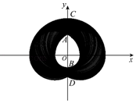

# Mathematics - 题目 144

**ID**: 4c1dd7fb3ff942e0a5813657b8dfe874
**年级**: Grade 12
**难度**: Medium-Hard
**题型**: Fill-in-the-blank

## 题目
已知集合 $P=\left \{\left ({x,y}\right )\left |{{\left({x-{\cos}θ}\right)^{2}}+{\left({y-{\sin}θ}\right)^{2}}=4,0\leqslant θ\leqslant π}\right .​​​​​​​‌\right \}$ .由集合P中所有的点组成的图形如图中阴影部分所示，中间白色部分形如美丽的“水滴”.给出下列结论：①“水滴”图形与y轴相交，最高点记为A，则点A的坐标为 $\left ({0,1}\right )$ ；②在集合P中任取一点M，则M到原点的距离的最大值为3；③阴影部分与y轴相交，最高点和最低点分别记为C，D，则 $\left |{CD}\right |=3+\sqrt {3}$ ；④白色“水滴”图形的面积是 $\frac {11}{6}π-\sqrt {3}$ .其中正确的有.

## 解答

1. 对于①中，方程 ${\left({x-{\cos}θ}\right)^{2}}+{\left({y-{\sin}θ}\right)^{2}}=4$ 中，
2. 令 $x=0$ ，得 ${\cos}{^{2}}θ+y{^{2}}-2y{\sin}θ+{\sin}{^{2}}θ=4$ ，
3. 所以 $2{\sin}θ=y-\frac {3}{y}$ ，其中 $θ\in \left [0,π\right ]$ ，所以 ${\sin}θ\in \left [0,1\right ]$ ，所以 $y-\frac {3}{y}\in \left [0,2\right ]$ ，
4. 解得 $y\in \left [-\sqrt {3},-1\right ]\cup \left [\sqrt {3},3\right ]$ ；
5. 所以点 $A\left ({0,\sqrt {3}}\right )$ ，点 $B\left ({0,-1}\right )$ ，点 $C\left ({0,3}\right )$ ，点 $D\left ({0,-\sqrt {3}}\right )$ ，所以①错误；
6. 对于②中，由 ${\left({x-{\cos}θ}\right)^{2}}+{\left({y-{\sin}θ}\right)^{2}}=4$ ，设 $\begin{cases}x=2{\cos}α+{\cos}θ\\y=2{\sin}α+{\sin}θ\end{cases}$ ，
7. 则点M到原点的距离为
8. $d=\sqrt {x{^{2}}+y{^{2}}}=\sqrt {{\left({2{\cos}α+{\cos}θ}\right)^{2}}+{\left({2{\sin}α+{\sin}θ}\right)^{2}}}=\sqrt {5+4{\cos}\left ({α-θ}\right )}$ ，
9. 当 $α=θ$ 时， ${\cos}\left ({α-θ}\right )=1$ ，d取得最大值为3，所以②正确；
10. 对于③中，由①知最高点为 $C\left ({0,3}\right )$ ，最低点为 $D\left ({0,-\sqrt {3}}\right )$ ，
11. 所以 $\left |{CD}\right |=3+\sqrt {3}$ ，③正确；
12. 对于④中，“水滴”图形是由一个等腰三角形，两个全等的弓形，和一个半圆组成；
13. 计算它的面积是 $S=S{{}_{半圆}}+2S{{}_{弓形}}+S{{}_{\mathrm{△}}}=\frac {1}{2}\times π\times 1{^{2}}+2\times \left ({\frac {2π}{3}-\sqrt {3}}\right )+\frac {1}{2}\times 2\times \sqrt {3}=\frac {11}{6}π-\sqrt {3}$ ，
14. 所以④正确；
15. 综上知，正确的命题序号是②③④.
16. 故答案为：②③④.

## 知识点

**中文**:
  - 单位圆与三角函数的基本性质
  - 弧长公式与扇形面积公式

**English**:
  - Basic Properties on Unit Circle
  - Arc Length and Sector Area Formulas

---
