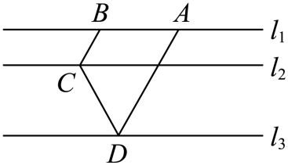

# Mathematics - 题目 2160

**ID**: 59494bfee2354103aa838569f6ecc269
**年级**: Grade 12
**难度**: Medium-Hard
**题型**: Fill-in-the-blank

## 题目
如图， $l{{}_{1}}//l{{}_{2}}//l{{}_{3}}$ ，且 $l{{}_{1}}$ 与 $l{{}_{2}}$ 的距离为1， $l{{}_{2}}$ 与 $l{{}_{3}}$ 的距离为2.​​​​​​​‌若 $A,B$ 在 $l{{}_{1}}$ 上， $C,D$ 分别在 $l{{}_{2}}$ ， $l{{}_{3}}$ 上， $CD=2CB$ ， $\angle BCD=120{}^\circ $ ， $BC//AD$ .则四边形 $ABCD$ 的面积为.

## 解答

1. 如图，设 $AD\cap l{{}_{2}}=H$ ， $\angle BCH=θ$ ，则 $\angle DCH=\frac {{{2}}{\rm{π}}}{3}-θ$
2. 因为 $l{{}_{1}}$ 与 $l{{}_{2}}$ 的距离为1， $l{{}_{2}}$ 与 $l{{}_{3}}$ 的距离为2，所以 $BC=\frac {1}{{\rm{s}}{\rm{i}}{\rm{n}}θ},CD=\frac {2}{{\rm{s}}{\rm{i}}{\rm{n}}(\frac {{{2}}{\rm{π}}}{3}-θ)}$ ，
3. 因为 $CD=2CB$ ，所以 $\frac {2}{{\rm{s}}{\rm{i}}{\rm{n}}θ}=\frac {2}{{\rm{s}}{\rm{i}}{\rm{n}}(\frac {{{2}}{\rm{π}}}{3}-θ)}$ ，得到 ${\rm{s}}{\rm{i}}{\rm{n}}θ={\rm{s}}{\rm{i}}{\rm{n}}(\frac {{{2}}{\rm{π}}}{3}-θ)$ ，
4. 由图易知 $θ\in \left ({0,\frac {{\rm{π}}}{2}}\right )$ ， $\frac {{{2}}{\rm{π}}}{3}-θ\in (0,\frac {{\rm{π}}}{2})$ ，所以 $θ=\frac {{{2}}{\rm{π}}}{3}-θ$ ，得到 $θ=\frac {{\rm{π}}}{3}$ ，
5. 所以 $BC=\frac {1}{{\rm{s}}{\rm{i}}{\rm{n}}\frac {{\rm{π}}}{3}}=\frac {2\sqrt {3}}{3}$ ， $CD=\frac {2}{{\rm{s}}{\rm{i}}{\rm{n}}\frac {{\rm{π}}}{3}}=\frac {4\sqrt {3}}{3}$ ，
6. 过 $C,B$ 分别作 $AD$ 的垂线，交 $AD$ 于 $E,F$ ，在 ${\rm{R}}{\rm{t}}\vartriangle CED$ 中， $\angle DCE=\frac {{\rm{π}}}{6}$ ， $CD=\frac {4\sqrt {3}}{3}$ ，
7. 所以 $CE=2,DE=\frac {2\sqrt {3}}{3}$ ，
8. 因为 $BC//AD$ ，所以 $BF=CE=2,EF=CB=\frac {{{2}}\sqrt {3}}{3}$ ，
9. 在 ${\rm{R}}{\rm{t}}\vartriangle BFA$ 中， $\angle ABF=\frac {{\rm{π}}}{6}$ ，所以 $AF=BF\cdot {\rm{t}}{\rm{a}}{\rm{n}}\frac {{\rm{π}}}{6}=\frac {2\sqrt {3}}{3}$ ，得到 $DA=\frac {6\sqrt {3}}{3}=2\sqrt {3}$ ，
10. 所以四边形 $ABCD$ 的面积为 $S=\frac {1}{2}\left ({CB+DA}\right )\cdot CE=\frac {1}{2}\times \left ({\frac {{{2}}\sqrt {3}}{3}+2\sqrt {3}}\right )\times 2=\frac {8\sqrt {3}}{3}$ ，
11. .

## 知识点

**中文**:
  - 在实际问题中建立三角函数模型

**English**:
  - Modeling Real-world Problems

---
