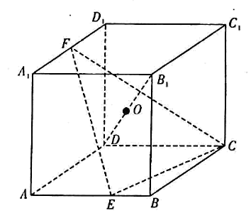

# Mathematics - 题目 2851

**ID**: 6422c98a14ec45a78d25863f2b13094c
**年级**: Grade 12
**难度**: Medium-Hard
**题型**: Fill-in-the-blank

## 题目
如图，长方体 $ABCD-A{{}_{1}}B{{}_{1}}C{{}_{1}}D{{}_{1}}$ 中， $AB=BC,BE=\frac {1}{3}AB$ ，点 $F$ 为 $A{{}_{1}}D{{}_{1}}$ 中点， $O$ 为直线 $DB{{}_{1}}$ 与平面 $EFC$ 的交点，则 $\frac {DO}{OB{{}_{1}}}=$.​​​​​​​‌

## 解答

1. 作 $D{{}_{1}}C{{}_{1}}$ 的六等分点 $H$ 且 $\frac {D{{}_{1}}H}{D{{}_{1}}C{{}_{1}}}=\frac {1}{6}$
2. $\because \frac {D{{}_{1}}H}{D{{}_{1}}F}=\frac {BE}{BC}$ ， $\therefore $ 可知 $FH//CE$
3. 设 $FH\cap B{{}_{1}}D{{}_{1}}=N,CE\cap BD=M$
4. 连接 $MN$ ，则 $M、N、O$ 三点共线（∵平面 $EFC\cap $ 平面 $BB{{}_{1}}D{{}_{1}}D=MN$ ）
5. $\because \frac {BM}{DM}=\frac {1}{3},\therefore \frac {DM}{BD}=\frac {3}{4}$ ，
6. 过 $F$ 作 $FP//A{{}_{1}}B{{}_{1}}$ 交 $B{{}_{1}}D{{}_{1}}$ 于 $P$ 点，
7. $\because \frac {D{{}_{1}}N}{NP}=\frac {D{{}_{1}}H}{FP}=\frac {1}{6}\div \frac {1}{2}=\frac {1}{3}$ ， $\therefore NP=3D{{}_{1}}N$ ， $\therefore \frac {D{{}_{1}}N}{B{{}_{1}}D{{}_{1}}}=\frac {D{{}_{1}}N}{8D{{}_{1}}N}=\frac {1}{8},\therefore \frac {NB{{}_{1}}}{B{{}_{1}}D{{}_{1}}}=\frac {7}{8}$
8. $\therefore \frac {DO}{OB{{}_{1}}}=\frac {DM}{NB{{}_{1}}}=\frac {3}{4}\div \frac {7}{8}=\frac {6}{7}$ .
9. 故答案为： $\frac {6}{7}$ .
10. 

## 知识点

**中文**:
  - 直线与直线的位置关系的判断

**English**:
  - Determining Line-Line Relationships

---
