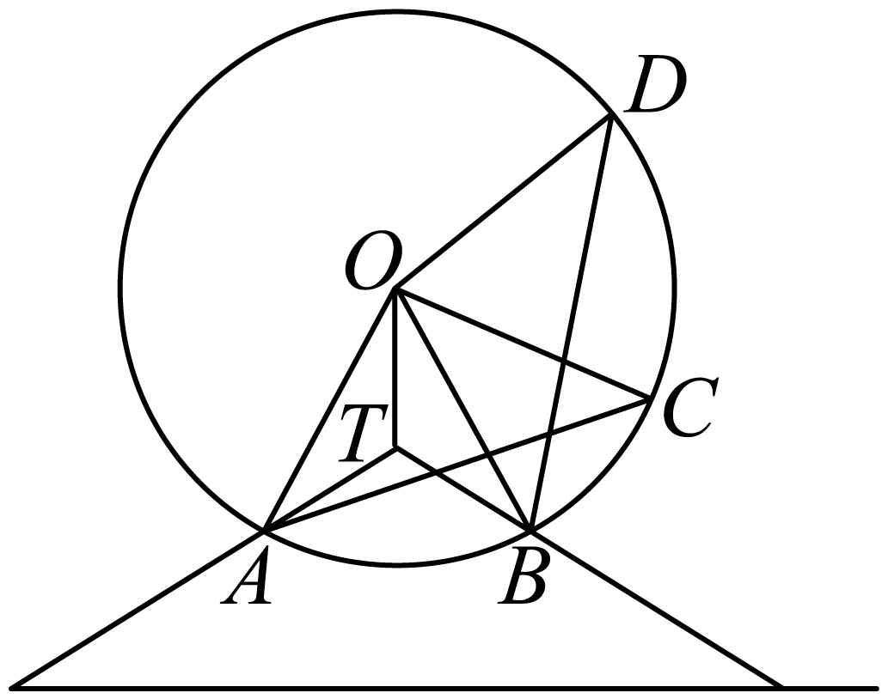

# Mathematics - 题目 2485

**ID**: 8d5b0d88fdad49aab2b8c09cd5c1c2a7
**年级**: Grade 12
**难度**: Medium-Hard
**题型**: Fill-in-the-blank

## 题目
“天津之眼”摩天轮是天津的地标建筑，闪耀着这座城市的宏伟与浪漫．下图是抽象自“天津之眼”的几何图形，圆 $O$ 是以1为半径的圆， $A$ ， $B$ 是关于直线 $OT$ 对称的两点，且 $TA=TB=TO$ ， $C$ ， $D$ 为圆 $O$ 上两个动点，满足 $\angle COD=60{}\degree $ ，且 $D$ 是以 $OC$ 为始边按逆时针方向旋转 $60{}\degree $ 所成角的终边与圆 $O$ 的交点．（1）当点 $C$ 运动到满足 $OC\bot OT$ ，且点 $D$ 在点 $O$ 上方时，则 $\overrightarrow {{AC}}$ 在 $\overrightarrow {{OD}}$ 上的投影向量的模为；​​​​​​​‌（2）当点 $C$ ， $D$ 在圆 $O$ 上运动时， $\overrightarrow {{AC}}\cdot \overrightarrow {{BD}}$ 的取值范围是．

## 解答

1. 以O为原点，建立平面直角坐标系，如图，
2. 
3. 设 $T\left ({0,b}\right )$ ， $A\left ({x,y}\right )$ ，则由 $TA=TB=TO$ ， $A$ , $B$ 关于直线 $OT$ 对称，
4. 所以 $\angle ATO=\angle ATB=\angle BTO=120{}\degree $ ，
5. 所以 $AB=OA=OB=1$ ，所以 $A\left ({-\frac {1}{2},-\frac {\sqrt {3}}{2}}\right )$ ， $b=-\frac {\sqrt {3}}{3}$ ，
6. （1）当 $OC\bot OT$ ，且点 $D$ 在点 $O$ 上方时， $C\left ({1,0}\right )$ ， $D\left ({\frac {1}{2},\frac {\sqrt {3}}{2}}\right )$ ,
7. 则 $\overrightarrow {{AC}}=\left ({\frac {3}{2},\frac {\sqrt {3}}{2}}\right )$ ， $\overrightarrow {{OD}}=\left ({\frac {1}{2},\frac {\sqrt {3}}{2}}\right )$ ，
8. 所以 $\overrightarrow {{AC}}$ 在 $\overrightarrow {{OD}}$ 上的投影向量的模为 $\left |{\frac {\overrightarrow {{AC}}\cdot \overrightarrow {{OD}}}{\left |{\overrightarrow {{OD}}}\right |}}\right |=\frac {\frac {3}{2}\times \frac {1}{2}+\frac {\sqrt {3}}{2}\times \frac {\sqrt {3}}{2}}{\sqrt {\frac {1}{4}+\frac {3}{4}}}=\frac {3}{2}$ ；
9. （2）设 $\angle xOC=α$ ，则 $C({\cos}α,\sin α)$ ，
10. 由 $\angle COD=60{}\degree $ ，所以 $D\left ({{\cos}\left ({α+60{}\degree }\right ),\sin \left ({α+60{}\degree }\right )}\right )$ ，
11. 由 $A\left ({-\frac {1}{2},-\frac {\sqrt {3}}{2}}\right ),B\left ({\frac {1}{2},-\frac {\sqrt {3}}{2}}\right )$ ，
12. 则 $\overrightarrow {{AC}}=\left ({{\cos}α+\frac {1}{2},\sin α+\frac {\sqrt {3}}{2}}\right ),\overrightarrow {{BD}}=\left ({{\cos}\left ({α+60{}\degree }\right )-\frac {1}{2},\sin \left ({α+60{}\degree }\right )+\frac {\sqrt {3}}{2}}\right )$ ,
13. 所以 $\overrightarrow {{AC}}\cdot \overrightarrow {{BD}}=\left ({{\cos}α+\frac {1}{2}}\right )\left ({{\cos}\left ({α+60{}\degree }\right )-\frac {1}{2}}\right )+\left ({\sin α+\frac {\sqrt {3}}{2}}\right )\left ({\sin \left ({α+60{}\degree }\right )+\frac {\sqrt {3}}{2}}\right )$
14. $={\cos}\left ({α+60{}\degree -α}\right )-\frac {1}{2}{\cos}α+\frac {1}{2}{\cos}\left ({α+60{}\degree }\right )-\frac {1}{4}+\frac {\sqrt {3}}{2}\sin α+\frac {\sqrt {3}}{2}\sin \left ({α+60{}\degree }\right )+\frac {3}{4}$
15. $=-{\cos}\left ({α+60{}\degree }\right )+\frac {1}{2}{\cos}\left ({α+60{}\degree }\right )+\frac {\sqrt {3}}{2}\sin \left ({α+60{}\degree }\right )+1$
16. $=\sin \left ({α+30{}\degree }\right )+1$ ，
17. 由 $-1\mathrm{\leqslant }\sin \left ({α+30{}\degree }\right )\mathrm{\leqslant }1$ ，可知 $0\mathrm{\leqslant }\sin \left ({α+30{}\degree }\right )+1\mathrm{\leqslant }2$ ，
18. 所以 $\overrightarrow {{AC}}\cdot \overrightarrow {{BD}}$ 的取值范围是 $\left [0,2\right ]$ .

## 知识点

**中文**:
  - 向量的投影
  - 数量积的计算

**English**:
  - Vector Projection
  - Calculation of Scalar Product

---
