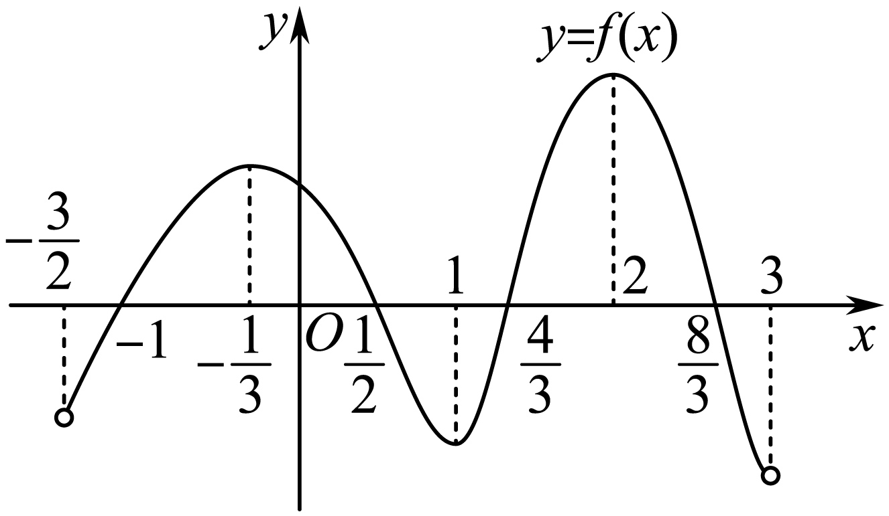

# Mathematics - 题目 1865

**ID**: 94ed1e2ef8714a7a8d79bd19ffa7e0f2
**年级**: Grade 12
**难度**: Medium-Hard
**题型**: Fill-in-the-blank

## 题目
函数 $y=f\left ({x}\right )$ 在其定义域 $\left [-\frac {3}{2},3\right ]$ 内的导数 $f^{′}{\left ({x}\right )}$ 存在，其图象如题图所示，记 $y=f\left ({x}\right )$ 的导数为 $y=f^{′}{\left ({x}\right )}$ ，则不等式 $f^{′}{\left ({x}\right )}\leqslant 0$ 的解集是．​​​​​​​‌

## 解答

1. 由图象可知 $f\left ({x}\right )$ 在区间 $\left [-\frac {1}{3},1\right ]$ 和[2，3]上单调递减，
2. 所以 $f^{′}{\left ({x}\right )}\leqslant 0$ 的解集为 $\left [-\frac {1}{3},1\right ]\cup \left [2,3\right ]$ ．

## 知识点

**中文**:
  - 利用导数研究函数的图象

**English**:
  - Studying Function Graphs

---
