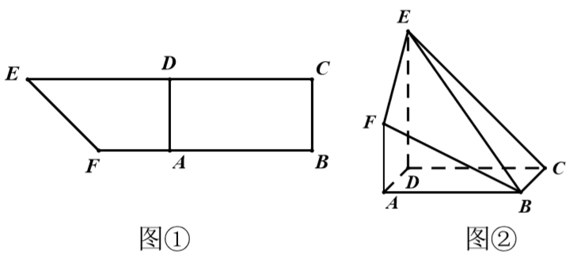

# Mathematics - 题目 1667

**ID**: 9fccd590880146bea8c860ffd64c35c8
**年级**: Grade 12
**难度**: Medium-Hard
**题型**: Fill-in-the-blank

## 题目
如图所示，在直角梯形 $BCEF$ 中， $\angle CBF=\angle BCE=90{^{\circ }}$ ， $A$ 、 $D$ 分别是 $BF$ 、 $CE$ 上的点， $AD{\rm{/}}{\rm{/}}BC$ ，且 $AB=DE=2BC=2AF$ （如图①）.​​​​​​​‌将四边形 $ADEF$ 沿 $AD$ 折起，连接 $BE$ 、 $BF$ 、 $CE$ （如图②）.在折起的过程中，则下列表述：① $AC{\rm{/}}{\rm{/}}$ 平面 $BEF$ ；②四点 $B$ 、 $C$ 、 $E$ 、 $F$ 可能共面；③若 $EF\bot CF$ ，则平面 $ADEF\bot $ 平面 $ABCD$ ；④平面 $BCE$ 与平面 $BEF$ 可能垂直.其中正确的是.

## 解答

1. 对于命题①，连接 $AC$ 、 $BD$ 交于点 $M$ ，取 $BE$ 的中点 $M$ 、 $N$ ，连接 $MN$ 、 $FN$ ，如下图所示：
2. 
3. 则 $AF=\frac {1}{2}DE$ 且 $AF{\rm{/}}{\rm{/}}DE$ ，四边形 $ABCD$ 是矩形，且 $AC\cap BD=M$ ， $\therefore M$ 为 $BD$ 的中点，
4. $\because N$ 为 $BE$ 的中点， $\therefore MN{\rm{/}}{\rm{/}}DE$ 且 $MN=\frac {1}{2}DE$ ， $\therefore MN{\rm{/}}{\rm{/}}AF$ 且 $MN=AF$ ，
5. $\therefore $ 四边形 $AFNM$ 为平行四边形， $\therefore AM{\rm{/}}{\rm{/}}FN$ ，即 $AC{\rm{/}}{\rm{/}}FN$ ，
6. $\because AC\not\subset $ 平面 $BEF$ ， $FN\subset $ 平面 $BEF$ ， $\therefore AC{\rm{/}}{\rm{/}}$ 平面 $BEF$ ，命题①正确；
7. 对于命题②， $\because BC{\rm{/}}{\rm{/}}AD$ ， $BC\not\subset $ 平面 $ADEF$ ， $AD\subset $ 平面 $ADEF$ ， $\therefore BC{\rm{/}}{\rm{/}}$ 平面 $ADEF$ ，
8. 若四点 $B$ 、 $C$ 、 $E$ 、 $F$ 共面，则这四点可确定平面 $α$ ，则 $BC\subset α$ ，平面 $α\cap $ 平面 $ADEF=EF$ ，由线面平行的性质定理可得 $BC{\rm{/}}{\rm{/}}EF$ ，
9. 则 $EF{\rm{/}}{\rm{/}}AD$ ，但四边形 $ADEF$ 为梯形且 $AD$ 、 $EF$ 为两腰， $AD$ 与 $EF$ 相交，矛盾.
10. 所以，命题②错误；
11. 对于命题③，连接 $DF$ 、 $CF$ ，设 $AD=AF=a$ ，则 $DE=2a$ ，
12. 
13. 在 $Rt\Delta ADF$ 中， $AD=AF=a$ ， $\angle DAF=\frac {π}{2}$ ，则 $ΔADF$ 为等腰直角三角形，
14. 且 $\angle AFD=\angle ADF=\frac {π}{4}$ ， $DF=\sqrt {2}a$ ， $\therefore \angle EDF=\frac {π}{4}$ ，且 $DE=2a$ ，
15. 由余弦定理得 $EF{^{2}}=DE{^{2}}+DF{^{2}}-2DE\cdot DF{\cos}\angle EDF=2a{^{2}}$ ， $\therefore DF{^{2}}+EF{^{2}}=DE{^{2}}$ ，
16. $\therefore DF\bot EF$ ，又 $\because EF\bot CF$ ， $DF\cap CF=F$ ， $\therefore EF\bot $ 平面 $CDF$ ，
17. $\because CD\subset $ 平面 $CDF$ ， $\therefore CD\bot EF$ ，
18. $\because CD\bot AD$ ， $AD$ 、 $EF$ 为平面 $ADEF$ 内的两条相交直线，所以， $CD\bot $ 平面 $ADEF$ ，
19. $\because CD\subset $ 平面 $ABCD$ ， $\therefore $ 平面 $ADEF\bot $ 平面 $ABCD$ ，命题③正确；
20. 对于命题④，假设平面 $BCE$ 与平面 $BEF$ 垂直，过点 $F$ 在平面 $BEF$ 内作 $FG\bot BE$ ，
21. $\because $ 平面 $BCE\bot $ 平面 $BEF$ ，平面 $BCE\cap $ 平面 $BEF=BE$ ， $FG\bot BE$ ， $FG\subset $ 平面 $BEF$ ，
22. $\therefore FG\bot $ 平面 $BCE$ ，
23. $\because BC\subset $ 平面 $BCE$ ， $\therefore BC\bot FG$ ，
24. $\because AD\bot AB$ ， $AD\bot AF$ ， $BC{\rm{/}}{\rm{/}}AD$ ， $\therefore BC\bot AB$ ， $BC\bot AF$ ，
25. 又 $\because AB\cap AF=A$ ， $\therefore BC\bot $ 平面 $ABF$ ， $\because BF\subset $ 平面 $ABF$ ， $\therefore BC\bot BF$ .
26. $\because FG\cap BF=F$ ， $\therefore BC\bot $ 平面 $BEF$ ， $\because EF\subset $ 平面 $BEF$ ， $\therefore BC\bot EF$ .
27. $\because AD{\rm{/}}{\rm{/}}BC$ ， $\therefore EF\bot AD$ ，显然 $EF$ 与 $AD$ 不垂直，命题④错误.
28. 故答案为：①③.
29. 

## 知识点

**中文**:
  - 探究性问题
  - 翻折问题

**English**:
  - Inquiry Problems
  - Folding Problems

---
