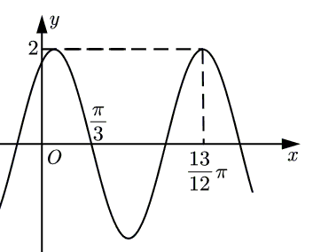

# Mathematics - 题目 3011

**ID**: a0a2830f24a24a5e95ef526f55cdfe10
**年级**: Grade 12
**难度**: Medium-Hard
**题型**: Fill-in-the-blank

## 题目
已知函数  $f(x)=2\cos (\omega x+\phi )$   的部分图像如图所示，则满足条件  $[f(x)-f(-\frac{7\pi }{4})][f(x)-f(\frac{4\pi }{3})]＞0$   的最小正整数  $x$   为．​​​​​​​‌

## 解答

1. 解法一：通解通法
2. 由图可知  $\frac{3}{4}T=\frac{13\pi }{12}-\frac{\pi }{3}=\frac{3\pi }{4}$   ，所以  $T=\frac{2\pi }{\omega }=\pi $   ，所以  $\omega =2$   .由五点法可得  $2×\frac{\pi }{3}+\phi =\frac{\pi }{2}$   ，所以  $\phi =-\frac{\pi }{6}$   ，
3. 所以  $f(x)=2\cos (2x-\frac{\pi }{6})$   ，所以  $f(-\frac{7\pi }{4})=2\cos (-\frac{11\pi }{3})=1$   ，  $f(\frac{4\pi }{3})=2\cos (\frac{5\pi }{2})=0$   .
4. 又因为  $[f(x)-f(-\frac{7\pi }{4})][f(x)-f(\frac{4\pi }{3})]＞0$   ，所以  $f(x)＞1$   或  $f(x)＜0$   ，所以  $\cos (2x-\frac{\pi }{6})＞\frac{1}{2}$   或  $\cos (2x-\frac{\pi }{6})＜0$   ，所以  $-\frac{\pi }{3}+2k\pi ＜2x-\frac{\pi }{6}＜\frac{\pi }{3}+2k\pi $   （  $k\in \mathbf{Z}$   ）或  $\frac{\pi }{2}+2k\pi ＜2x-\frac{\pi }{6}＜\frac{3\pi }{2}+2k\pi $   （  $k\in \mathbf{Z}$   ），所以  $-\frac{\pi }{12}+k\pi ＜x＜\frac{\pi }{4}+k\pi $   （  $k\in \mathbf{Z}$   ）或  $\frac{\pi }{3}+k\pi ＜x＜\frac{5\pi }{6}+k\pi $   （  $k\in \mathbf{Z}$   ），
5. 令  $k=0$   ，得  $-\frac{\pi }{12}＜x＜\frac{\pi }{4}$   或  $\frac{\pi }{3}＜x＜\frac{5\pi }{6}$   （  $k\in \mathbf{Z}$   ），所以  $x$   的最小正整数为2.
6. 解法二：数形结合法
7. 由图可知  $\frac{3}{4}T=\frac{13\pi }{12}-\frac{\pi }{3}=\frac{3\pi }{4}$   ，所以  $T=\frac{2\pi }{\omega }=\pi $   ，所以  $\omega =2$   ，由五点法可得  $2×\frac{\pi }{3}+\phi =\frac{\pi }{2}$   ，所以  $\phi =-\frac{\pi }{6}$   ，
8. 所以  $f(x)=2\cos (2x-\frac{\pi }{6})$   ，所以  $f(-\frac{7\pi }{4})=2\cos (-\frac{11\pi }{3})=1$   ，  $f(\frac{4\pi }{3})=2\cos (\frac{5\pi }{2})=0$   .
9. 又因为  $[f(x)-f(-\frac{7\pi }{4})][f(x)-f(\frac{4\pi }{3})]＞0$   ，所以  $f(x)＞1$   或  $f(x)＜0$   ，所以  $2\cos (2x-\frac{\pi }{6})＞1$   或  $2\cos (2x-\frac{\pi }{6})＜0$   ，结合图象，发现  $f(1)=2\cos (2-\frac{\pi }{6})＜2\cos (\frac{\pi }{2}-\frac{\pi }{6})=1$   ，
10. 所以结合图形可知，最小正整数应该满足  $f(x)＜0$   ，
11. 又  $f(2)=2\cos (4-\frac{\pi }{6})＜0$   ，符合题意，所以  $x$   的最小正整数为2.

## 知识点

**中文**:
  - 余弦函数的图象及应用

**English**:
  - Graph and Applications of Cosine Function

---
