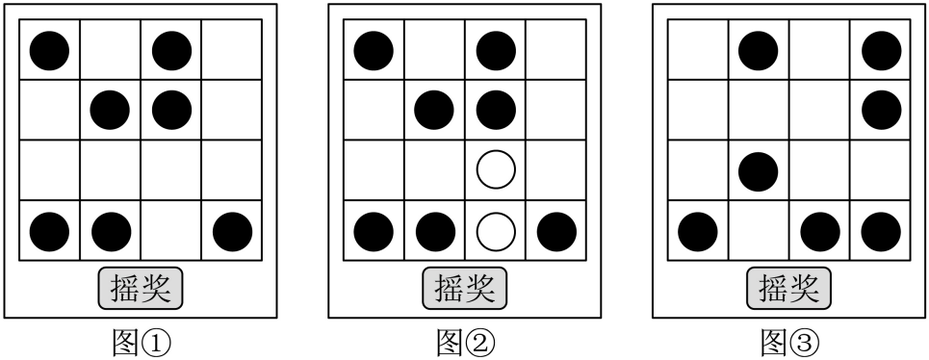

# Mathematics - 题目 1363

**ID**: b3b51f507d964af580425ebf3720c1ec
**年级**: Grade 12
**难度**: Medium-Hard
**题型**: Fill-in-the-blank

## 题目
为激励高三学子的学习热情， 数学老师开发了一款小游戏程序， 同学们表现优秀时可参与一次.​​​​​​​‌ 游戏规则如下：第一步， 在图①所示的棋盘内， 学生点击摇奖， 程序会随机放上 7 枚黑棋；第二步， 学生自行选择空格放上 2 枚白棋；最终， 每当有 4 枚棋子在同一行、列或对角线上时， 称为连成一条线. 若未连成线， 则获安慰奖；连成一、二、三条线，分别获三、二、一等奖，图②就是一种获一等奖的情况. 现在小明和小红都可参与一次游戏. 小明点击摇奖后， 出现了图③的情况， 若他随机地放上白棋，则他获二等奖的概率是；已知小红放上白棋时总能保证奖励最大化，则在“点击摇奖后，7 枚黑棋中恰有 4 枚在第一列” 的条件下，她获一等奖的概率是.

## 解答

1. 对于小明，在图③的情况下，再放2枚白棋形成两条线的不同情况有4种，
2. 而样本空间共有 ${\rm{C}}{{}_{9}^{2}}=36$ 种不同情况，所以小明获二等奖的概率是 $P{{}_{1}}=\frac {4}{36}=\frac {1}{9}$ ；
3. 对于小红，9枚棋子形成三条线的形状（简称“三线”）必然由一行、一列、一对角线构成，
4. 由于第一列已经确定，所以当第一或第四行连上时，对角线还有1种情况；当第二行或三行连上时，
5. 对角线还有2种情况，因此“三线”共有 $2\times 1+2\times 2=6$ 种，由于小红总能保证奖励最大化，
6. 则只需随机出来的形状恰好是“三线”去掉2枚棋子（简称“准三线”）即可，
7. 因此从第一列外的5枚棋子中去掉2枚棋子形成的“准三线”共 $6{\rm{C}}{{}_{5}^{2}}=60$ 种，
8. 但是，有一些“准三线”可以由多个“三线”得到：
9. 第一列和某一对角线形成的“准三线”，可以由3个不同的“三线”得到，重复计算的“准三线”有 $2\times 2=4$ 次；
10. 
11. 第一列和第二行或三行形成的“准三线”，可以由2个不同的“三线”得到，重复计算的“准三线”有 $2\times 1=2$ 次，
12. 
13. 因此，“准三线”实际上只有 $60-4-2=54$ 种，第一列之外随机放上3枚棋子的所有情况为 ${\rm{C}}{{}_{12}^{3}}$ 种，
14. 所以小红获得一等奖的概率 $P{{}_{2}}=\frac {54}{{\rm{C}}{{}_{12}^{3}}}=\frac {27}{110}$ .

## 知识点

**中文**:
  - 概率与计数原理相结合的应用题

**English**:
  - Combined Problems

---
