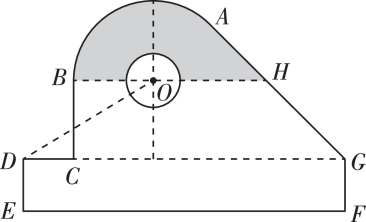

# Mathematics - 题目 221

**ID**: c286b2b6891646a1af186ba3c53a9af0
**年级**: Grade 12
**难度**: Medium-Hard
**题型**: Fill-in-the-blank

## 题目
某中学开展劳动实习，学生加工制作零件，零件的截面如图所示.​​​​​​​‌O为圆孔及轮廓圆弧AB所在圆的圆心，A是圆弧AB与直线AG的切点，B是圆弧AB与直线BC的切点，四边形DEFG为矩形，BC⊥DG，垂足为 ${\rm \mathit{C}，tan∠\mathit{ODC}＝}\frac{3}{5}{\rm ，\mathit{BH}}$∥DG，EF＝12 cm，DE＝2 cm，A到直线DE和EF的距离均为7 cm，圆孔半径为1 cm，则图中阴影部分的面积为cm^{2}.

## 解答

1. 连接OA，过点A作EF的垂线，分别交BH，DG于点M，N，过点O垂直于CG的直线与CG交于点P，则由EF＝12，DE＝2，A到直线DE和EF的距离为7可知AN＝NG＝5，则 ${\rm ∠\mathit{MAH}＝}\frac{\mathrm{\pi }}{4}$ .又OA⊥AG，所以 ${\rm △\mathit{AOM}}$ 为等腰直角三角形， ${\rm ∠\mathit{AOM}＝}\frac{\mathrm{\pi }}{4}{\rm ，∠\mathit{AOB}＝}$  $\frac{3\mathrm{\pi }}{4}$ .令AM＝OM＝MH＝PN＝x，则 ${\rm \mathit{OP}＝\mathit{MN}＝5－\mathit{x}，\mathit{DP}＝7－\mathit{x}，\mathit{OA}＝\mathit{AH}＝}\sqrt{2}{\rm \mathit{x}}$ ，由 ${\rm tan∠\mathit{ODC}＝}\frac{OP}{DP}{\rm ＝}$  $\frac{5-x}{7-x}{\rm ＝}$  $\frac{3}{5}$ ，得x＝2，则 ${\rm \mathit{OA}＝2}\sqrt{2}$ ，所以 ${\rm \mathit{S}_{△}\mathit{_{OAH}}＝}\frac{1}{2}$ ·OA·AH＝4，S_{扇形}_{OAB}＝ $\frac{1}{2}{\rm ×}$  $\frac{3\mathrm{\pi }}{4}{\rm ×\mathit{OA}^{2}＝}$  $\frac{3\mathrm{\pi }}{8}{\rm ×8＝3π}$ ，圆孔半径为1，则S_{半圆}_{O}＝ $\frac{1}{2}{\rm π×1^{2}＝}$  $\frac{\mathrm{\pi }}{2}$ ，所以S_{阴影}＝S_{扇形}_{OAB}＋S_{△}_{OAH}－S_{半圆}_{O}＝3π＋4－ $\frac{\mathrm{\pi }}{2}{\rm ＝}$  $\frac{5\mathrm{\pi }}{2}{\rm ＋4}$ .
2. 

## 知识点

**中文**:
  - 弧长公式与扇形面积公式

**English**:
  - Arc Length and Sector Area Formulas

---
