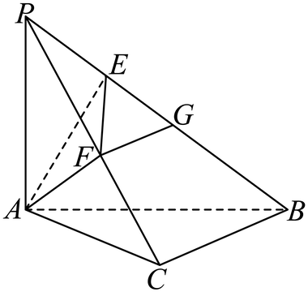

# Mathematics - 题目 1564

**ID**: e12334db478d4f9dbd7d53fb83e2c626
**年级**: Grade 12
**难度**: Medium-Hard
**题型**: Fill-in-the-blank

## 题目
已知 $PA\bot $ 平面 $ABC$ ， $BC\bot AC$ ， $\angle ABP=30{^{\circ }}$ ， $AF\bot CP$ 于 $F$ ， $AE\bot BP$ 于 $E$ ， $G$ 在 $BC$ 上，且满足 $FG//BC$ ，则四面体 $P-ABC$ 与 $A-EFG$ 的外接球的体积比的取值范围为．​​​​​​​‌

## 解答

1. 设 $PB=4$ ，则 $PA=2$ ， $AB=2\sqrt {3}$ ， $AE=\sqrt {3}$ ，
2. 因为 $PA\bot $ 平面 $ABC$ ， $BC\subset $ 平面 $ABC$ ，所以 $PA\bot BC$ ,
3. 且 $BC\bot AC$ ， $PA\cap AC=A$ ， $PA,AC\subset $ 平面 $PAC$ ，
4. 所以 $BC\bot $ 平面 $PAC$ ， $PC\subset $ 平面 $PAC$ ，所以 $BC\bot PC$ ，
5. 所以四面体 $P-ABC$ 的外接球的直径为 $PB$ ，所以半径 $r{{}_{1}}=2$ ，
6. 对四面体 $A-EFG$ ， $AE\bot EG$ ，
7. 因为 $FG//BC$ ，所以 $FG\bot AF$ ，
8. 则 $AG$ 是四面体 $A-EFG$ 的外接球的直径，
9. 所以四面体 $A-EFG$ 的外接球半径为 $r{{}_{2}}=\frac {1}{2}AG$ ，
10. 所以 $\frac {r{{}_{1}}}{r{{}_{2}}}=\frac {4}{AG}$ ，只求 $AG$ 的范围，设 $\angle APC=θ\left ({0<θ<\frac {{\rm{π}}}{2}}\right )$ ，则 $PF=2{\rm{c}}{\rm{o}}{\rm{s}}θ$ ， $PC=\frac {2}{{\rm{c}}{\rm{o}}{\rm{s}}θ}$ ， $\frac {PF}{PC}=\frac {PG}{PB}$ ，则 $PG=4{\rm{c}}{\rm{o}}{\rm{s}}{^{2}}θ$ ，
11. 令 $PG=t$ ，则 $0<t<4$ ，且 $t\ne 1$ ，
12. 在 $\mathrm{△}PAG$ 中，由余弦定理可知，
13. $AG{^{2}}=PA{^{2}}+PG{^{2}}-2\times PA\cdot PG\cdot {\rm{c}}{\rm{o}}{\rm{s}}60{^{\circ }}=4+t{^{2}}-2t=(t-1){^{2}}+3\in \left ({3,12}\right )$ ，则 $AG\in \left ({\sqrt {3},2\sqrt {3}}\right )$ ，
14. 所以 $\frac {r{{}_{1}}}{r{{}_{2}}}=\frac {4}{AG}\in \left ({\frac {2}{\sqrt {3}},\frac {4}{\sqrt {3}}}\right )$ ，则外接球的体积比的取值范围是 $\left ({\frac {8\sqrt {3}}{9},\frac {64\sqrt {3}}{9}}\right )$ ．
15. 

## 知识点

**中文**:
  - 球的体积
  - 球的切接问题

**English**:
  - Volume of a Sphere
  - Tangency and Inscribed/Circumscribed Spheres

---
