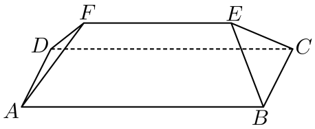

# Mathematics - 题目 3884

**ID**: f45ff2b9707e48659ff3ac501b144216
**年级**: Grade 12
**难度**: Medium-Hard
**题型**: Fill-in-the-blank

## 题目
如图，五面体 $ABCDEF$ ，其中两个面是全等的等腰梯形，两个面是全等的等腰三角形．已知 $AB=25,BC=10$ ，且等腰梯形所在平面，等腰三角形所在平面与平面 $ABCD$ 的夹角的正切值均为 $\frac {\sqrt {14}}{5}$ ，则该五面体的体积为．​​​​​​​‌

## 解答

1. 如图，作 $FG\mathrm{⊥}AB$ 于 $G$ ， $HG//DA$ ，连接 $FH$ ；同理作 $EM\bot AB$ 于 $M$ ， $MN//{\rm BC}$ ，连接 $EN$ ，取 $AD$ 中点 $P$ ，连接 $OP$ ，再作 $FO\bot GH$ 于 $O$ ，
2. 因为等腰梯形所在平面､等腰三角形所在平面与平面 $ABCD$ 的夹角的正切值均为 $\frac {\sqrt {14}}{5}$ ，
3. 因为 $FG\mathrm{⊥}AB$ ，房顶的底面为矩形， $HG//DA$ ，所以 $HG\bot AB$ ，
4. 又 $AD$ 中点 $P$ ， $PF\bot AD$ ，且 $FG=FH$ ，所以 $FO\bot GH$ ，
5. 所以 $OP\bot AD$ ， $FP\bot AD$ ，所以由二面角的定义可得 $\angle FGH=\angle FPO$ ，正切值均为 $\frac {\sqrt {14}}{5}$ .则 $GO=HO=\frac {1}{2}BC=5{\rm{m}}$ .所以 $FO=\frac {\sqrt {14}}{5}\times 5=\sqrt {14},OP=\sqrt {14}\div \frac {\sqrt {14}}{5}=5$ ，
6. 因为 $FO\bot GH$ ， $FO\bot PO$ ， $PO\cap GH=O$ ，且 $PO,GH\subset $ 底面 $ABCD$ ，
7. 所以 $FO\bot $ 底面 $ABCD$ ，
8. 所以该五面体的体积为2倍的四棱锥 $ADHG-F$ 的体积加上三棱柱 $FGH-EMN$ 的体积，
9. 即 $\frac {1}{3}AG\cdot GH\times FO\times 2+\frac {1}{2}GH\cdot FO\times GM=\frac {2}{3}\times 5\times 10\times \sqrt {14}+\frac {1}{2}\times 10\times \sqrt {14}\times 15=\frac {325\sqrt {14}}{3}$ .
10. 

## 知识点

**中文**:
  - 简单组合体的表面积与体积

**English**:
  - Area and Volume of Composite Solids

---
