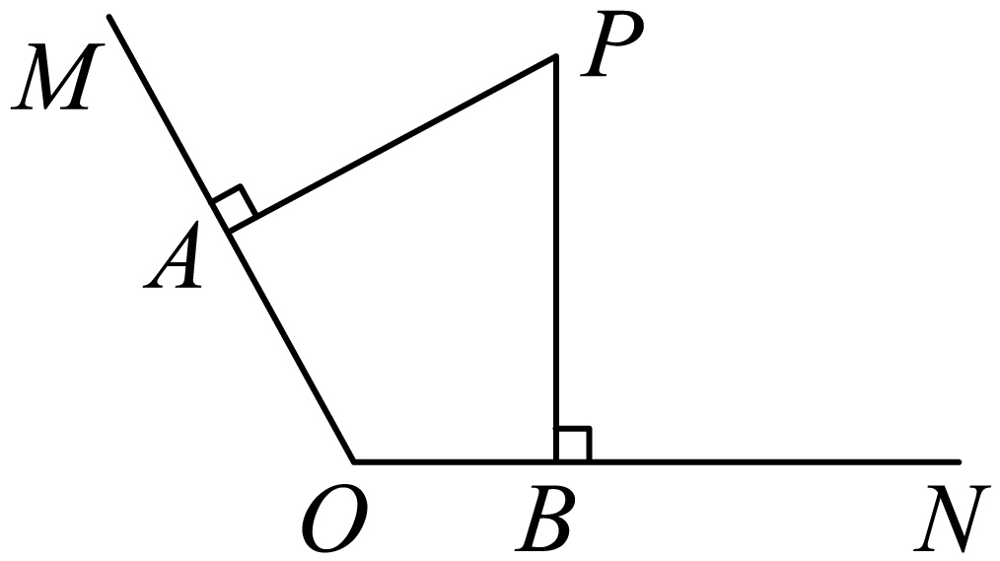

# Mathematics - 题目 3880

**ID**: fe1aec6c7f0c4a7fa0e058afe667b047
**年级**: Grade 12
**难度**: Medium-Hard
**题型**: Fill-in-the-blank

## 题目
如图所示，已知 $0<\angle MON<{\rm{π}}$ ，  $\angle MON$ 内有一点 $P$ 与 $O$ 的距离为1  ${\rm km，}PA\bot MO$ ， $PB\bot NO$ ，垂足分别为A、B且 $\angle AOP=2\angle BOP$ ． 当四边形 $APBO$ 的面积为最大值时，则 $\angle MON=$．(结果精确至0.​​​​​​​‌ ${\rm 01}{}\degree $ )

## 解答

1. 设 $\angle BOP=θ$ ，则 $\angle AOP=2θ$ ，由题意知 $0<3θ<{\rm{π}}$ ，则 $0<θ<\frac {{\rm{π}}}{3}$ ，
2. 如图，连接 $OP$ .
3. 
4. 在 ${\rm{R}}{\rm{t}}△OAP$ 中， $OP=1$ ，则， $AP=\sin 2θ,AO={\cos}2θ$ ；
5. 在 ${\rm{R}}{\rm{t}}\mathrm{△}OBP$ 中，同理可得， $BP=\sin θ,OB={\cos}θ$ ；
6. 故四边形的面积 $S\left ({θ}\right )=S{{}_{\vartriangle OAP}}+S{{}_{\vartriangle OBP}}=\frac {1}{2}\sin 2θ{\cos}2θ+\frac {1}{2}\sin θ{\cos}θ=\frac {1}{4}\left ({\sin 4θ+\sin 2θ}\right )$ ， $0<θ<\frac {{\rm{π}}}{3}$ ，
7. 求导得 $S^{′}{\left ({θ}\right )}={\cos}4θ+\frac {1}{2}{\cos}2θ$ ，令 $S^{′}{\left ({θ}\right )}=0$ ，可得 $2{\cos}{^{2}}2θ-1+\frac {1}{2}{\cos}2θ=0$ ，
8. 由 $0<θ<\frac {{\rm{π}}}{3}$ ，则 $0<2θ<\frac {{{2}}{\rm{π}}}{3}$ ，
9. 令 $t={\cos}2θ\in \left ({-\frac {1}{2},1}\right ]$ ，则 $2t{^{2}}+\frac {1}{2}t-1=0$ ，即 $\frac {\sqrt {3}}{3}$ ，
10. 解得 $t=\frac {-1+\sqrt {33}}{8}$ 或 $t=\frac {-1-\sqrt {33}}{8}<-\frac {1}{2}$ （舍去），
11. 由 $\frac {1}{2}<\frac {-1+\sqrt {33}}{8}<\frac {\sqrt {2}}{2}$ ，故不妨设 ${\cos}2β=\frac {-1+\sqrt {33}}{8}$ ，且 $\frac {{\rm{π}}}{4}<2β=\frac {{\rm{π}}}{3}$ ，
12. 当 $\frac {-1+\sqrt {33}}{8}<t\leqslant 1$ ，即 $0<2θ<2β$ ，
13. 当 $-\frac {1}{2}<t<\frac {-1+\sqrt {33}}{8}$ ，即 $2β<2θ<\frac {2{\rm{π}}}{3}$ 时，
14. $2t{^{2}}+\frac {1}{2}t-1<0$ ，即 $S^{′}{\left ({θ}\right )}<0$ ， $S\left ({θ}\right )$ 在 $\left ({β,\frac {{\rm{π}}}{3}}\right )$ 单调递增；
15. 故 $S\left ({θ}\right ){{}_{{\rm \max }}}=S\left ({β}\right )$ ，即当 $θ=β$ 时取到最大值.
16. 由 ${\cos}2β=\frac {-1+\sqrt {33}}{8}$ ，可得 ${\cos}{^{2}}β=\frac {7+\sqrt {33}}{16}$ ，
17. 则 ${\cos}3β={\cos}2β{\cos}β-\sin 2β\sin β=\left ({2{\cos}{^{2}}β-1}\right ){\cos}β-2\sin {^{2}}β{\cos}β$
18. $=4{\cos}{^{3}}β-3{\cos}β={\cos}β\left ({4{\cos}{^{2}}β-3}\right )=\sqrt {\frac {\sqrt {33}-3}{12}}$ .
19. 此时 $\angle MON=3β={\arccos}\sqrt {\frac {\sqrt {33}-3}{12}}\approx 1.4038{\rm{r}}{\rm{a}}{\rm{d}}=80.44{}\degree $ .

## 知识点

**中文**:
  - 在实际问题中建立三角函数模型
  - 导数在优化问题中的应用

**English**:
  - Modeling Real-world Problems
  - Optimization Problems

---
