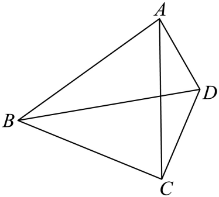

# Mathematics - 题目 2513

**ID**: ff1c4733389343e8bf7b549329598726
**年级**: Grade 12
**难度**: Medium-Hard
**题型**: Fill-in-the-blank

## 题目
如图，在平面四边形ABCD中， $AB=AC=BD=10$ ，当四边形ABCD的面积最大时， $BC{^{2}}+CD{^{2}}+DA{^{2}}$ 的最小值为.​​​​​​​‌

## 解答

1. 
2. 如图，设 $AC\cap BD=O$ , $\angle AOD=θ$ ,
3. 则四边形ABCD的面积为 $S=S{{}_{\vartriangle ABD}}+S{{}_{\vartriangle BCD}}=\frac {1}{2}BD\times AO\sin θ+\frac {1}{2}BD\times CO\sin θ$  $=\frac {1}{2}BD\times AC\sin θ=50\sin θ$ ，
4. 因 $0<θ<{\rm{π}}$ ，故当且仅当 $\sin θ=1$ ，即 $θ=\frac {{\rm{π}}}{2}$ 时， $S{{}_{{\rm \max }}}=50$ .
5. 当 $θ=\frac {{\rm{π}}}{2}$ 时，设 $AO=x,OB=y$ ，则 $CO=10-x,OD=10-y$ ,
6. 于是 $BC{^{2}}+CD{^{2}}+DA{^{2}}=y{^{2}}+(10-x){^{2}}+(10-y){^{2}}+(10-x){^{2}}+x{^{2}}+(10-y){^{2}}$  $=3(x{^{2}}+y{^{2}})-40(x+y)+400$ ，
7. 因 $AO{^{2}}+BO{^{2}}=100$ ,即 $x{^{2}}+y{^{2}}=100$ ,
8. 由 $(x+y){^{2}}=x{^{2}}+y{^{2}}+2xy\leqslant 2(x{^{2}}+y{^{2}})=200$ ，则有 $x+y\leqslant 10\sqrt {2}$ ，当且仅当 $x=y=5\sqrt {2}$ 时取等号，
9. 即当 $x=y=5\sqrt {2}$ 时， $BC{^{2}}+CD{^{2}}+DA{^{2}}$ 的最小值为 $300-40\times 10\sqrt {2}+400=700-400\sqrt {2}$ .
10. 故答案为： $700-400\sqrt {2}$ .

## 知识点

**中文**:
  - 复杂图形（多个三角形拼接、四边形）求解

**English**:
  - Solving Complex Shapes (Combined Triangles, Quadrilaterals)

---
