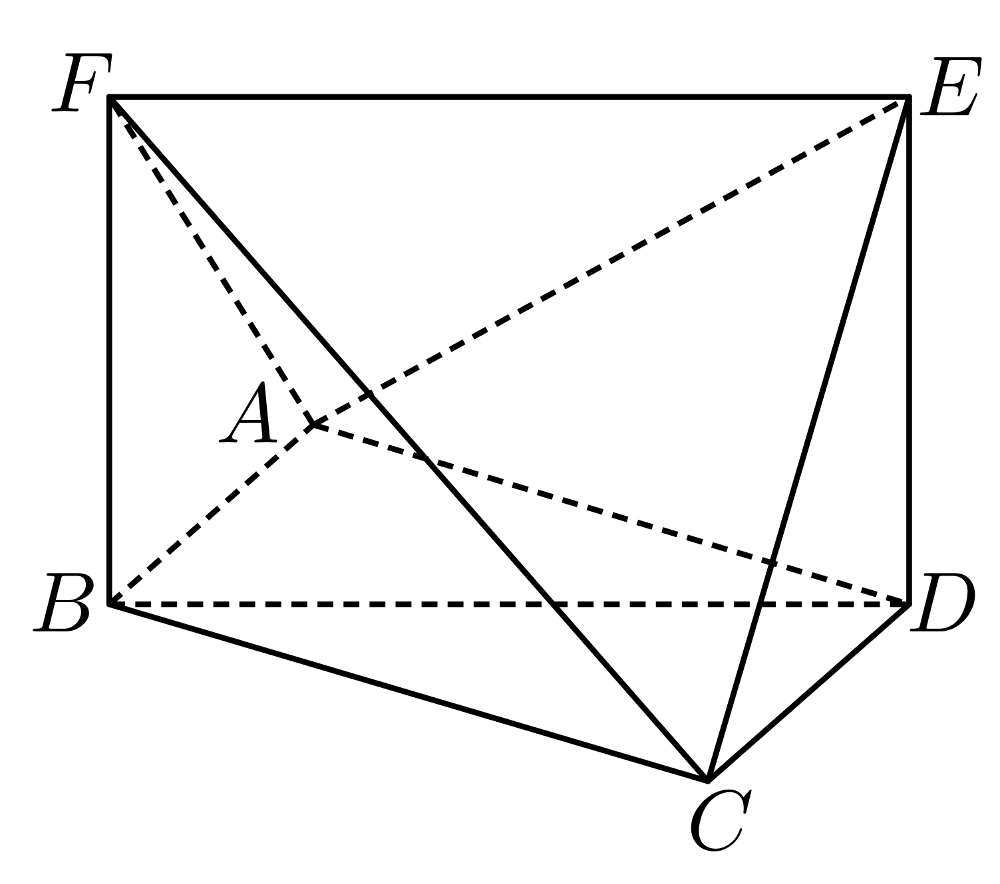

# Mathematics - 题目 966

**ID**: 1d415ff37e7c4b2fba70b7c6257f97c4
**年级**: Grade 12
**难度**: Medium-Hard
**题型**: Multiple-choice

## 题目
如图，四边形 $ABCD$ 为正方形，四边形 $EFBD$ 为矩形，且平面 $ABCD$ 与平面 $EFBD$ 互相垂直.​​​​​​​‌若多面体 $ABCDEF$  的体积为 $\frac {16}{3}$ ，则该多面体外接球表面积的最小值为

## 解答

1. 根据题意，连接 $AC,BD$ 交于 $M$ 点，过 $M$ 作 $MN$ // $DE$ 交 $EF$ 于 $N$ 点，交 $BE$ 于 $O$ ，连接 $OC$ .
2. 
3. 因为四边形 $ABCD$ 是正方形，故可得 $AC\bot BD$ ，
4. 又因为平面 $ABCD\bot $ 平面 $EFBD$ ，且交线为 $BD$ ，又 $AC\subset $ 平面 $ABCD$ ，故 $AC\bot $ 平面 $EFBD$ ，
5. 不妨设 $CD=a,DE=b$ ，
6. 故可得多面体 $ABCDEF$ 的体积 $V=\frac {1}{3}S{{}_{EFBD}}\times AC=\frac {1}{3}\times \sqrt {2}ab\times \sqrt {2}a=\frac {2}{3}a{{}^{2}}b$ ；
7. 则 $\frac {2}{3}a{{}^{2}}b=\frac {16}{3}$ ，解得 $b=\frac {8}{a{{}^{2}}}$ ；
8. 又容易知多面体外接球的球心在四边形 $ABCD$ 外心的垂线上，且为 $MN$ 的中点 $O$ ，
9. 设外接球半径为 $R$ ，则 $R{{}^{2}}=OC{{}^{2}}=OM{{}^{2}}+MC{{}^{2}}=\left ({\frac {1}{2}b}\right ){{}^{2}}+\left ({\frac {\sqrt {2}}{2}a}\right ){{}^{2}}=\frac {1}{2}a{{}^{2}}+\frac {1}{4}b{{}^{2}}$ ；
10. 将 $b=\frac {8}{a{{}^{2}}}$ 代入可得 $R{{}^{2}}=\frac {1}{2}a{{}^{2}}+\frac {16}{a{{}^{4}}}$ ，不妨令 $a{{}^{2}}=t,(t>0)$ ，
11. 则 $y=R{{}^{2}}=\frac {1}{2}t+\frac {16}{t{{}^{2}}}$ ，则 $y^{′}=\frac {1}{2}-\frac {32}{t{{}^{3}}}$ ，容易知 $y^{′}$ 是关于 $t$ 的单调增函数，
12. 且当 $t=4$ 时， $y^{′}=0$ ，故可得 $y=R{{}^{2}}=\frac {1}{2}t+\frac {16}{t{{}^{2}}}$ 在 $\left ({0,4}\right )$ 上单调递减，在 $\left ({4,+\infty }\right )$ 单调递减.
13. 故 $y{{}_{\min }}=R{{}_{\min }^{2}}=\frac {1}{2}\times 4+\frac {16}{16}=3$ .
14. 则外接球表面积的最小值 $S{{}_{\min }}=4πR{{}_{\min }^{2}}=12π$ .
15. 故选：B.
16. 【点睛】本题考查棱锥体积的计算、面面垂直的性质、外接球表面积的计算、利用导数求函数的最值，属压轴题.

## 知识点

**中文**:
  - 导数在优化问题中的应用
  - 球的表面积
  - 球的切接问题

**English**:
  - Optimization Problems
  - Surface Area of a Sphere
  - Tangency and Inscribed/Circumscribed Spheres

---
