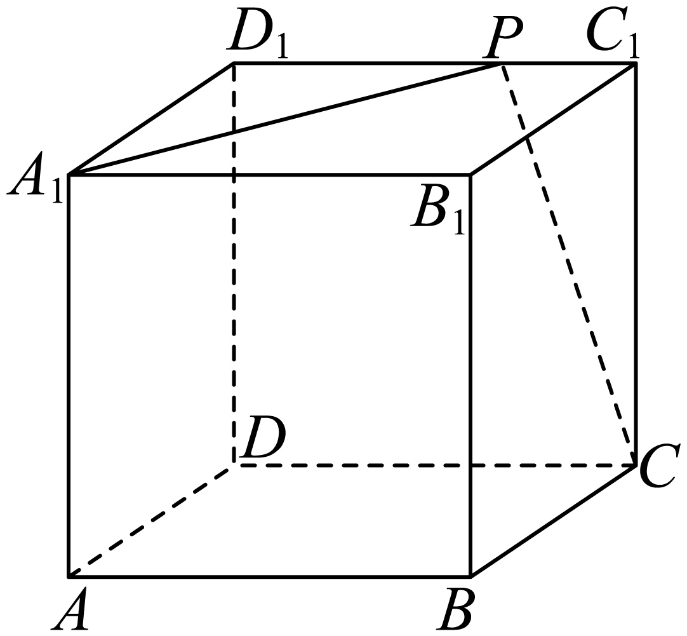

# Mathematics - 题目 1996

**ID**: 2f21c624695844d29a4c55a94795edf8
**年级**: Grade 12
**难度**: Medium-Hard
**题型**: Multiple-choice

## 题目
如图，正方体 $ABCD-A{{}_{1}}B{{}_{1}}C{{}_{1}}D{{}_{1}}$ 的边长为 ${\rm 4，}\overrightarrow {{D{{}_{1}}P}}=3\overrightarrow {{PC{{}_{1}}}}$ ，平面 $α$ 经过点 $A{{}_{1}}$ ， $P$ ，则（      ）​​​​​​​‌

## 解答

1. 在 $ABCD-A{{}_{1}}B{{}_{1}}C{{}_{1}}D{{}_{1}}$ 中， $A{{}_{1}}C=\sqrt {A{\rm A}{_{1}^{2}}+AB{^{2}}+BC{^{2}}}=4\sqrt {3}$ , $A{{}_{1}}P=\sqrt {A{{}_{1}}D{{}_{1}^{2}}+D{{}_{1}}P{^{2}}}=5$ ，
2. 在 $△A{{}_{1}}PC$ 中， $A{{}_{1}}C=4\sqrt {3}$ ， $A{{}_{1}}P=5$ ， $PC=\sqrt {17}$ ，
3. ∵ $A{{}_{1}}C{^{2}}\ne A{{}_{1}}P{^{2}}+CP{^{2}}$ ，∴A错误．
4. ∵ $BC//B{{}_{1}}C{{}_{1}}//A{{}_{1}}D{{}_{1}}$ ，∴直线 $A{{}_{1}}P$ 与直线 $BC$ 所成角等于 $\angle D{{}_{1}}A{{}_{1}}P$ ， ${\tan}\angle D{{}_{1}}A{{}_{1}}P=\frac {D{{}_{1}}P}{D{{}_{1}}A{{}_{1}}}=\frac {3}{4}$ ，∴B正确．
5. 因为平面 $ABB{{}_{1}}A{{}_{1}}$  $/\mskip-4mu/$  $CDD{{}_{1}}C{{}_{1}}$ ，且 $A{{}_{1}}D{{}_{1}}\bot $ 平面 $CDD{{}_{1}}C{{}_{1}}$ ，
6. 所以直线 $A{{}_{1}}P$ 与平面 $ABB{{}_{1}}A{{}_{1}}$ 所成角等于直线 $A{{}_{1}}P$ 与平面 $CDD{{}_{1}}C{{}_{1}}$ 所成角 $\angle A{{}_{1}}PD{{}_{1}}$ ， ${\tan}\angle A{{}_{1}}PD{{}_{1}}=\frac {4}{3}$ ，∴C正确．
7. 因为正方体的对面都相互平行，且根据面面平行的性质定理可得，
8. 在 $AB$ 边上作点 $Q$ 使得 $\overrightarrow {{BQ}}=3\overrightarrow {{QA}}$ ，则平行四边形 $A{{}_{1}}PCQ$ 为所求截面．
9. 在 $△A{{}_{1}}PC$ 中， ${\cos}\angle A{{}_{1}}CP=\frac {48+17-25}{2\times 4\sqrt {3}\times \sqrt {17}}=\frac {5}{\sqrt {51}}$ ，
10. ∴ $\sin \angle A{{}_{1}}CP=\frac {\sqrt {26}}{\sqrt {51}}$ ， $S{{}_{\vartriangle A{{}_{1}}PC}}=\frac {1}{2}\times 4\sqrt {3}\times \sqrt {17}\times \frac {\sqrt {26}}{\sqrt {51}}=2\sqrt {26}$ ，
11. ∴平行四边形 $A{{}_{1}}PCQ$ 的面积为 $4\sqrt {26}$ ．∴D错误．
12. 
13. 故选BC.

## 知识点

**中文**:
  - 平面与平面平行的性质
  - 直线与平面所成的角

**English**:
  - Properties of Plane-Plane Parallelism
  - Line-Plane Angle

---
